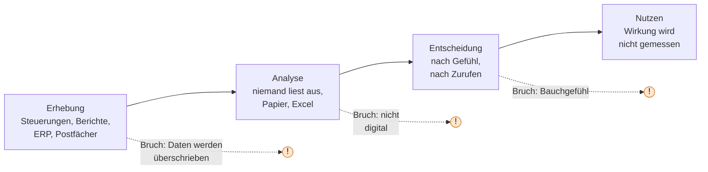
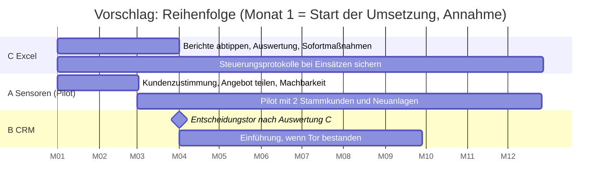

# Tag 1 (Modul 3), Arbeitsauftrag 1 und 2: Datenquellen und Priorisierung bei Brenner Fördertechnik GmbH

> [!IMPORTANT]
> **Auf einen Blick**
>
> - **Arbeitsauftrag 1:** Bei Brenner entstehen viele Daten, aber nur der **ERP** wird genutzt. Die wertvollsten Quellen werden nicht gelesen: die **Steuerungen** (420 Anlagen, nach 90 Tagen überschrieben), die **1.900 Papierberichte** und die **Postfächer** der 6 Vertriebler. Die teuersten Entscheidungen ohne Daten sind die **Ersatzteilstrategie** (ca. 2 Mio. € gehen an Drittanbieter), die **Lagerbestellung** (bis zu 0,9 Mio. € Kapital in Ladenhütern) und die **Planung des neuen Modells** nach Zurufen.
> - **Arbeitsauftrag 2, Empfehlung:** **C (Excel) zuerst**, sofort und mit 25.000 € (3 Monate). **A (Sensoren) als Pilot** mit den beiden anfragenden Stammkunden, nicht als Vollprojekt für 300.000 €. **B (CRM) danach**, nach einem Entscheidungstor im Monat 3.
> - **Warum diese Reihenfolge:** C liefert die Datenbasis, die A braucht (Fehlerursachen für die Sensordaten), kostet 8 % des Budgets und beantwortet in 3 Monaten die offenen Fragen. A ist die einzige Maßnahme, die dem Wettbewerber (Fernwartung, 2 von 11 Ausschreibungen verloren) etwas entgegensetzt. B hängt an der Bereitschaft des Vertriebs, selbst zu pflegen.
> - **Budget:** A allein kostet im ersten Jahr 300.000 € (260.000 € + 40.000 €) und verbraucht damit das gesamte Budget. A + B + C zusammen wären 463.000 €. Der Plan C + A-Pilot (maximal 150.000 €) + B bleibt bei 295.000 €.
> - **Größte Lücken:** Gilt das Budget auch für laufende Kosten? Ist A teilbar? Warum gingen die zwei Ausschreibungen wirklich verloren? Würden Kunden zustimmen und zahlen?

**Aufgabe 1:** Wo entstehen bei Brenner Daten (auch ungenutzte)? Welche Entscheidungen fallen ohne Daten? Wo könnten Daten helfen (Wartung, Vertrieb, Produktentwicklung)? Dazu das Ergebnisraster mit fünf Bereichen.

**Aufgabe 2:** Die Geschäftsführung fragt: „Womit sollen wir anfangen?“ Drei Maßnahmen (A Sensoren, B CRM, C Excel-Auswertung) nach Nutzen, Risiko und Kosten bewerten, priorisieren, fehlende Informationen benennen.

> [!NOTE]
> Rechnungen mit Zahlen aus dem Aufgabenblatt sind nachgerechnet. Alle anderen Zahlen sind als **Annahme** gekennzeichnet und müssen vor einer Entscheidung geprüft werden. Aussagen zu Rechtsfragen sind nicht geprüft. Die Priorisierung ist meine Einschätzung, nicht die einzig mögliche.

---

## 1. Ausgangslage: was zählt, was nicht

Brenner baut Förderanlagen für Lebensmittel- und Pharmabetriebe, verkauft rund 60 Anlagen im Jahr zu je 350.000 € (**21 Mio. € Umsatz**) und verdient **ausschließlich am Verkauf**. Nach der Lieferung endet der Kontakt, außer bei Störungen. Das entspricht dem „klassischen Modell“ der Folien (Einnahmen einmalig, Kundenkontakt endet nach Lieferung, Produkt im Mittelpunkt).

Nicht alles auf den Folien betrifft die Entscheidung. Die Folien enthalten bewusst **Rauschen**:

| Information | Relevant? | Begründung |
|---|:---:|---|
| 75-jähriges Bestehen, neues Logo | kaum | Nur als Anlass, ein neues Angebot nächstes Jahr bekannt zu machen (Idee, nicht belegt). |
| Kantine mit Caterer ab März | nein | Keine Wirkung auf Daten, Kunden oder Kosten der Maßnahmen. |
| Fluktuation 4 % | nein | Normalwert. Nur relevant, falls Wissen an einzelnen Personen hängt (Vertriebler, Techniker). |
| Fuhrpark auf E-Autos (eigenes Budget) | nein | Eigenes Budget, berührt die 300.000 € nicht. |
| Geschäftsführer geht in 2 Jahren in Ruhestand | **ja** | Er kann die Maßnahme nicht mehr bis zum Ende tragen. Ohne Nachfolger als Förderer droht „bleibt beim Alten“ (Folie Kultur). |
| 2 IT-Mitarbeitende für 240 Arbeitsplätze | **ja** | Kapazitätsgrenze für Plattform, Mobilfunk und CRM. |
| Wettbewerber Kröger bietet seit 9 Monaten Fernwartung an | **ja** | Zeitdruck. 2 von 11 Ausschreibungen (18 %) gingen verloren. |

---

## 2. Arbeitsauftrag 1: Wo Daten entstehen und was Brenner damit macht

### 2.1 Frage 1: Wo entstehen Daten, auch solche, die niemand nutzt?

Die Folie „Wertschöpfung durch Daten“ beschreibt vier Stufen: Erhebung, Analyse, Entscheidung, Nutzen. Bei Brenner reißt die Kette an jeder Stufe:



| Quelle | Was dort steht | Umfang | Genutzt? | Zustand | Auffälligkeit |
|---|---|---|:---:|---|---|
| **Steuerungen der Anlagen** | Laufzeiten, Störcodes, Temperaturen | ca. 420 Anlagen | **nein** | Wird nach **90 Tagen überschrieben** | Jeden Tag gehen Daten unwiederbringlich verloren. |
| **Serviceordner (Papier)** | Fehlerbild, Teile, Arbeitsstunden | ca. 1.900 Berichte seit 2017 | **nein** | Stichprobe von 50: 31 vollständig (62 %), 12 ohne Fehlerursache (24 %), 7 kaum lesbar (14 %) | Für die Maschine nicht auswertbar, nur manuell. |
| **ERP** | Aufträge, Rechnungen, Ersatzteilverkäufe, Lager | seit 2012 | **ja** (Buchhaltung) | Vermutlich gut, aber nur für Abrechnung genutzt | Enthält auch die Kaufhistorie jedes Kunden, das ist die Vertriebspipeline. |
| **Postfächer der 6 Vertriebler** | Anfragen, Angebote, Absagen | unbekannt | **nein** | Jeder sieht nur seine eigenen Mails | Die Gründe für verlorene Ausschreibungen stehen hier. |
| **Excel „Garantie.xlsx“** | Garantiefälle, vermutete Ursache, Kosten | 2025: 38 Fälle, 210.000 € | teilweise | Ursache nur **vermutet** | Durchschnitt 5.526 € je Fall, fast 4-mal so viel wie ein Technikereinsatz (1.400 €). |
| **E-Mails zu Garantiefällen** | Klärung der Fälle | unbekannt | **nein** | „Geklärt und danach archiviert“ | Wissen verschwindet im Archiv. |
| **Angebote in Word/Excel** | Preise, Konditionen | unbekannt | **nein** | Verteilt auf Rechner der Vertriebler | Keine Auswertung der Gewinn- oder Verlustquote möglich. |

**Hinzu kommen Daten, die gar nicht erhoben werden:** Abwanderungsgründe („warum, weiß niemand genau“), Ersatzteile, die Kunden bei Drittanbietern kaufen, und die Wirkung von Maßnahmen.

**Zwei Plausibilitätsprüfungen:**

- Die Stichprobe von 50 Berichten erlaubt nur eine grobe Aussage: 62 % vollständig, aber das 95-%-Intervall reicht von etwa 49 % bis 75 %. Hochgerechnet auf alle Berichte sind das rund 1.180 vollständige, 460 ohne Ursache und 270 kaum lesbare (Hochrechnung, keine Zählung).
- 1.900 Berichte in rund 10 Jahren sind etwa **190 Einsätze im Jahr**. Bei 8 Technikern sind das etwa 24 Einsätze je Techniker, also einer alle zwei Wochen. Das passt schlecht zu einer Vollzeitstelle. Entweder fehlen Berichte (Datenlücke), oder die Techniker machen vor allem anderes (Wartung, Inbetriebnahme). Das ist eine Frage an den Service, keine Tatsache.

### 2.2 Frage 2: Welche Entscheidungen fallen heute ohne Daten?

Die Folie „Wann reicht Erfahrung, wann braucht es Daten?“ gibt einen einfachen Test: **Wiederholt sich die Entscheidung häufig?** Dann Daten systematisch nutzen. **Steht viel Geld oder Risiko auf dem Spiel?** Dann Daten gezielt beschaffen. Sonst genügt Erfahrung.

| Entscheidung heute | Wie entschieden? | Häufig? | Viel Geld/Risiko? | Folge nach dem Test | Größenordnung |
|---|---|:---:|:---:|---|---|
| Ersatzteil-Strategie (was bieten wir aktiv an?) | Vertrieb schätzt nur | ja | **ja** | Daten **systematisch** nutzen | **ca. 2 Mio. €** Umsatz gehen an Dritte (Schätzung des Vertriebs, siehe 4.3). Eigener Umsatz 1,1 Mio. €, also nur 35 % des Gesamtmarkts. |
| Lagerbestellung | Lagerleiter „nach Gefühl“ | ja | **ja** | systematisch | Bestand 2,3 Mio. €, 40 % der Artikel (rund 2.700 von 6.800) ohne Bewegung seit 2 Jahren. Bis zu **0,9 Mio. €** gebundenes Kapital (Annahme: gleicher Durchschnittswert wie der übrige Bestand), bei 8 % Zins etwa 74.000 € im Jahr. |
| Planung des neuen Modells | nach Zurufen aus dem Vertrieb | selten | **ja** | gezielt beschaffen | Entwicklungskosten nicht genannt, vermutlich mehrere Millionen (Annahme). **Verfügbarkeitsfehler**: der letzte laute Kunde prägt das Bild. |
| Technikereinsätze bei Störungen | reaktiv, wenn der Kunde anruft | ja | mittel | systematisch | ca. 190 Einsätze x 1.400 € ≈ 270.000 € im Jahr und etwa 480 Stillstandstage beim Kunden (190 x 2,5; Annahme: 1 Bericht = 1 Einsatz). |
| Garantiefälle | per E-Mail geklärt, Ursache „vermutet“ | ja | **ja** | systematisch | 210.000 € im Jahr (1 % des Umsatzes). Ohne belegte Ursache keine Gegenmaßnahme. |
| Kundenansprache zur Neuinvestition | Vertriebler nach Gedächtnis | ja | **ja** | systematisch | 420 Anlagen im Bestand bei 60 Verkäufen im Jahr: rechnerisch **alle 7 Jahre** eine Neuanschaffung, passend zum Rhythmus von 5 bis 8 Jahren. Der Bestand ist die Pipeline. |
| Reaktion auf Wettbewerber | Bauchgefühl, „Kröger bietet Fernwartung an“ | selten | **ja** | gezielt beschaffen | 2 verlorene Ausschreibungen x 350.000 € ≈ **700.000 €** Umsatz (Annahme: je 1 Durchschnittsanlage). Gründe nicht dokumentiert. |
| Farbe des neuen Logos, Kantine | Erfahrung | nein | nein | **Erfahrung genügt** | gering |

**Am teuersten ohne Daten** (Rangfolge nach Größenordnung): 1. Ersatzteil-Strategie (2 Mio. €, entgangen, kein Verlust im engeren Sinn), 2. Lager (bis 0,9 Mio. € gebunden), 3. verlorene Ausschreibungen (ca. 0,7 Mio. €), 4. Technikereinsätze (0,27 Mio. €), 5. Garantie (0,21 Mio. €). Die Produktplanung kann größer sein, ist aber nicht beziffert.

### 2.3 Ergebnisraster (Frage 3: Wo könnten Daten helfen?)

| Bereich | Wo entstehen Daten? | Welche Entscheidung ohne Daten? | Wie könnten Daten helfen? |
|---|---|---|---|
| **Anlage beim Kunden** | Steuerung: Laufzeiten, Störcodes, Temperaturen (420 Anlagen, nach 90 Tagen gelöscht). Kein Zugriff von Brenner. | Wartung erst nach der Störung. Niemand weiß, welche Anlage als Nächstes ausfällt. Kein Wissen über tatsächliche Nutzung und Belastung. | **Predictive Maintenance:** Abweichungen vom Normalverhalten (z. B. steigende Temperatur) kündigen Ausfälle an, der Techniker kommt vor dem Stillstand. Laufzeitdaten zeigen die reale Belastung. Einstieg ohne Hardware: bei jedem Serviceeinsatz das Steuerungsprotokoll sichern (Idee, technische Machbarkeit prüfen). |
| **Service** | Papierberichte im Ordner (1.900 seit 2017, 14 % kaum lesbar), Garantie-Excel, Garantie-E-Mails. 8 Techniker. | Welche Teile mitnehmen? Wann wen schicken? Garantie: Ursache wird vermutet, nicht belegt. | Digitale Einsatzberichte mit **Pflichtfeld Fehlerursache** (24 % fehlen heute). Auswertung nach Fehlerbild, Anlage, Teil: Welche 5 Fehler verursachen die Mehrzahl der Einsätze und Garantiekosten? Einsatzplanung nach Wahrscheinlichkeit. |
| **Vertrieb** | ERP (Kaufhistorie seit 2012), Postfächer der 6 Vertriebler (Anfragen, Angebote, Absagen), Angebote in Word/Excel. | Wen wann ansprechen? Warum wurden 2 von 11 Ausschreibungen verloren? Welcher Preis? Jeder Vertriebler weiß nur seine eigenen Fälle. | Reinvestitionsliste aus ERP-Daten: Alter der Anlage + 5 bis 8 Jahre = Zeitpunkt für das Gespräch. Gemeinsame Sicht auf Anfragen und Absagegründe. Gewinn- und Verlustquote je Wettbewerber, Preis, Anlagentyp. |
| **Lager & Einkauf** | ERP (Bestand, Bewegungen, Ersatzteilverkäufe), Serviceberichte (welche Teile getauscht wurden). | Der Lagerleiter bestellt nach Gefühl. 40 % der Artikel liegen seit 2 Jahren. Welche Teile fehlen, wenn ein Kunde sie braucht? | Bedarfsprognose pro Teil aus Verbrauch und Anlagenbestand. Nicht mehr bewegte Artikel erkennen. Teile, die bei Einsätzen getauscht, aber von Dritten gekauft werden, gezielt anbieten. |
| **Produktentwicklung** | Garantie-Excel (Ursache „vermutet“), Servicestatistik, Absagegründe aus Ausschreibungen, Steuerungsdaten. | Neues Modell nach Zurufen aus dem Vertrieb. | Belegte Schwachstellen der Anlagen (Fehler nach Bauteil) und tatsächliche Nutzung der Anlagen in die Konstruktion. Anforderungen aus allen Kunden und Absagen statt aus dem letzten Anruf. |

### 2.4 Plenum-Diskussion (meine Antworten, nicht die der Gruppe)

| Frage | Antwort |
|---|---|
| Welche ungenutzte Datenquelle überrascht am meisten? | Die **Steuerungen**: Sie speichern seit Jahren Laufzeiten und Störungen, aber nur 90 Tage und niemand liest sie aus. Der Wert (Vorhersage von Ausfällen) wächst mit der Historie, und die geht täglich verloren. Auf Platz 2: die **Absagen in den Postfächern**, die zeigen, warum Aufträge verloren gehen, und kein zusätzliches Geld kosten. |
| Welche Entscheidung ohne Daten ist am teuersten? | Die **Ersatzteil-Strategie** mit rund 2 Mio. € Umsatz bei Dritten. Wichtig: Das ist eine Schätzung des Vertriebs. Vor einer Entscheidung wäre sie zu prüfen (Ankereffekt, Überoptimismus der Folie „Verzerrungen“). Am sichersten belegt ist das Lager: 2,3 Mio. € Bestand sind eine Zahl aus der Buchhaltung. |
| Wo könnten sich Gruppen uneinig sein? | (1) **Ersatzteile oder Wartung zuerst?** Ersatzteile sind das größere Geld, Wartung ist das Kundenthema. (2) **Ist Excel überhaupt „Digitalisierung“?** Nein, aber es ist der schnellste Weg zur Datenbasis. (3) **Sensoren sofort oder erst die Daten bereinigen?** Das ist der Zielkonflikt Geschwindigkeit gegen Qualität der Folien. (4) Wie ernst ist der Wettbewerber, nur 2 von 11 Ausschreibungen? |

---

## 3. Arbeitsauftrag 2: Bewertung der drei Maßnahmen

### 3.1 Zahlen zu den Maßnahmen

| | A) Sensoren | B) CRM | C) Excel |
|---|---:|---:|---:|
| Einmalkosten | 260.000 € | 120.000 € | 25.000 € |
| Laufende Kosten je Jahr | 40.000 € | 18.000 € | kaum |
| **Erstes Jahr gesamt** | **300.000 €** | **138.000 €** | **25.000 €** |
| Anteil am Budget (300.000 €) im 1. Jahr | **100 %** | 46 % | 8 % |
| Kosten über 3 Jahre | 380.000 € | 174.000 € | 25.000 € |
| Zeit bis zum Start | ca. 12 Monate | ca. 6 Monate | ca. 3 Monate |
| Voraussetzungen | Steuerung ab Baujahr 2014, **Zustimmung der Kunden**, Mobilfunkempfang (jede 7. Anlage hat keinen) | Vertrieb und Service pflegen selbst jeden Kontakt und Einsatz | Controller und Werkstudent tippen Papierberichte ab |

**Kombinationen und Budget** (erstes Jahr, einschließlich laufender Kosten):

| Kombination | Kosten | Im Budget (300.000 €)? |
|---|---:|:---:|
| A allein | 300.000 € | ja, ohne Reserve |
| A + C | 325.000 € | **nein** (nur ohne die 40.000 € Laufkosten: 285.000 €) |
| A + B | 438.000 € | nein |
| B + C | 163.000 € | ja |
| A + B + C | 463.000 € | **nein** |

Das Aufgabenblatt sagt nicht, ob das Budget auch laufende Kosten abdeckt. Beide Lesarten sind oben angegeben.

**Break-even, was jede Maßnahme „verdienen“ muss** (3 Jahre):

| Maßnahme | Muss pro Jahr bringen | Anschauliche Übersetzung |
|---|---:|---|
| A | 127.000 € | = etwa **90 vermiedene Technikereinsätze** je Jahr (je 1.400 €), also fast die Hälfte aller geschätzten ca. 190 Einsätze. Das ist unrealistisch. Die Maßnahme rechnet sich nur mit **zusätzlichem Umsatz** (Service-Abo, Ersatzteile) oder **gehaltenen Aufträgen** (eine gewonnene Anlage = 350.000 € Umsatz). |
| B | 58.000 € | Bei angenommener Marge von 20 % je Anlage (70.000 €) etwa **2,5 zusätzliche Anlagen in 3 Jahren**, das sind 1,4 % auf rund 180 Verkäufe. Machbar, aber der Effekt ist schwer zuzuordnen. |
| C | einmalig 25.000 € | Bezahlt, wenn die Auswertung etwa **5 von 38 Garantiefällen** (13 %) künftig verhindert (25.000 € / 5.526 € ≈ 4,5). Oder 1 % weniger Lagerbestand (23.000 €). |

Die Marge ist **angenommen** (nicht im Aufgabenblatt). Ersatzteile: Jeder Prozentpunkt der Drittanbieter-Umsätze, den Brenner zurückholt, sind rund 20.000 € Umsatz, 10 Prozentpunkte etwa 200.000 € (Umsatz, nicht Gewinn).

### 3.2 Bewertungsraster

| Kriterium | A) Sensoren | B) CRM | C) Excel |
|---|---|---|---|
| **Nutzen** | **hoch, aber spät und unsicher.** Einzige Maßnahme gegen die Fernwartung des Wettbewerbers. Schafft ein neues Geschäftsmodell (Datenbasierter Service, laufende Einnahmen), senkt Stillstand (2,5 Tage je Störung), ermöglicht Vorhersage. Wirkt frühestens nach 12 Monaten. | **mittel.** Gemeinsame Sicht auf Kontakte, Angebote und Absagen, Erinnerung an Reinvestitionen, Grundlage für Service-Verträge. Wirkung hängt stark an der Pflege. | **mittel, aber schnell und sicher.** Zeigt Fehlerursachen, Garantiekosten und Ersatzteilbedarf, liefert die Datenbasis für A und B. Nutzt Daten, die schon da sind. |
| **Risiko** | **hoch.** (1) Kunden müssen zustimmen (Lebensmittel und Pharma haben oft strenge IT-Regeln, Annahme). (2) Nur Steuerungen ab 2014. (3) Jede 7. Anlage ohne Empfang. (4) 2 IT-Mitarbeitende, keine Erfahrung mit Plattformen. (5) **Ohne Fehlerhistorie** kann man aus Sensordaten nichts vorhersagen (Altberichte lückenhaft). (6) Bindung an Anbieter. | **mittel.** (1) **Akzeptanz**: Vertriebler pflegen selbst, „Wissen ist Macht“ und „das haben wir immer so gemacht“ (Folie Kultur). (2) Ein leeres CRM ist wertlos. (3) Einführung bindet Vertrieb und Service 6 Monate lang. | **niedrig.** (1) Reine Handarbeit, nicht dauerhaft tragfähig. (2) 14 % der Berichte kaum lesbar, 24 % ohne Ursache, die Aussagekraft hat Grenzen. (3) Gefahr einer Insel-Lösung („eine Excel-Datei je Leitung“).  ggf. OCR (optical character recogintion)|
| **Kosten** | **hoch:** 260.000 € + 40.000 € im Jahr. Verbraucht allein das gesamte Budget. | **mittel:** 120.000 € + 18.000 € im Jahr. | **niedrig:** 25.000 €. |
| **Zeit** | 12 Monate (Wettbewerber ist dann bereits 21 Monate am Markt) | 6 Monate | **3 Monate** |
| **Priorität** | **2 (als Pilot)** | **3** (nach Entscheidungstor) | **1** |
| **Was mir fehlt** | Ist A **teilbar** (Pilot)? Preis je Anlage gegen Fixkosten? Wie viele der 420 Anlagen sind ab 2014 und haben Empfang? Würden Kunden zustimmen und **zahlen**? Wer betreibt die Plattform? | Wer pflegt? Gibt es Zusagen von Vertrieb und Service? Warum wurden die Ausschreibungen verloren? Marge je Anlage? | Welche Fragen soll die Auswertung beantworten? Wie viele Berichte sind digitalisierbar? Wem gehört die Excel-Datei später? |

### 3.3 Priorisierungsentscheidung

**Empfehlung: C sofort, A als Pilot, B nach einem Entscheidungstor.**



| Schritt | Was | Kosten | Wann |
|---|---|---:|---|
| 1 | **C:** 1.900 Berichte digitalisieren, Garantie-Excel bereinigen, Auswertung zu Fehlern, Ersatzteilen, Garantie und Lager. Dabei die **ERP-Kaufhistorie** zur Reinvestitionsliste machen und **Absagen** der 11 Ausschreibungen sichten. | 25.000 € | Monat 1 bis 3 |
| 2 | **Sofortmaßnahme ohne Budget:** Bei jedem Serviceeinsatz das **Steuerungsprotokoll sichern** und Fehlerursache als Pflichtfeld erfassen. So gehen keine Daten mehr verloren, und die künftigen Sensordaten haben eine Fehlerhistorie. | ~0 € | ab Monat 1 |
| 3 | **A-Pilot** mit den **2 anfragenden Stammkunden** und einigen Neuanlagen: Zustimmung, Angebot für ein **gestaffeltes Paket** einholen. Obergrenze **150.000 €** (Annahme: etwa die Hälfte). | ≤ 150.000 € | ab Monat 2, Start ca. Monat 3 bis 4 |
| 4 | **Entscheidungstor (Monat 3 bis 4):** Zeigt C, dass sich die Fehler konzentrieren, und sagen die Pilotkunden zu? Dann **B** starten (schlanke Variante, Pflichtfelder nur für die Kernprozesse) und A ausbauen. | 120.000 € | ab Monat 4 |
| | **Summe** | **≤ 295.000 €** | |

**Warum C zuerst:**

- Die Maßnahme ist **billig** (8 % des Budgets), **schnell** (3 Monate) und hat das **kleinste Risiko**.
- Sie liefert die **Datenbasis für A**: Sensordaten zeigen nur, dass etwas abweicht. Was es bedeutet, sagen erst die Fehlerberichte.
- Sie beantwortet **fehlende Informationen** (siehe 3.4) und liefert dem Vertrieb **sofort** eine Reinvestitionsliste, ohne CRM.
- Sie folgt dem Prinzip der Folien: „Klein starten, Wirkung messen, dann ausbauen.“
- Gefahr: Wird C als „fertig“ betrachtet, bleibt es eine Insel. Deshalb als Vorstufe für A und B und mit festem Eigentümer (klare Zuständigkeit).

**Warum A als Pilot und nicht im Ganzen:**

- Der Wettbewerber ist 9 Monate voraus, und die Kunden fragen bereits. **Nichts tun ist keine Option.**
- A allein **verbraucht das gesamte Budget** und würde 12 Monate dauern. In dieser Zeit wäre Brenner 21 Monate hinter Kröger.
- Zwei Stammkunden haben angefragt, das heißt **Zahlungsbereitschaft ist wahrscheinlich**, aber nicht belegt. Ein Pilot mit ihnen testet Zustimmung, Mobilfunk und Nutzen, bevor 260.000 € fließen.
- Die Steuerungsdaten gehen täglich verloren, jeder Monat Verzug kostet Historie.
- Ein Pilot ist auch ein **Referenzprojekt** für Ausschreibungen gegen Kröger.

**Warum B zuletzt:**

- Der Nutzen hängt am Verhalten von sechs Vertrieblern und acht Technikern. Zuerst muss die Kultur (Daten teilen) vorbereitet werden, und das CRM sollte mit den Ergebnissen aus C starten (Fragen, Pflichtfelder).
- Ein Teil des Nutzens (Reinvestitionsliste aus dem ERP, Absagen sichten) steht **ohne CRM** schon in Schritt 1 zur Verfügung.
- B wird später für **Service-Verträge** gebraucht (Kontakte, Einsätze, Verträge an einer Stelle). Sie wird also nicht gestrichen, sondern folgt auf C und den A-Pilot.

**Konfidenz:** C als Erstes ist eine **sichere** Empfehlung. Die Reihenfolge von A und B ist eine **begründete Einschätzung**, die sich ändern kann (siehe 3.4).

**Rückfalloption**, falls A **nicht teilbar** ist: C + B jetzt (163.000 € im ersten Jahr), A im nächsten Budgetjahr mit den Zahlen aus C und der Zustimmung der Kunden. Dann sollte der Kontakt zu den zwei Stammkunden über Zwischenlösungen gehalten werden (z. B. regelmäßige manuelle Auswertung der Störcodes).

### 3.4 Welche Informationen fehlen?

| # | Fehlende Information | Warum wichtig | Würde die Entscheidung ändern? | Woher? |
|---|---|---|---|---|
| 1 | Gilt das **Budget auch für laufende Kosten**? | Entscheidet, ob A + C passt (285.000 € oder 325.000 €) | **ja** | Geschäftsführung / Controlling |
| 2 | Ist A **teilbar**? Preis je Anlage gegen Fixkosten der Plattform? | Ohne Pilot fehlt der Weg für A | **ja** (A ganz oder im nächsten Jahr) | Angebot einholen |
| 3 | Warum gingen die **2 Ausschreibungen verloren**: wirklich Fernwartung oder Preis, Lieferzeit, Referenz? | Verfügbarkeitsfehler: Die zwei Fälle prägen das Bild | **ja** (wenn Preis, ist A nicht dringend) | Absagen in den Postfächern, Kundengespräch |
| 4 | Wie viele der **420 Anlagen** sind ab Baujahr 2014 und haben Empfang? | Begrenzt den Nutzen von A | ja | Anlagenliste im ERP |
| 5 | Würden Kunden **zustimmen und zahlen**? Wie viel? | Ohne Zahlungsbereitschaft keine laufenden Einnahmen | **ja** | Gespräch mit den 2 Stammkunden |
| 6 | **IT- und Datenschutzregeln** der Kunden (Pharma, Lebensmittel), Haftung und Datenzugang | Kann A ausschließen oder verteuern | ja | Kundengespräche, rechtliche Prüfung (nicht von mir geprüft) |
| 7 | Wie viele **Störungen** gibt es im Jahr, wie viele wären aus der Ferne lösbar? | Quantifiziert den Nutzen von A | ja | Ergebnis aus C |
| 8 | **Marge** für Anlagen und Ersatzteile | Macht aus Umsatz einen Gewinn | ja | Controlling |
| 9 | Woher kommt die **2-Mio.-€-Schätzung** für Ersatzteile? | Ankereffekt, Überoptimismus | möglich | Vertrieb, Stichprobe bei Kunden |
| 10 | Wer **betreibt** Plattform, CRM, Excel? Kapazität der 2 IT-Mitarbeitenden? | Betrieb ist die häufigste Schwachstelle | ja | IT-Leitung |
| 11 | Wie entwickelt sich die **Führung** (Geschäftsführer geht in 2 Jahren)? | Wer trägt das Vorhaben weiter? | möglich | Geschäftsführung |
| 12 | Wie vollständig sind die **Altberichte**: Stichprobe nur 50 von 1.900 | Hochrechnung hat ±13 Prozentpunkte Unsicherheit | möglich | Größere Stichprobe in Monat 1 |

### 3.5 Antworten auf die Leitfragen für das Plenum

| Leitfrage | Antwort |
|---|---|
| Welche Reihenfolge, und warum? | **C, dann A als Pilot, dann B.** C ist billig, schnell und liefert die Datenbasis. A ist die strategische Antwort auf den Wettbewerber, aber zu groß und zu unsicher als Vollprojekt. B hängt an der Pflege und folgt nach dem Entscheidungstor. |
| Welche fehlende Information hätte die Entscheidung geändert? | (1) **Gilt das Budget für laufende Kosten?** und **Ist A teilbar?**: Sonst fällt der Pilot weg und A wird auf nächstes Jahr verschoben. (2) Wären die **Absagen** wegen Preis und nicht wegen Fernwartung, wäre A weniger dringend. (3) Fehlende **Zustimmung der Kunden** würde A stoppen. |
| Wie gehen Sie mit dem Zeitdruck um? | Nicht mit dem schnellsten Vollprojekt, sondern mit **schnellen sichtbaren Schritten**: Kontakt zu den 2 Stammkunden sofort, Pilot als Referenz in Ausschreibungen, Steuerungsprotokolle ab Monat 1 sichern, Ergebnisse aus C nach 3 Monaten. So verliert Brenner keine Daten und kein Vertrauen. Und: Zeitdruck ist kein Grund, 260.000 € ungeprüft auszugeben. |

---

## 4. Kurzvorschlag an die Geschäftsführung

> Wir sollten mit der Auswertung der vorhandenen Daten (C, 25.000 €, 3 Monate) beginnen, weil sie billig ist, die Datenbasis für alles Weitere liefert und zeigt, wo die 210.000 € Garantie- und rund 270.000 € Einsatzkosten tatsächlich entstehen. Parallel starten wir mit den beiden anfragenden Stammkunden einen **Pilot für Fernwartung (A)** statt des 300.000-€-Gesamtprojekts, denn nur A reagiert auf den Wettbewerber, und die Steuerungsdaten gehen täglich verloren. Das CRM (B) folgt nach einem Entscheidungstor im Monat 3 bis 4. Vorher klären wir, ob das Budget auch die laufenden Kosten trägt, ob A teilbar ist und warum die zwei Ausschreibungen verloren gingen.

---

## 5. Nachrechnung (Python)

```python
# Rechnungen aus dem Aufgabenblatt
umsatz = 60 * 350_000                       # 21 Mio. EUR
ersatz_anteil = 1.1 / (1.1 + 2.0)           # 35,5 % des Ersatzteilmarkts
reinvest = 420 / 60                         # 7 Jahre pro Anlage
garantie_je_fall = 210_000 / 38             # 5.526 EUR
tote_artikel = 6_800 * .40                  # 2.720
gebundenes_kapital = 2_300_000 * .40        # bis 920.000 EUR (Annahme)

# Service (Annahme: 1 Bericht = 1 Einsatz, 9,9 Jahre seit 2017)
einsaetze = 1_900 / 9.9                     # ca. 190 pro Jahr
kosten_einsaetze = einsaetze * 1_400        # ca. 270.000 EUR
stillstandstage = einsaetze * 2.5           # ca. 480

# Kosten der Maßnahmen
A1, A3 = 260_000 + 40_000, 260_000 + 3 * 40_000   # 300.000 / 380.000
B1, B3 = 120_000 + 18_000, 120_000 + 3 * 18_000   # 138.000 / 174.000
C = 25_000
print(A1 + B1 + C)                          # 463.000
print(C + 150_000 + 120_000)                # 295.000 (Plan)

# Break-even
a_be = A3 / 3                               # 126.667 EUR pro Jahr
b_be_anlagen = B3 / (350_000 * .20)         # 2,5 Anlagen (Marge 20 % angenommen)
c_be_faelle = C / garantie_je_fall          # 4,5 Garantiefälle
```

Das Skript wurde ausgeführt und gibt die in den Tabellen genannten Werte aus. Das Mermaid-Gantt-Diagramm habe ich nicht auf GitHub gerendert.
