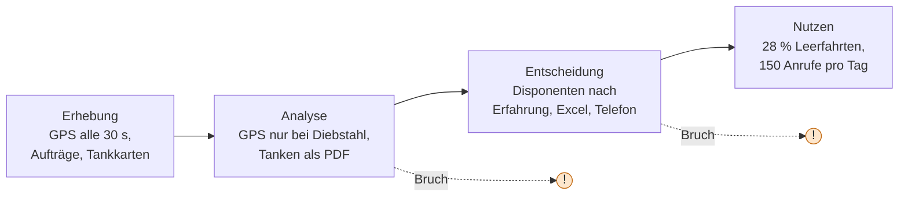
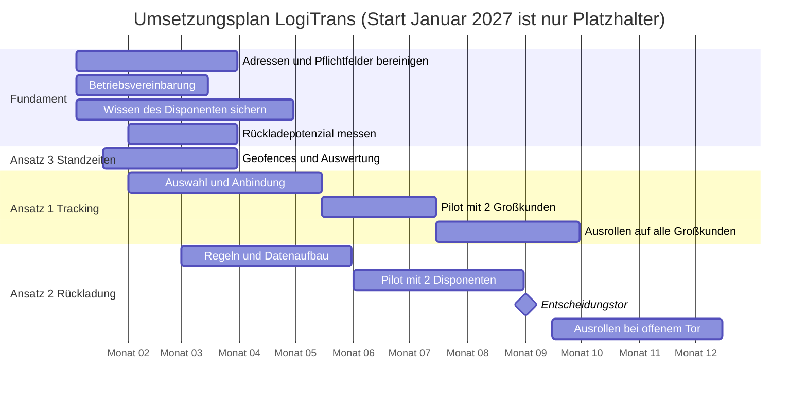

# Fallstudie LogiTrans GmbH (UE 5–6): datenbasierte Geschäftsansätze

> [!NOTE]
> **So ist die Datei aufgebaut**
>
> | Teil | Inhalt | Springen |
> |:---:|---|:---:|
> | **A** | **Mattis Lösung**: leeres Raster zum Selbst-Ausfüllen | [→ Teil A](#teil-a-mattis-lösung) |
> | **B** | **Lösungsentwurf** (KI): zum Vergleichen, *nach* dem eigenen Entwurf lesen | [→ Teil B](#teil-b-lösungsentwurf) |

**Aufgabe:** (1) drei datenbasierte Geschäftsansätze identifizieren, (2) nach Nutzen und Machbarkeit bewerten (Bewertungsraster), (3) eine priorisierte Umsetzungsstrategie entwickeln. Rahmen: **800.000 € Budget, 12 Monate, 2 Personen in der IT.**

---

# Teil A: Mattis Lösung

> [!TIP]
> **Erst hier schreiben, dann Teil B lesen.** Alles Graue ist leer und gehört dir. Die Fragen stammen aus dem Aufgabenblatt.

## Schritt 0 · Daten, Zahlen, Fakten aus dem Aufgabenblatt

Nur die Angaben der Folien 2–6, kurz sortiert, **ohne Bewertung und ohne Rechnung**.

### Das Unternehmen

| Merkmal | Angabe |
|---|---|
| Branche, Größe | Spedition für Industrie und Handel, Sitz Kassel, 120 eigene Lkw, 310 Mitarbeitende |
| Umsatz, Marge | 58 Mio. €, Marge von 4,1 % auf 2,3 % gefallen |
| Planung | 4 Disponenten, täglich nach Erfahrung, mit Excel und Telefon |
| Jubiläum | Nächstes Jahr 50 Jahre, neues Logo und neue Lkw-Planen beauftragt |

### Kosten und Fuhrpark

| Thema | Angabe |
|---|---|
| Fahrleistung | je Lkw ca. 130.000 km im Jahr |
| Leerfahrten | 28 % aller gefahrenen Kilometer |
| Verbrauch | Ø 31 l/100 km |
| Diesel | 8,6 Mio. € (2025), in 2 Jahren +18 % |
| Maut | 5,1 Mio. € (2025), für 2027 weitere Erhöhung angekündigt |
| E-Lkw | 10 für den Nahverkehr bestellt, Lieferung in 14 Monaten |

### Vorhandene Daten

| Quelle | Inhalt | Heutige Nutzung |
|---|---|---|
| GPS-Telematik | Position aller Lkw alle 30 Sekunden, seit 3 Jahren | nur bei Diebstahl oder Unfall |
| Transport-Management | Aufträge, Adressen, Zeitfenster, Gewichte | Rechnungsstellung |
| Tankkarten | Verbrauch je Fahrzeug und Tankvorgang | Monatsabrechnung als PDF |
| Fahrerprotokolle | Wartezeiten an Laderampen | Papier, nach 6 Monaten vernichtet |
| Auftragsdaten (Qualität) | 12 % der Adressen fehlerhaft oder doppelt, Zeitfenster oft nur als Freitext | |

### Betrieb und Kunden

| Thema | Angabe |
|---|---|
| Disposition | ca. 380 Aufträge pro Tag, jeder Disponent plant „seine“ Kunden, Rückladungen nur, wenn zufällig bekannt |
| Kundenservice | ca. 150 Anrufe pro Tag „Wo ist meine Sendung?“, bindet 2 Vollzeitkräfte |
| Großkunden | 5 Großkunden bringen 46 % des Umsatzes, 2 dieser Verträge laufen in 9 Monaten aus |
| Anforderung | Großkunden verlangen Echtzeit-Tracking, 2 Ausschreibungen deshalb verloren |

### Rahmen und Randbedingungen

| Thema | Angabe |
|---|---|
| Betriebsrat | stimmt GPS-Auswertungen nur zu, wenn sie nicht der Leistungskontrolle einzelner Fahrer dienen |
| Personal | erfahrenster Disponent geht in 8 Monaten in Rente, 9 Fahrerstellen unbesetzt |
| Budget, Zeit, IT | 800.000 €, 12 Monate, IT-Abteilung 2 Personen |
| Erwartung der Leitung | Kosten spürbar senken, Großkunden halten und neue gewinnen, ein umsetzbarer Plan |

> [!NOTE]
> **Daraus ergeben sich (reine Rechnung, keine Bewertung)**
>
> | Größe | Rechnung | Ergebnis |
> |---|---|---:|
> | Kilometer pro Jahr, gesamt | 120 Lkw × 130.000 km | 15,6 Mio. km |
> | davon Leerkilometer | 28 % × 15,6 Mio. km | 4,37 Mio. km |
> | davon beladene Kilometer | 72 % × 15,6 Mio. km | 11,23 Mio. km |
> | Dieselverbrauch pro Jahr | 15,6 Mio. km × 0,31 l/km | 4,84 Mio. Liter |
> | Dieselpreis (Gegenprobe) | 8,6 Mio. € / 4,84 Mio. l | 1,78 €/l |
> | Diesel je Kilometer | 8,6 Mio. € / 15,6 Mio. km | 0,55 €/km |
> | Diesel je Lkw und Jahr | 8,6 Mio. € / 120 | ca. 71.700 € |
> | Maut je Kilometer | 5,1 Mio. € / 15,6 Mio. km | 0,33 €/km |
> | Maut je Lkw und Jahr | 5,1 Mio. € / 120 | 42.500 € |
> | Diesel + Maut zusammen | 8,6 + 5,1 Mio. € | 13,7 Mio. € (23,6 % vom Umsatz) |
> | **Maut auf Leerkilometern** | 28 % × 5,1 Mio. € *(Annahme: Maut fällt je km an, egal ob beladen)* | **1,43 Mio. €** |
> | **Diesel auf Leerkilometern** | 28 % × 8,6 Mio. € *(Annahme: gleicher Verbrauch wie beladen, also Obergrenze)* | **2,41 Mio. €** |
> | **Leerfahrten zusammen** | 1,43 + 2,41 Mio. € | **3,84 Mio. €** |
> | Wert von 1 Prozentpunkt Leerfahrten | 1 % × 15,6 Mio. km = 156.000 km, mal 0,88 €/km | ca. 137.000 € |
> | Diesel vor 2 Jahren | 8,6 Mio. € / 1,18 | ca. 7,29 Mio. € (Mehrkosten ca. 1,31 Mio. €) |
> | Gewinn heute | 2,3 % × 58 Mio. € | 1,33 Mio. € |
> | Gewinn vor dem Rückgang | 4,1 % × 58 Mio. € | 2,38 Mio. € (Lücke ca. 1,04 Mio. €) |
> | Aufträge pro Jahr | 380 × 250 Arbeitstage *(Annahme: 250)* | 95.000 |
> | Umsatz je Auftrag | 58 Mio. € / 95.000 | ca. 611 € |
> | Aufträge je Lkw und Tag | 380 / 120 | ca. 3,2 |
> | Fehlerhafte Adressen | 12 % × 380 pro Tag | ca. 46 pro Tag |
> | Anrufe je Kundenservice-Kraft | 150 / 2 | 75 pro Tag |
> | Umsatz der 5 Großkunden | 46 % × 58 Mio. € | 26,68 Mio. € |
> | Umsatz je Großkunde (Ø) | 26,68 Mio. € / 5 *(Annahme: gleich groß)* | ca. 5,34 Mio. € |
> | GPS-Meldungen pro Tag | 120 Lkw × 2.880 (alle 30 s, 24 h, Obergrenze) | ca. 345.600 |

## Schritt 1 · Die drei Ansätze

| # | Name des Ansatzes | Welche Daten nutzt er? | Welches Problem löst er? |
|:---:|---|---|---|
| **1** | <br><br> | <br><br> | <br><br> |
| **2** | <br><br> | <br><br> | <br><br> |
| **3** | <br><br> | <br><br> | <br><br> |

## Schritt 2 · Bewertungsraster

| Ansatz | Nutzen (1–5) | Machbarkeit (1–5) | Kosten | Begründung |
|:---|:---:|:---:|:---:|:---|
| **Ansatz 1** | <br><br><br> | <br><br><br> | <br><br><br> | <br><br><br><br><br> |
| **Ansatz 2** | <br><br><br> | <br><br><br> | <br><br><br> | <br><br><br><br><br> |
| **Ansatz 3** | <br><br><br> | <br><br><br> | <br><br><br> | <br><br><br><br><br> |

## Schritt 3 · Priorisierte Umsetzungsstrategie

| Reihenfolge | Ansatz | Zeitraum | Budget | Baut auf | Entscheidungstor (wann, woran gemessen?) |
|:---:|---|---|---|---|---|
| **1.** | <br><br> | <br><br> | <br><br> | <br><br> | <br><br> |
| **2.** | <br><br> | <br><br> | <br><br> | <br><br> | <br><br> |
| **3.** | <br><br> | <br><br> | <br><br> | <br><br> | <br><br> |

**Summe Budget:** ______ von 800.000 € &nbsp;·&nbsp; **Reserve:** ______

---

# Teil B: Lösungsentwurf

> [!IMPORTANT]
> **Auf einen Blick**
>
> - **Die drei Ansätze:** **1 Tracking-Portal** für Kunden (datenbasierter Service), **2 Rückladungs-Assistent** für die Disposition (Optimierung), **3 Standzeiten-Auswertung** an den Laderampen (Optimierung, aus vorhandenen GPS-Daten). Dazu ein gemeinsames **Datenfundament** (Adressen, Zeitfenster), das kein eigener Ansatz ist, sondern Voraussetzung.
> - **Größter Hebel:** 28 % Leerfahrten sind **4,37 Mio. km im Jahr**. Allein Diesel und Maut dafür kosten rund **3,5 Mio. €**. Jeder Prozentpunkt weniger Leerfahrten bringt etwa **0,16 Mio. €** im Jahr. Bei 2 / 4 / 6 Prozentpunkten weniger sind das **0,34 / 0,65 / 0,95 Mio. €**.
> - **Reihenfolge:** Monate 1–3 Fundament, Standzeiten, Machbarkeitsprüfung der Rückladung. **Tracking live bis Monat 5**, weil zwei Großkunden-Verträge in 9 Monaten auslaufen. **Rückladungs-Pilot ab Monat 6**, solange der erfahrenste Disponent noch da ist (Rente in 8 Monaten). **Entscheidungstor Monat 9.**
> - **Budget:** **600.000 €** im ersten Jahr, **200.000 € Reserve**, danach **120.000 €** laufend. Ein Rückladungs-Nutzen ist erst ab Jahr 2 eingeplant.
> - **Größte Lücken:** Wie viele Leerfahrten hätten überhaupt eine passende Rückladung gehabt? Warum gingen die 2 Ausschreibungen verloren? Was verlangen die Großkunden genau? Stimmt der Betriebsrat zu?

> [!NOTE]
> Rechnungen mit Zahlen aus dem Aufgabenblatt sind nachgerechnet (Python-Check am Ende). Alle anderen Zahlen sind als **Annahme** gekennzeichnet und müssen vor einer Entscheidung geprüft werden, besonders die **Kostenschätzungen** (Angebote einholen). Rechtliche Aussagen (Betriebsrat, DSGVO) sind **nicht** geprüft. Die Priorisierung ist eine begründete Einschätzung, nicht die einzig mögliche.

---

## 1. Ausgangslage: was zählt, was nicht

LogiTrans fährt mit 120 eigenen Lkw, hat 58 Mio. € Umsatz und eine **auf 2,3 % gefallene Marge** (zuvor 4,1 %). Das sind rund **1,33 Mio. € Gewinn statt 2,38 Mio. €**, also eine Lücke von etwa **1,04 Mio. €**. Die Kosten steigen (Diesel +18 %, Maut 2027 höher), und die Großkunden verlangen etwas, das die Firma nicht bieten kann (Echtzeit-Tracking).

Die Kette aus der Folie „Wertschöpfung durch Daten“ (Erhebung, Analyse, Entscheidung, Nutzen) bricht hier an **zwei Stellen**. Die Erhebung funktioniert, die Analyse und die Entscheidung nicht:



### Rechnung aus den Zahlen des Aufgabenblatts

| Größe | Rechnung | Ergebnis |
|---|---|---|
| Jahreskilometer | 120 Lkw × 130.000 km | **15,6 Mio. km** |
| Leerkilometer | 28 % × 15,6 Mio. km | **4,37 Mio. km** |
| Dieselkosten je km | 8,6 Mio. € / 15,6 Mio. km | 0,55 €/km (entspricht ca. 1,78 €/l bei 31 l/100 km) |
| Mautkosten je km | 5,1 Mio. € / 15,6 Mio. km | 0,33 €/km |
| Kosten der Leerkilometer | 28 % × (8,6 + 5,1 Mio. €) | **3,84 Mio. €** (Obergrenze) |
| Dasselbe, Diesel × 0,85 | Leere Lkw verbrauchen weniger (**Annahme** 0,85) | **3,47 Mio. €** |
| Aufträge pro Jahr | 380 × 250 Arbeitstage (**Annahme** 250) | ca. 95.000, **ca. 611 € Umsatz je Auftrag** |
| Fehlerhafte Adressen | 12 % × 380 | ca. 46 Aufträge **pro Tag** |
| Anrufe je Kopf | 150 Anrufe / 2 Vollzeitkräfte | 75 Anrufe pro Kopf und Tag |
| Großkunden | 46 % × 58 Mio. € / 5 | **ca. 5,3 Mio. € je Kunde** (**Annahme:** gleich groß) |

### Was auf den Folien zählt und was nicht

| Information | Relevant? | Begründung |
|---|:---:|---|
| 28 % Leerfahrten, Diesel +18 %, Maut | **ja** | Größter Kostenhebel. Eine Mauterhöhung 2027 macht jeden gesparten Kilometer wertvoller. |
| 2 Ausschreibungen wegen Echtzeit-Tracking verloren | **ja** | Direkter Beleg, dass Tracking Umsatz kostet. |
| 2 Großkunden-Verträge laufen in 9 Monaten aus | **ja** | Hartes Zeitfenster für Ansatz 1. Zusammen etwa 10,7 Mio. € Umsatz (Durchschnitt). |
| Betriebsrat: keine Leistungskontrolle einzelner Fahrer | **ja** | Schränkt den Zweck der GPS-Auswertung ein (siehe 2.4). |
| Erfahrenster Disponent geht in 8 Monaten in Rente | **ja** | Wissen sichern und den Pilot rechtzeitig starten. |
| 9 Fahrerstellen unbesetzt | **ja** | Weniger Leerkilometer entlasten knappes Fahrpersonal. |
| 2 Personen in der IT | **ja** | Kapazitätsgrenze, deshalb Kauf statt Eigenbau. |
| 10 E-Lkw, Lieferung in 14 Monaten | teils | Liegt hinter dem 12-Monats-Horizont. Nur beachten, damit die Planung später E-Lkw (Reichweite, Laden) aufnehmen kann. |
| 50-jähriges Bestehen, neues Logo, neue Planen | **nein** | Kein Bezug zu Daten, Kosten oder Kunden. |

---

## 2. Aufgabe 1: drei datenbasierte Geschäftsansätze

Für jeden Ansatz gilt der Entscheidungstest der Folien: Die Entscheidung fällt **häufig** (täglich 380 Aufträge, 150 Anrufe) und es geht um **viel Geld**. Beides spricht dafür, Daten systematisch zu nutzen und nicht nur nach Erfahrung zu planen. Die Zuordnung zu den Geschäftsmodellen der Folien steht jeweils dabei.

### 2.1 Ansatz 1: Tracking-Portal für Kunden (Echtzeit-Sendungsverfolgung)

| | |
|---|---|
| **Idee** | Kunden sehen Position und voraussichtliche Ankunftszeit ihrer Sendung selbst (Portal oder Schnittstelle). Die Daten sind da: GPS alle 30 Sekunden, Aufträge im Transport-Management. |
| **Modelltyp (Folien)** | **Datenbasierter Service**. Später optional **Pay-per-Use** (z. B. Schnittstelle für Großkunden als Zusatzleistung). |
| **Löst** | 2 verlorene Ausschreibungen, 2 auslaufende Verträge, 150 Anrufe „Wo ist meine Sendung?“ pro Tag (2 Vollzeitkräfte). |
| **Voraussetzung** | Saubere Adressen und Auftrags-Schlüssel (12 % fehlerhaft), sonst stimmt die Ankunftszeit nicht. |
| **Betriebsrat** | Unkritisch, **wenn** der Kunde nur seine Sendung sieht, **nicht** den Fahrer und nicht den Lkw außerhalb der Tour. Das gehört in die Betriebsvereinbarung. |
| **Kauf statt Eigenbau** | Fertige Software („Visibility-Plattform“) mit Anbindung an Telematik und TMS. Eigenbau würde 2 IT-Leute binden. |

### 2.2 Ansatz 2: Rückladungs-Assistent für die Disposition

| | |
|---|---|
| **Idee** | Das System schlägt den Disponenten für leere Rückfahrten **passende Aufträge** vor (Ort, Zeitfenster, Gewicht, Lkw-Typ). Der Disponent entscheidet weiterhin. |
| **Modelltyp (Folien)** | **Optimierung** (Kosten senken, wie der Predictive-Maintenance-Fall: bestehender Ablauf wird besser, nicht neu verkauft). |
| **Löst** | 28 % Leerfahrten, „Rückladungen nur, wenn zufällig bekannt“, jeder Disponent plant „seine“ Kunden, das Wissen des scheidenden Disponenten. |
| **Voraussetzung** | Bereinigte Adressen, Zeitfenster als strukturierte Felder (nicht Freitext), realistische Rampenzeiten (aus Ansatz 3). |
| **Risiko** | Es ist **unbekannt**, wie oft passende Rückladungen überhaupt existieren. Das muss **vor** dem Kauf in den eigenen Daten gemessen werden (siehe 4.1). |
| **Umfang** | Zuerst nur **Vorschläge** für 2 Disponenten (Pilot), keine Vollautomatik. Bei 380 Aufträgen pro Tag und nur 4 Disponenten lohnt sich Unterstützung. |

### 2.3 Ansatz 3: Standzeiten-Auswertung an den Laderampen

| | |
|---|---|
| **Idee** | Aus den GPS-Daten (seit 3 Jahren vorhanden) werden automatisch **Aufenthaltszeiten an Kundenadressen** abgeleitet (Geofencing). Heute stehen Wartezeiten nur auf Papier und werden nach 6 Monaten vernichtet. |
| **Modelltyp (Folien)** | **Optimierung**. Später vielleicht **Daten als Produkt** (Wartezeit-Benchmarks), das ist aber nicht geprüft. |
| **Löst** | Unbezahlte Wartezeit, unrealistische Zeitfenster in der Planung, fehlende Beweise gegenüber Kunden. |
| **Datenmenge** | Bis zu ca. 380 Mio. Positionen (Obergrenze: 120 Lkw × 2.880 Meldungen am Tag × 3 Jahre). Das ist für eine Datenbank mit Geo-Index machbar, Excel schafft es nicht. |
| **Betriebsrat** | Auswertung **je Rampe und Kunde**, nicht je Fahrer. Mindestgruppengröße und Löschfristen in der Betriebsvereinbarung festlegen. |
| **Besonderheit** | Billigster Ansatz, braucht keine neue Hardware und liefert **die Zahlen, die Ansatz 2 braucht**. |

### 2.4 Datenfundament (Voraussetzung, kein eigener Ansatz)

Adressen bereinigen (12 % ≈ 46 Aufträge pro Tag), Zeitfenster als Datum-Felder erfassen, **Auftrags-Schlüssel zwischen GPS und Transport-Management** herstellen. Das ist die Antwort auf die Folienhürden *Datenqualität* und *Datensilos*. Ohne dieses Fundament scheitern 1 und 2 an falschen Adressen.

### 2.5 Bewusst nicht gewählt

| Idee | Warum nicht jetzt |
|---|---|
| Fahrstil- und Verbrauchsvergleich **je Fahrer** (Tankkarten + GPS) | Der Betriebsrat stimmt nicht zu, wenn es der Leistungskontrolle einzelner Fahrer dient. Auswertung **je Fahrzeug** wäre möglich, der Hebel ist aber kleiner. |
| Planung für die 10 E-Lkw | Lieferung in 14 Monaten, außerhalb des 12-Monats-Plans. Der Assistent (Ansatz 2) soll aber so gebaut werden, dass Reichweite und Laden später ergänzt werden können. |
| Wartezeit-Benchmarks an Kunden verkaufen | Idee für später, nur wenn die Daten belastbar sind. Rechtlich nicht geprüft. |
| Vollautomatische Tourenplanung | Zu große Umstellung mit 4 Disponenten, einem Rentner und nur 2 IT-Leuten. Erst Vorschläge, dann ausbauen. |

---

## 3. Aufgabe 2: Bewertungsraster

| Ansatz | Nutzen (1–5) | Machbarkeit (1–5) | Kosten (**Annahme**) | Begründung |
|:---|:---:|:---:|:---:|:---|
| **1 Tracking-Portal** | **4** | **4** | 110.000 € einmalig + 45.000 € / Jahr | **Nutzen:** schützt Verträge mit zusammen ca. 10,7 Mio. € Umsatz, hat direkt 2 Ausschreibungen gekostet, entlastet den Kundenservice. Wirkt aber über Umsatz und nicht direkt als Kostensenkung. **Machbarkeit:** Daten sind da, Standardsoftware gibt es. Risiko: Adressqualität. |
| **2 Rückladungs-Assistent** | **5** | **3** | 260.000 € einmalig + 60.000 € / Jahr | **Nutzen:** größter Hebel (0,34 bis 0,95 Mio. € im Jahr), erst ab Jahr 2. **Machbarkeit:** abhängig von Datenfundament, Annahme der Disponenten und davon, ob passende Rückladungen existieren. Nur als Pilot mit Vorschlägen machbar. |
| **3 Standzeiten-Auswertung** | **3** | **5** | 40.000 € einmalig + 10.000 € / Jahr | **Nutzen:** mittel, vor allem als Beweis und Planungsgrundlage. Steht und fällt mit den Verträgen (Standgeld). **Machbarkeit:** nur vorhandene Daten, kein neues Gerät, kleiner Aufwand. |
| *Datenfundament* | *Voraussetzung* | *Voraussetzung* | 70.000 € einmalig + 5.000 € / Jahr | Nicht bewertet, weil es nur Bedingung für 1 und 2 ist. |

Die Punkte sind meine Einschätzung. Eine einfache Gewichtung (Nutzen × Machbarkeit) ergibt 16 / 15 / 15 und trennt die Ansätze kaum. Die Reihenfolge entscheidet deshalb **nicht die Punktzahl**, sondern Fristen und Abhängigkeiten (Abschnitt 4).

### 3.1 Nutzen nachgerechnet

**Ansatz 2: Rückladungen (Hauptnutzen).** Wenn die beförderte Last gleich bleibt (11,2 Mio. beladene km) und der Leerkilometer-Anteil von 28 % sinkt, sinkt die Gesamtstrecke. Gesparte Kosten rechnen mit Diesel × 0,85 (**Annahme**) plus Maut. Fahrerstunden und Verschleiß sind **nicht** eingerechnet, die Rechnung ist also vorsichtig.

| Leerkilometer-Anteil | gesparte Kilometer | Anteil an der Gesamtstrecke | Ersparnis pro Jahr | Netto nach 120.000 € Betrieb |
|:---:|---:|---:|---:|---:|
| 28 % → 26 % (−2 Pp) | 0,42 Mio. km | 2,7 % | ca. **335.000 €** | ca. 215.000 € |
| 28 % → 24 % (−4 Pp, Basis) | 0,82 Mio. km | 5,3 % | ca. **653.000 €** | ca. 533.000 € |
| 28 % → 22 % (−6 Pp) | 1,20 Mio. km | 7,7 % | ca. **955.000 €** | ca. 835.000 € |

- **Break-even** des Ansatzes 2 im ersten Jahr (320.000 €): rund **2 Prozentpunkte** weniger Leerfahrten reichen aus, wenn der Effekt volle 12 Monate wirkt.
- **Personal:** 5,3 % weniger Kilometer entsprechen rechnerisch der Auslastung von etwa **6 Lkw**, bei 9 unbesetzten Fahrerstellen (Näherung).
- **Alle Basiswerte (2 / 4 / 6 Prozentpunkte) sind Annahmen.** Ob 4 Punkte realistisch sind, zeigt erst der Pilot.

**Ansatz 1: Tracking.**
- **Kundenservice:** Fallen 50 bis 70 % der 150 Anrufe weg, sind das **1,0 bis 1,4 Vollzeitkräfte**. Bei 55.000 € je Stelle (**Annahme**) sind das rund 55.000 bis 77.000 € Kapazität im Jahr. Das deckt fast die Lizenz (45.000 €), wenn die Mitarbeitenden anders eingesetzt werden.
- **Verträge:** Break-even im ersten Jahr (155.000 €): das Projekt trägt sich, wenn es **einen** Großkunden-Vertrag (5,3 Mio. € Umsatz) mit einem Beitrag von **etwa 2,9 %** des Umsatzes sichert. Bei einer Netto-Marge von 2,3 % wären es ca. 122.000 € Gewinn, der Deckungsbeitrag ist höher, weil die Lkw-Kosten bleiben. Das ist **keine Prognose**, sondern eine Schwelle.
- **Zahlungsbereitschaft:** unbekannt. Tracking ist für Großkunden vermutlich eine **Mindestanforderung** (Ausschreibungen wurden deswegen verloren), also eher Voraussetzung für Aufträge als ein Aufpreis. Das muss im Gespräch geklärt werden.

**Ansatz 3: Standzeiten.** Break-even im ersten Jahr (50.000 €): bei **40 € je Stunde** Standgeld (**Annahme**, muss im Vertrag stehen) müssen **1.250 Stunden** im Jahr durchsetzbar sein, das sind **etwa 5 Stunden pro Arbeitstag** für die gesamte Flotte. Bei 380 Aufträgen am Tag ist das gut möglich, aber erst die Daten zeigen es.

### 3.2 Wirtschaftlichkeit des Pakets (nur Ansatz 2 gerechnet)

Eingeplant sind 600.000 € im ersten Jahr und **kein Nutzen** im ersten Jahr (Pilot, Lernphase). Ab Jahr 2 wirkt Ansatz 2 voll, **ohne** Nutzen aus Ansatz 1 und 3 und ohne höhere Maut 2027.

| Szenario | Kumuliert nach Jahr 2 | Kumuliert nach Jahr 3 | Payback ab Projektstart (Näherung) |
|---|---:|---:|---|
| −2 Pp | ca. −385.000 € | ca. −170.000 € | ca. 3,8 Jahre |
| −4 Pp (Basis) | ca. −67.000 € | ca. +466.000 € | ca. 26 Monate |
| −6 Pp | ca. +235.000 € | ca. +1.070.000 € | ca. 21 Monate |

Das ist **vorsichtig**, weil Nutzen aus Tracking und Standzeiten und die Mauterhöhung fehlen. Es zeigt aber auch: Fällt der Effekt auf −2 Punkte, ist das Paket erst nach Jahren bezahlt. Darum ein **Entscheidungstor** vor der Ausweitung.

---

## 4. Aufgabe 3: priorisierte Umsetzungsstrategie

### 4.1 Reihenfolge und Begründung

| Phase | Zeitraum | Inhalt | Warum jetzt |
|:---:|---|---|---|
| **0** | Monat 1–3 | **Datenfundament**, **Ansatz 3 (Standzeiten)**, **Rückladepotenzial messen**, Wissen des Disponenten sichern, **Betriebsvereinbarung** | Alles andere baut darauf auf. Standzeiten sind ein Schnellerfolg (nur vorhandene Daten). Die Potenzialanalyse zeigt, ob Ansatz 2 sich lohnt, **bevor** Geld fließt. Der Disponent geht in 8 Monaten. |
| **1** | Monat 2–5 | **Ansatz 1 (Tracking):** Anbieter wählen, anbinden, live bis Monat 5, Pilot mit den **2 Großkunden mit auslaufendem Vertrag** | Frist: Verträge laufen in 9 Monaten aus. Der Kunde muss vorher erleben, dass es funktioniert. |
| **2** | Monat 6–9 | **Ansatz 2 (Rückladung), Pilot** mit 2 Disponenten, Vorschläge statt Automatik | Braucht Phase 0 (Adressen, Rampenzeiten). Läuft, solange der erfahrenste Disponent noch da ist (Monat 6–8). |
| **Tor** | Monat 9 | Entscheidung über Ausweitung | Siehe Kriterien unten. |
| **3** | Monat 10–12 | **Ausrollen** von Ansatz 2 auf alle Disponenten (nur bei offenem Tor), Tracking für alle Großkunden | Budgetreserve schützt vor Überraschungen. |



> [!NOTE]
> Das Diagramm ist nicht auf GitHub gerendert geprüft. Falls es dort nicht erscheint, gilt die Tabelle darüber.

### 4.2 Entscheidungstor im Monat 9 (Ansatz 2)

Das Tor ist offen, wenn **alle** drei Bedingungen erfüllt sind (Schwellen sind **Annahmen**):

1. **Wirkung:** Der Leerkilometer-Anteil ist im Pilot um **mindestens 2 Prozentpunkte** niedriger als ohne Assistent (das entspricht ungefähr dem Break-even des ersten Jahres).
2. **Annahme:** Die Disponenten übernehmen **mindestens 40 %** der Vorschläge.
3. **Daten:** Die Quote fehlerhafter Adressen liegt unter einem festgelegten Wert (z. B. 3 %).

**Wie wird die Wirkung fair gemessen?** Die Disponenten betreuen unterschiedliche Kunden. Ein Vergleich „Pilot-Disponenten gegen die anderen“ wäre verzerrt, wie beim Teehaus-Beispiel (Auswahleffekt). Besser: **dieselben Disponenten wechseln tageweise** zwischen „mit Assistent“ und „ohne“ (Zufallsauswahl der Tage), und es wird über 8 Wochen verglichen.

**Rückfalloption:** Fällt das Tor zu, bleiben Ansatz 1, Ansatz 3 und das Fundament bestehen. Ansatz 2 wird gestoppt oder verkleinert, und das Reservebudget bleibt ungenutzt.

### 4.3 Budget und IT-Kapazität

| Posten | Einmalig | Laufend / Jahr | Kosten im 1. Jahr | IT-intern (Personenmonate, **Annahme**) |
|---|---:|---:|---:|---:|
| Datenfundament | 70.000 € | 5.000 € | 75.000 € | 2 |
| Ansatz 3 Standzeiten | 40.000 € | 10.000 € | 50.000 € | 1 |
| Ansatz 1 Tracking | 110.000 € | 45.000 € | 155.000 € | 2 |
| Ansatz 2 Rückladung | 260.000 € | 60.000 € | 320.000 € | 3 |
| **Summe** | **480.000 €** | **120.000 €** | **600.000 €** | **8** |
| **Reserve** | | | **200.000 €** (25 % des Budgets) | |

- **Ausweitung nach dem Tor:** Wird sie aus der Reserve bezahlt, bleibt ein Puffer. Wie viel sie kostet, ist nicht bekannt (Angebot einholen).
- **IT-Kapazität:** 2 Personen haben in 12 Monaten 24 Personenmonate. Angenommen, die Hälfte geht in den Betrieb, bleiben **12 Personenmonate**. Gebraucht werden **8**, der Rest ist Puffer. Das geht nur mit **Standardsoftware und einem externen Partner** für die Integration, nicht mit Eigenentwicklung.
- **Laufende Kosten:** 120.000 € im Jahr ab Jahr 2. Gilt das Budget auch dafür? Das ist eine offene Frage.

---

## 5. Fehlende Informationen

1. **Rückladepotenzial:** Wie oft hätte eine leere Rückfahrt einen passenden Auftrag (Ort, Zeit, Gewicht) gehabt? Das ist die wichtigste Zahl für Ansatz 2 und aus den vorhandenen Daten ermittelbar.
2. **Die 2 verlorenen Ausschreibungen:** Wirklich wegen Tracking, oder auch wegen des Preises? Was war die Auftragsgröße?
3. **Die 2 auslaufenden Verträge:** Welche Kunden, welcher Umsatz (5,3 Mio. € ist nur der Durchschnitt), was verlangen sie im Detail (Portal, Schnittstelle, Genauigkeit der Ankunftszeit)?
4. **Zahlungsbereitschaft:** Würden Kunden für Tracking zahlen, oder erwarten sie es als Standard?
5. **Betriebsrat:** Wird eine Betriebsvereinbarung mit den vorgeschlagenen Grenzen (Auswertung je Rampe und Kunde, kein Fahrerbezug, Löschfristen) akzeptiert? Rechtlich nicht geprüft.
6. **Telematik-Anbieter:** Gehören die Rohdaten LogiTrans, gibt es einen Export oder eine Schnittstelle? Sonst droht Abhängigkeit vom Anbieter.
7. **Datenqualität im Detail:** Sind die 12 % Adressfehler Dubletten, Schreibfehler oder fehlende Hausnummern? Wie viele Zeitfenster sind nur Freitext?
8. **Standgeld:** Steht es in den Verträgen? Ohne diese Klausel bleibt Ansatz 3 ein reines Planungswerkzeug.
9. **Disponenten und Fahrer:** Würden sie Vorschläge annehmen? Ohne Akzeptanz bleibt der Assistent ungenutzt (Folienhürde *Kultur*).
10. **Kosten:** Alle Beträge in Abschnitt 3 und 4 sind Schätzungen, es braucht Angebote.
11. **Budget:** Gilt es nur für das erste Jahr oder auch für laufende Kosten?
12. **Entwicklung von Diesel und Maut 2027:** Ein höherer Preis erhöht den Nutzen von Ansatz 2, ist aber nicht eingerechnet.

---

## 6. Vorschlag an die Geschäftsführung

> Wir starten mit dem **Datenfundament** und der **Auswertung der Standzeiten**, weil beides billig ist und alles Weitere trägt. Parallel messen wir, **wie viele Leerfahrten eine passende Rückladung gehabt hätten**, bevor wir Geld für Ansatz 2 ausgeben. Das **Tracking-Portal** gehen wir sofort an und bringen es mit den **2 Großkunden mit auslaufendem Vertrag** in Betrieb, weil dort die Frist von 9 Monaten drängt. Den **Rückladungs-Assistenten** testen wir ab Monat 6 mit 2 Disponenten, solange der erfahrenste Disponent noch da ist. **Im Monat 9 entscheiden wir** anhand des Leerkilometer-Anteils, ob wir ausweiten. Der Plan kostet im ersten Jahr **600.000 €** von 800.000 €, **200.000 € bleiben Reserve**. Offen sind die Zahlungsbereitschaft der Kunden, die Zustimmung des Betriebsrats und die Frage, ob das Budget auch laufende Kosten (120.000 € im Jahr) deckt.

---

## 7. Python-Check der Rechnungen

```python
# python3 -I check.py   (nur Standardbibliothek)
km = 120 * 130_000
diesel, maut = 8.6e6, 5.1e6
fuel_km, maut_km = diesel / km, maut / km
loaded = km * 0.72

print("Kilometer gesamt / leer:", km, round(km * 0.28))
print("Diesel EUR/l:", round(fuel_km / 0.31, 2))
print("Kosten Leerkm (Obergrenze / Diesel*0.85):",
      round(0.28 * (diesel + maut)), round(0.28 * (diesel * .85 + maut)))
print("Aufträge/Jahr:", 380 * 250, "Umsatz je Auftrag:", round(58e6 / (380 * 250)))
print("Marge-Lücke:", round(58e6 * (0.041 - 0.023)))
print("Großkunde (Durchschnitt):", round(58e6 * 0.46 / 5))

run = 120_000
for e in (0.26, 0.24, 0.22):
    saved_km = km - loaded / (1 - e)
    saving = saved_km * (fuel_km * 0.85 + maut_km)
    cum2 = -600_000 + (saving - run)
    cum3 = cum2 + (saving - run)
    # Payback in Monaten ab Start (Nutzen ab Jahr 2)
    months, cum = 12, -600_000
    while cum < 0:
        months += 1
        cum += (saving - run) / 12
    print(f"Leer {e:.0%}: gespart {saved_km/1e6:.2f} Mio. km, {saving:,.0f} EUR/Jahr, "
          f"nach J2 {cum2:,.0f}, nach J3 {cum3:,.0f}, Payback ca. {months} Monate")

# Break-even Ansatz 2 (Jahr 1: 320k) in Prozentpunkten
cost_per_km = fuel_km * 0.85 + maut_km
need_km = 320_000 / cost_per_km
print("Break-even Ansatz 2: km", round(need_km), "-> Leeranteil", round(1 - loaded / (km - need_km), 3))

print("Ansatz 1 Break-even (155k) auf Großkunde:", round(155_000 / (58e6 * 0.46 / 5), 3))
print("Ansatz 3 Break-even (50k) bei 40 EUR/h:", 50_000 / 40, "h =", 50_000 / 40 / 250, "h/Tag")
print("Budget Jahr 1:", sum(a + b for a, b in [(70, 5), (110, 45), (260, 60), (40, 10)]), "k EUR")
print("GPS-Positionen (Obergrenze):", 120 * 2880 * 365 * 3)
```
