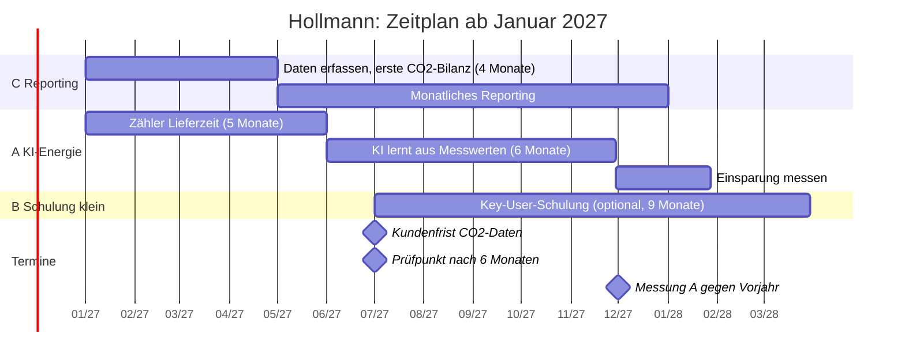

# Tag 2 (Modul 3), Arbeitsauftrag 2: Budget 400.000 € für KI-Energie, Schulung oder Reporting bei Hollmann Möbelwerke GmbH

> [!NOTE]
> | Teil | Inhalt | Springen |
> |:---:|---|:---:|
> | **A** | **Mattis Lösung**: Fakten, Rechnungen und meine Einträge | [→ Teil A](#teil-a-mattis-lösung) |
> | **B** | **Lösungsentwurf** (KI) | [→ Teil B](#teil-b-lösungsentwurf) |

**Aufgabe:** Drei Maßnahmen (A KI-Energie, B Data-Literacy-Schulung, C Nachhaltigkeitsreporting) nach **Impact, Risiko, Zeit bis Wirkung** bewerten, **priorisieren** (Budget 400.000 €) und die **Zielkonflikte** benennen.

---

# Teil A: Mattis Lösung

## Schritt 0 · Daten, Zahlen, Fakten aus dem Aufgabenblatt

### Die drei Maßnahmen

| | A) KI-Energie | B) Schulung | C) Reporting |
|---|---|---|---|
| Investition | ca. 280.000 € | ca. 150.000 € | ca. 60.000 € |
| Bis zur Wirkung | Zähler 5 Monate Lieferzeit, dann 6 Monate Lernen | 6 Präsenztage je Person über 9 Monate | erste CO₂-Bilanz nach ca. 4 Monaten |
| Laufend | 25.000 €/Jahr Wartung | keine | halbe Stelle im Controlling |
| Bekannt | Anbieter nennt 8–15 % Einsparung in drei Holzbetrieben | 390 Personentage fehlen im Tagesgeschäft | liefert Zahlen, spart selbst keine Energie |
| Zielgruppe | 45 Führungskräfte + 20 Key-User (B) | | |

### Rahmen

| Thema | Angabe |
|---|---|
| Budget | 400.000 € |
| Energie 2025 | 2,9 Mio. € (Strom 1,1 · Gas 1,8), Trockenkammern und Lackieranlage ≈ 60 % davon, in zwei Jahren +35 % |
| Kunden | zwei Büroausstatter (zusammen 29 % des Umsatzes) wollen CO₂-Daten je Produkt ab 1. Juli nächsten Jahres |
| Bank | ohne Nachhaltigkeitsbericht +0,4 Prozentpunkte Zins auf 6-Mio.-€-Kredit ab 2027 |
| Datenlage | Strom und Gas nur als Monatsrechnung je Werk, Holz und Abfall auf Papier-Lieferscheinen |
| Sonstiges | Werk B bekommt Photovoltaik (eigenes Budget), Showroom Frankfurt öffnet im Frühjahr |

> [!NOTE]
> **Daraus ergeben sich (reine Rechnung, keine Bewertung)**
>
> | Größe | Rechnung | Ergebnis |
> |---|---|---:|
> | Energiekosten vor zwei Jahren | 2,9 Mio. € / 1,35 | ca. 2,15 Mio. € (+752.000 €) |
> | Energie in den Anlagen von A | 60 % × 2,9 Mio. € | 1,74 Mio. € |
> | Einsparung A pro Jahr *(Annahme: Prozentsatz bezieht sich auf die 1,74 Mio. €)* | 8 % bis 15 % × 1,74 Mio. € | 139.200 € bis 261.000 € |
> | Netto nach Wartung | Einsparung − 25.000 € | 114.200 € bis 236.000 € |
> | Amortisation A ab Wirkung | 280.000 € / Netto | 1,2 bis 2,5 Jahre |
> | Wirkung A beginnt nach | 5 + 6 Monate | 11 Monaten |
> | Einsparung für Amortisation in 3 Jahren | (280.000 € / 3 + 25.000 €) / 1,74 Mio. € | 6,8 % |
> | Personentage B | (45 + 20) × 6 | 390 |
> | Kosten je Personentag B | 150.000 € / 390 | ca. 385 € |
> | Mehrkosten Zins | 0,4 % × 6 Mio. € | 24.000 € pro Jahr |
> | Summe alle drei | 280.000 + 150.000 + 60.000 € | 490.000 € (90.000 € über Budget) |
> | A + B / A + C / B + C | Summen | 430.000 € / 340.000 € / 210.000 € |

## Schritt 1 · Bewertungsraster

| Kriterium | A) KI-Energie | B) Schulung | C) Reporting |
|:---|:---|:---|:---|
| **Impact** | echte Reduktion von CO2 | | hoch, Austatter wollen Zahlen, nicht **gute** Zahlen |
| **Risiko** | mittel | | gering |
| **Zeit bis Wirkung** | 11 MOnate | | 4 Monate, rechtzeitig für Ausstatter |
| **Ihre Priorität** | hoch als Pilot | | sehr hoch, |
| **Zielkonflikt** | Daten ohne gutes Reporting und Schulung wie Informationen benutzt werden ggf. overkill | | |

---

# Teil B: Lösungsentwurf

> [!IMPORTANT]
> **Auf einen Blick**
>
> - **Empfehlung:** **C zuerst und voll, A ebenfalls, B zurückgestellt.** C (60.000 €) sichert 29 % des Umsatzes und den Bankzins (24.000 €/Jahr). A (280.000 €) ist der einzige Hebel mit echter Einsparung (139.000 bis 261.000 € pro Jahr).
> - **Budget:** 340.000 € verplant, **60.000 € Reserve**. Alle drei (490.000 €) passen nicht.
> - **B** kostet 390 Personentage und wirkt erst nach 9 Monaten, ohne Zahl für den Nutzen. Eine **verkleinerte Fassung nur für die 20 Key-User** (ca. 46.000 €) kommt aus der Reserve, wenn A nach dem ersten Halbjahr im Plan liegt.
> - **Größtes Risiko:** die 8–15 % stammen vom Anbieter. Schon **6,8 %** reichen für eine Amortisation in drei Jahren ab Wirkung, deshalb bleibt A vertretbar.

> [!NOTE]
> **Annahmen**, die nicht auf dem Blatt stehen: der Prozentsatz des Anbieters bezieht sich nur auf die 1,74 Mio. € der Anlagen (vorsichtig gerechnet). Das Budget deckt die Investitionen, laufende Kosten (25.000 € Wartung, halbe Stelle) laufen im Betriebsbudget. Der Preis der verkleinerten Schulung ist anteilig gerechnet (20 von 65 Personen), keine Anbieterangabe.

## Schritt 1 · Bewertungsraster

| Kriterium | A) KI-Energie | B) Schulung | C) Reporting |
|:---|:---|:---|:---|
| **Impact** | **hoch, direkt in €**: 139.000 bis 261.000 € pro Jahr, senkt auch CO₂ | **mittel, indirekt**: bessere Entscheidungen, aber kein € Wert nennbar | **hoch, aber defensiv**: sichert 29 % Umsatz und vermeidet 24.000 € Zins, spart selbst nichts |
| **Risiko** | **mittel bis hoch**: 8–15 % aus anderen Betrieben, Lieferzeit der Zähler, KI muss erst lernen | **mittel**: Wirkung schwer messbar, 390 Tage fehlen im Alltag | **niedrig**: günstig, Verfahren bekannt. Papier-Lieferscheine kosten Handarbeit |
| **Zeit bis Wirkung** | **11 Monate**, Amortisation 2,1 bis 3,4 Jahre ab Start | **9 Monate**, Nutzen erst danach | **4 Monate**, rechtzeitig vor dem 1. Juli bei Start im Januar |
| **Ihre Priorität** | **2** | **3** (später, klein) | **1** |
| **Zielkonflikt** | Kosten heute gegen Einsparung später, Anbieterversprechen gegen Eigenmessung | Lernen gegen Tagesgeschäft (390 Tage) | Pflichtzahlen gegen Maßnahmen, die wirken |

## Schritt 2 · Priorisierung und Budget

| Maßnahme | Entscheidung | Betrag | Begründung |
|:---|:---:|---:|:---|
| C) Reporting | **ja, sofort** | 60.000 € | Kundenfrist 1. Juli und Bankzins ab 2027. Ohne Zahlen verlieren wir Aufträge |
| A) KI-Energie | **ja, sofort** | 280.000 € | einziger Hebel gegen +35 % Energiekosten. Zähler liefern zugleich Daten für C |
| B) Schulung | **später, klein** | 0 € jetzt | nicht im Budget, Start der Key-User-Fassung erst nach Prüfpunkt |
| **Reserve** | | **60.000 €** | deckt Lieferverzug der Zähler oder die Key-User-Schulung (ca. 46.000 €) |

**Prüfpunkt nach 6 Monaten:** Zähler laufen und C hat die erste Bilanz geliefert? Dann Key-User-Schulung (20 Personen, 120 Personentage) aus der Reserve starten. Nach 11 Monaten **Messung** der Einsparung gegen Vorjahr, bei unter 6,8 % Nachverhandlung mit dem Anbieter.

**Warum nicht A + B + C:** 490.000 € liegen 90.000 € über dem Budget. **Warum nicht B statt A:** B kostet 390 Personentage, hat keine nachweisbare Einsparung und wirkt erst nach 9 Monaten.

### Zeitplan

> [!NOTE]
> *Annahme:* Start am 1. Januar 2027, Kundenfrist 1. Juli 2027. Die Key-User-Schulung läuft über 9 Monate, wie im Aufgabenblatt für B angegeben.



Die erste Bilanz liegt ca. Ende April vor, **zwei Monate vor der Kundenfrist**. Die Wirkung von A beginnt erst im Dezember 2027, deshalb zählt für 2027 nur C.

## Schritt 3 · Zielkonflikte

| Zielkonflikt | Zwischen was? | Umgang damit |
|:---|:---|:---|
| 1 | **Nachhaltigkeit gegen Kosten**: C spart keine Energie, kostet aber Geld und bindet eine halbe Stelle | als Pflichtausgabe behandeln (Kunden, Bank), nicht am Einsparnutzen messen |
| 2 | **Wirkung gegen Geschwindigkeit**: A bringt am meisten, braucht aber 11 Monate, C wirkt nach 4 | C zuerst, A parallel starten, Zähler früh bestellen |
| 3 | **Budget gegen Kompetenz**: ohne Schulung nutzt kaum jemand die Auswertungen, B passt aber nicht ins Budget und bindet 390 Tage | Key-User-Fassung nach Prüfpunkt, Rest im nächsten Budget |
| 4 | **Eigene Maßnahme gegen anderes Budget**: PV in Werk B senkt den Strombezug, A rechnet mit der alten Basis | Basis nach PV-Start neu messen, sonst wird A zu gut oder zu schlecht bewertet |

## Python-Check

```python
# python3 -I check.py
energie = 2.9e6
anlagen = 0.6 * energie                      # 1,74 Mio. €
print(energie / 1.35, energie - energie / 1.35)

for s in (0.08, 0.15):
    netto = s * anlagen - 25_000
    print(s, s * anlagen, netto, 280_000 / netto)   # Einsparung, Netto, Amortisation ab Wirkung

print((280_000 / 3 + 25_000) / anlagen)      # nötige Einsparung für 3 Jahre: 0.068
print(0.004 * 6e6, (45 + 20) * 6, 150_000 / 390)
print(280_000 + 150_000 + 60_000, 400_000 - 340_000, 150_000 * 20 / 65)
```

Ergebnis: 2,15 Mio. € vor zwei Jahren (+752.000 €), Einsparung 139.200 bis 261.000 €, Netto 114.200 bis 236.000 €, Amortisation 2,45 bis 1,19 Jahre ab Wirkung (plus 11 Monate bis dahin), Schwelle 6,8 %, Zins 24.000 €, 390 Personentage (ca. 385 € je Tag), Summe 490.000 €, Reserve 60.000 €, Key-User-Fassung ca. 46.000 €.
