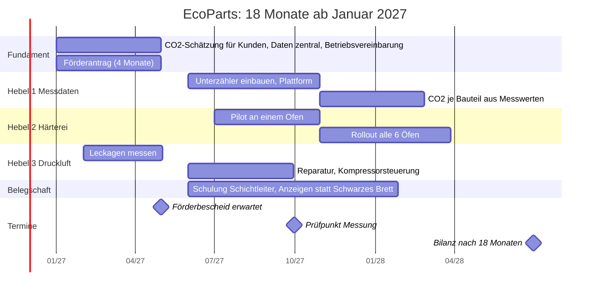

# Tag 2 (Modul 3), Fallstudie: Effizienz und Nachhaltigkeit bei der EcoParts GmbH

> [!NOTE]
> | Teil | Inhalt | Springen |
> |:---:|---|:---:|
> | **A** | **Mattis Lösung**: Fakten, Rechnungen, leere Raster | [→ Teil A](#teil-a-mattis-lösung) |
> | **B** | **Lösungsentwurf** (KI): zum Vergleichen, *nach* dem eigenen Entwurf lesen | [→ Teil B](#teil-b-lösungsentwurf) |

**Aufgabe:** (1) **drei Hebel** für Effizienz und Nachhaltigkeit identifizieren, (2) nach **Wirkung und Umsetzbarkeit** bewerten, (3) eine **priorisierte Transformationsstrategie** entwickeln. Rahmen: 1 Mio. €, 18 Monate, Betriebsrat beteiligen.

---

# Teil A: Mattis Lösung

## Schritt 0 · Daten, Zahlen, Fakten aus dem Aufgabenblatt

### Das Unternehmen

| Thema | Angabe |
|---|---|
| Firma | Zulieferer von Metall- und Kunststoffteilen, 520 Mitarbeitende |
| Energie | Härterei, Spritzguss, Druckluft verbrauchen 70 % des Stroms, Energiekosten 4,2 Mio. € pro Jahr |
| Strompreis | 0,21 €/kWh, Lastspitzen kosten zusätzlich ca. 310.000 € Leistungspreis pro Jahr |
| Kunden | drei Großkunden mit 41 % des Umsatzes verlangen CO₂-Werte je Bauteil (ab nächstem Jahr quartalsweise) und Reduktionsziele, sonst droht Auslistung. Ein Großkunde hat im Frühjahr einen Wettbewerber ausgelistet |
| Personal | 18 Schichtleiter und Meister (Ø 52 Jahre), 1 Energiebeauftragter in Teilzeit, 1 IT-Fachkraft je Werk. Steuerung nach Erfahrung, Kennzahlen am Schwarzen Brett |
| Betriebsrat | unterstützt Energiesparen, lehnt Leistungsdaten einzelner Beschäftigter ab |
| Sonstiges | neue Kantine, Sponsoring Handballverein |

### Verbraucher

| Verbraucher | Anteil am Strom | Besonderheit |
|---|---:|---|
| Härterei (6 Öfen) | 38 % | laufen rund um die Uhr, am Wochenende auf Temperatur gehalten |
| Spritzguss (24 Maschinen) | 18 % | |
| Druckluft (3 Kompressoren) | 14 % | Leckagen nie gemessen |

### Datenquellen

| Quelle | Inhalt | Zustand |
|---|---|---|
| Maschinensteuerungen | Temperatur, Druck, Laufzeit, Stückzahl | lokal, nur 30 Tage |
| Energiezähler | Stromverbrauch gesamt | nur ein Hauptzähler je Werk |
| ERP | Aufträge, Material, Ausschuss | Ausschussgrund oft „Sonstiges“ |
| Schichtbücher | Störungen, Rüstzeiten | handschriftlich |

### Rahmen und Angebote

| Thema | Angabe |
|---|---|
| Budget, Zeit | 1 Mio. €, 18 Monate |
| Erwartung | Energiekosten deutlich senken, CO₂-Daten liefern, Belegschaft mitnehmen |
| Messtechnik | 40 Unterzähler an den Großverbrauchern inklusive Einbau: 150.000 € |
| Förderung | Bundesprogramm übernimmt bis zu 40 % von Effizienz-Investitionen, Antrag dauert ca. 4 Monate |

> [!NOTE]
> **Daraus ergeben sich (reine Rechnung, keine Bewertung)**
>
> | Größe | Rechnung | Ergebnis |
> |---|---|---:|
> | Anteile der drei Verbraucher | 38 + 18 + 14 | 70 % |
> | Kosten je Verbraucher *(Annahme: die 4,2 Mio. € sind Strom einschließlich Leistungspreis)* | Härterei 38 %, Spritzguss 18 %, Druckluft 14 % × 4,2 Mio. € | 1.596.000 € / 756.000 € / 588.000 € |
> | Strommenge *(gleiche Annahme)* | (4,2 Mio. € − 310.000 €) / 0,21 €/kWh | ca. 18,5 GWh |
> | CO₂ des Stroms *(Annahme: 0,4 kg CO₂ je kWh)* | 18,5 GWh × 0,4 | ca. 7.400 t pro Jahr |
> | Anteil Leistungspreis | 310.000 € / 4,2 Mio. € | 7,4 % |
> | Wert von 1 % Einsparung | 1 % × 4,2 Mio. € | 42.000 € |
> | Anteil der Wochenendzeit | 2 Tage / 7 Tage | 28,6 % der Zeit (Öfen halten Temperatur) |
> | Preis je Unterzähler | 150.000 € / 40 | 3.750 € |
> | Förderung auf die Zähler | 40 % × 150.000 € | bis 60.000 € (Nettopreis 90.000 €) |
> | Zählbare Großverbraucher | 6 Öfen + 24 Spritzguss + 3 Kompressoren | 33 (bei 40 Zählern) |
> | Budget je Monat | 1 Mio. € / 18 | ca. 55.600 € |

## Schritt 1 · Bewertungsraster

| Hebel | Wirkung (1–5) | Umsetzbarkeit (1–5) | Kosten | Begründung |
|:---|:---:|:---:|:---:|:---|
| **Hebel 1** | | | | <br><br><br> |
| **Hebel 2** | | | | <br><br><br> |
| **Hebel 3** | | | | <br><br><br> |

## Schritt 2 · Transformationsstrategie

| Phase | Zeitraum | Was passiert | Budget | Prüfpunkt |
|:---|:---:|:---|---:|:---|
| 1 | | <br><br> | | |
| 2 | | <br><br> | | |
| 3 | | <br><br> | | |

## Schritt 3 · Belegschaft, Betriebsrat, Risiken

| Thema | Mein Vorgehen |
|:---|:---|
| Betriebsrat | <br><br> |
| Schichtleiter | <br><br> |
| Größtes Risiko | <br><br> |

---

# Teil B: Lösungsentwurf

> [!IMPORTANT]
> **Auf einen Blick**
>
> - **Drei Hebel:** (1) **Messdaten und CO₂-Bilanz** (Unterzähler, zentrale Maschinendaten), (2) **Härterei**: Wochenend- und Lastfahrweise, (3) **Druckluft**: Leckagen und Kompressorsteuerung.
> - **Reihenfolge:** Hebel 1 ist **Voraussetzung** für die Kundendaten und beweist die Einsparungen der anderen. Hebel 3 ist der schnelle Erfolg, Hebel 2 bringt das meiste Geld.
> - **Wirkung:** ca. **292.000 € pro Jahr** (7 % der Energiekosten), davon 222.000 € aus der Härterei. Investition **830.000 € von 1 Mio. €**, Reserve 170.000 €. Förderung (bis 240.000 €) ist **nicht eingeplant**.
> - **Kunden:** Der erste Quartalswert kommt als **Schätzung** aus Hauptzähler und Laufzeiten, gemessene Werte folgen ab dem Einbau der Zähler.
> - **Belegschaft:** Daten nur je **Anlage**, nie je Person. Das ist die Bedingung des Betriebsrats und zugleich der Grund, dass Schichtleiter die Zahlen nutzen.

> [!NOTE]
> **Annahmen**, die nicht auf dem Blatt stehen: alle Kosten außer den 150.000 € für die Zähler sind meine Schätzung (Plattform 150.000 €, Härterei 350.000 €, Druckluft 100.000 €, Schulung und Anzeigen 80.000 €). Die Einsparungen sind Annahmen: 10 % in der Härterei (Wochenendabsenkung, Chargenplanung), 20 % weniger Leistungspreis, 12 % in der Druckluft (Leckagen). Ob die Messtechnik und die Maßnahmen gefördert werden, ist offen, und manche Programme verbieten einen Start vor dem Bescheid. Das ist **vorab zu klären**. Der Emissionsfaktor von 0,4 kg/kWh ist ein grober Wert.

## Schritt 1 · Bewertungsraster

| Hebel | Wirkung (1–5) | Umsetzbarkeit (1–5) | Kosten | Begründung |
|:---|:---:|:---:|---:|:---|
| **1 Messdaten und CO₂-Bilanz**<br>40 Unterzähler, Maschinendaten zentral und länger als 30 Tage speichern, Ausschussgründe pflegen, CO₂ je Bauteil | **4** | **4** | 300.000 € | Spart selbst nichts, ist aber **Voraussetzung**: ohne CO₂-Werte droht die Auslistung bei 41 % des Umsatzes. Zeigt, wo die Energie bleibt |
| **2 Härterei-Fahrweise**<br>Wochenende absenken, Chargen bündeln, Lastspitzen glätten | **5** | **3** | 350.000 € | Größter Verbraucher (38 %, 1,6 Mio. €). Ca. 222.000 € pro Jahr. Schwerer, weil Öfen rund um die Uhr laufen und Qualität gesichert sein muss |
| **3 Druckluft**<br>Leckagen orten und beheben, Kompressoren nach Bedarf steuern | **2** | **5** | 100.000 € | Nur 14 % (588.000 €), ca. 71.000 € pro Jahr. Leckagen wurden nie gemessen, das ist ein schneller und sicherer Erfolg |

## Schritt 2 · Transformationsstrategie

| Phase | Zeitraum | Was passiert | Budget | Prüfpunkt |
|:---|:---:|:---|---:|:---|
| **1 Fundament** | Monat 1–4 | CO₂-Schätzung aus Hauptzähler und Laufzeiten für Quartal 1. Maschinendaten zentral sichern. Betriebsvereinbarung. Förderantrag. Leckagen nur messen | 80.000 € | CO₂-Werte beim Kunden, Vereinbarung unterschrieben, Bescheid im Monat 5 |
| **2 Umsetzen** | Monat 5–12 | Zähler einbauen, Druckluft reparieren, Härterei-Fahrweise erst in einem Ofen, dann alle 6. Schichtleiter einbinden | 600.000 € | Monat 9: Zähler laufen, erste gemessene Einsparung in Härterei oder Druckluft |
| **3 Ausbau** | Monat 13–18 | Rollout, Spritzguss-Standby aus den Zählerdaten, Quartalsberichte aus Messwerten | 150.000 € | Monat 18: Einsparung gegen Vorjahr gemessen, Entscheidung Verstetigung |



*Zeiträume sind meine Planung ab einem angenommenen Start am 1. Januar 2027.*

**Budget:** 80.000 + 600.000 + 150.000 = 830.000 €, **170.000 € bleiben** als Reserve für Verzug, ohne Förderung. Mit Förderung (bis 240.000 € auf 600.000 € förderfähige Kosten) sinkt der Nettoeinsatz auf ca. 590.000 €.

**Wirkung:** ca. 292.000 € pro Jahr. Amortisation von Härterei und Druckluft allein in ca. 1,5 Jahren, des gesamten Pakets in ca. 2,8 Jahren (ca. 2,0 mit voller Förderung). Innerhalb der 18 Monate fallen nur etwa 240.000 € an, wenn die Wirkung ab Monat 9 einsetzt.

> [!NOTE]
> Das Ziel „Energiekosten deutlich senken“ wird mit ca. 7 % **nur teilweise** erreicht. Weitere Potenziale (Spritzguss 756.000 €, Beschaffung des Stroms) liegen nach dem Einbau der Zähler offen und sind der Grund für die Reserve.

## Schritt 3 · Belegschaft, Betriebsrat, Risiken

| Thema | Vorgehen |
|:---|:---|
| **Betriebsrat** | von Anfang an beteiligen. Betriebsvereinbarung: Messdaten nur **je Anlage und Schicht-Ebene aggregiert, nie je Person**. Löschfristen für die Rohdaten. Das erfüllt die Bedingung des Betriebsrats |
| **Schichtleiter** | Erfahrung bleibt die Grundlage, die Zahlen prüfen sie. Anzeigen an den Anlagen statt am Schwarzen Brett, Schulung im Lesen der Kennzahlen (Lesen, Verstehen, Hinterfragen). Ein Ofen als Pilot, die Schichtleiter bewerten die Absenkung selbst |
| **Risiko Förderung** | manche Programme schließen einen Start vor dem Bescheid aus. Vorab klären, sonst Monat 5 abwarten und Phase 2 verschiebt sich |
| **Risiko Qualität** | Absenkung am Wochenende darf Härteergebnis nicht verschlechtern. Pilot mit Prüfung vor dem Rollout |
| **Risiko Kundenfrist** | die Quartalswerte beginnen vor den Zählern. Schätzung zuerst, Messwerte später, Methode offen dokumentieren |
| **Nicht verfolgt** | Kantine, Handballverein: für die Energiebilanz ohne Bedeutung |

## Python-Check

```python
# python3 -I check.py
e, lp = 4.2e6, 0.31e6
kwh = (e - lp) / 0.21
print(kwh, kwh * 0.4 / 1000)                       # 18,5 GWh, 7.400 t
haert, spritz, druck = 0.38 * e, 0.18 * e, 0.14 * e
print(haert, spritz, druck, haert + spritz + druck, lp / e, 150_000 / 40)

s3 = 0.12 * druck                                  # Druckluft
s2 = 0.10 * haert + 0.20 * lp                      # Härterei plus Leistungspreis
print(s3, s2, s3 + s2, (s3 + s2) / e)

inv = 300_000 + 350_000 + 100_000 + 80_000         # 830.000 €
print(inv, 1e6 - inv, 0.4 * 600_000)
print((350_000 + 100_000) / (s2 + s3), inv / (s2 + s3), (inv - 240_000) / (s2 + s3))
```

Ergebnis: 18,5 GWh (ca. 7.400 t CO₂), Kosten 1.596.000 / 756.000 / 588.000 €, Einsparung 70.560 € (Druckluft) und 221.600 € (Härterei), zusammen 292.160 € = 7,0 %. Investition 830.000 €, Reserve 170.000 €, Förderung bis 240.000 €, Amortisation 1,5 / 2,8 / 2,0 Jahre.
