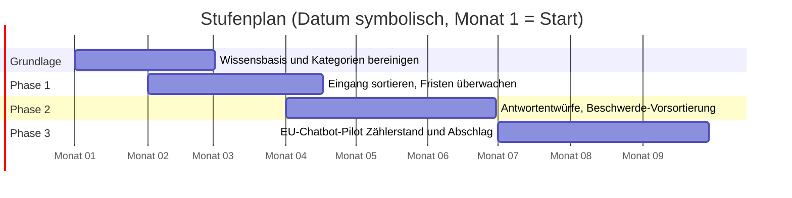

# Tag 4 (Modul 3), Fallstudie: KI im Kundenservice der ServicePlus GmbH

> [!NOTE]
> | Teil | Inhalt | Springen |
> |:---:|---|:---:|
> | **A** | **Mattis Lösung**: Fakten, Rechnungen, leere Raster | [→ Teil A](#teil-a-mattis-lösung) |
> | **B** | **Lösungsentwurf** (KI): zum Vergleichen, *nach* dem eigenen Entwurf lesen | [→ Teil B](#teil-b-lösungsentwurf) |

**Aufgabe:** (1) Geeignete **KI-Einsatzbereiche** identifizieren, (2) **Risiken** bewerten (z. B. falsche Antworten), (3) eine **priorisierte Implementierungsstrategie** entwickeln.

---

# Teil A: Mattis Lösung

## Schritt 0 · Daten, Zahlen, Fakten aus dem Aufgabenblatt

### Das Unternehmen

| Thema | Angabe |
|---|---|
| Firma | ServicePlus GmbH, Kundenservice-Dienstleister für Energieversorger und Telekommunikation |
| Menge | ca. 38.000 Anfragen pro Monat, per E-Mail, Kontaktformular, Telefon |
| Probleme | Bearbeitungszeit Ø 2,5 Tage, Kundenzufriedenheit sinkt, Personalkosten 3,4 Mio. € pro Jahr |
| Daten | E-Mails und Gesprächsnotizen als Freitext, Kategorien von Hand und uneinheitlich |
| Rahmen | Budget 500.000 €, ein Auftraggeber droht mit Kündigung |

### Anfragen nach Anliegen (Stichprobe: 1.000)

| Zählerstand | Abschlag ändern | Rechnung unklar | Umzug | Beschwerde | Sonstiges |
|---:|---:|---:|---:|---:|---:|
| 27 % | 22 % | 19 % | 14 % | 11 % | 7 % |

### Der Service im Detail

| Thema | Angabe |
|---|---|
| Kanäle | E-Mail 45 %, Kontaktformular 25 %, Telefon 30 % (nur Mo–Fr 8–18 Uhr) |
| Bearbeitung | Eine Beschwerde dauert etwa **8×** so lange wie ein Zählerstand. 24-Stunden-Ziel heute nur bei 31 % erreicht |
| Personal | 65 Servicekräfte auf 52 Vollzeitstellen, Fluktuation 24 % pro Jahr, Einarbeitung 3 Monate |
| Systeme | Ticketsystem seit 2021 mit ca. 1,1 Mio. Anfragen, Kategorie bei 35 % „Allgemein“ |
| Wissen | Antworten in 140 Word-Dokumenten, teils veraltet und widersprüchlich |

### Was sie außerdem erfahren

| Thema | Angabe |
|---|---|
| Auftraggeber | Energieversorger: 70 % der Anfragen, **droht mit Kündigung**. Telekom-Anbieter: 30 %, zufrieden |
| Vertragsstrafe | Ab dem 3. Quartal kostet jede Anfrage **über 48 Stunden 4 €** |
| Anfragen | In ca. 40 % der E-Mails stehen Kunden- und Zählernummer im Betreff |
| Angebot | Chatbot-Anbieter mit **Servern in den USA**, „in 4 Wochen startklar“ |
| Büro | Mietvertrag verlängert, im Frühjahr wird das 2. Obergeschoss neu gestaltet |

### Was das Team berichtet, was die Auftraggeber erwarten

| Team berichtet | Auftraggeber erwarten |
|---|---|
| Viele Anfragen wiederholen sich fast wörtlich | Antwort innerhalb von 24 Stunden |
| Beschwerden werden oft eskaliert | Keine falschen Auskünfte zu Verträgen |
| Das Team fürchtet um Arbeitsplätze | Datenschutz wird eingehalten |

> [!NOTE]
> **Daraus ergeben sich (reine Rechnung, keine Bewertung)**
>
> | Größe | Rechnung | Ergebnis |
> |---|---|---:|
> | Anfragen je Monat nach Anliegen | 38.000 × 27 / 22 / 19 / 14 / 11 / 7 % | 10.260 / 8.360 / 7.220 / 5.320 / 4.180 / 2.660 |
> | Zählerstand plus Abschlag | 27 % + 22 % | 49 % = 18.620 je Monat |
> | Anfragen je Kanal je Monat | 38.000 × 45 / 25 / 30 % | 17.100 / 9.500 / 11.400 |
> | Schriftlich (E-Mail plus Formular) | 45 % + 25 % | 70 % = 26.600 je Monat |
> | Kosten je Anfrage | 3,4 Mio. € / (38.000 × 12) | 7,46 € |
> | Kosten je Vollzeitstelle | 3,4 Mio. € / 52 | 65.385 € |
> | Köpfe je Vollzeitstelle | 65 / 52 | 1,25 |
> | Anteil Beschwerden an der Arbeitszeit *(Annahme: alle anderen Anliegen so aufwendig wie Zählerstand)* | 11 × 8 = 88 von (89 + 88) = 177 | 49,7 % der Zeit bei 11 % der Anfragen |
> | 24-Stunden-Ziel verfehlt | 38.000 × 69 % | 26.220 Anfragen je Monat |
> | Vertragsstrafe je Monat *(Annahme: Anteil über 48 Std. 10 % / 30 % / 50 %, gilt für alle Anfragen)* | 3.800 / 11.400 / 19.000 × 4 € | 15.200 € / 45.600 € / 76.000 € |
> | Vertragsstrafe je Jahr, gleiche Anteile | × 12 | 182.400 € / 547.200 € / 912.000 € |
> | Fluktuation | 65 × 24 % | 15,6 Personen je Jahr |
> | Einarbeitung *(Annahme: 3 Monate voll unproduktiv)* | 15,6 × 0,25 Jahre × 65.385 € | ca. 255.000 € je Jahr |
> | Tickets mit „Allgemein“ / mit Kategorie | 1,1 Mio. × 35 % / 65 % | 385.000 / 715.000 |
> | E-Mails mit Nummer im Betreff | 38.000 × 45 % × 40 % | 6.840 je Monat (18 % aller Anfragen) |
> | Telefon erreichbar | 50 Std. von 168 Std. je Woche | 30 % der Zeit |
> | Auftraggeber in Anfragen | 38.000 × 70 % / 30 % | 26.600 / 11.400 |
> | Hebel Zählerstand plus Abschlag *(Annahme: gleiche Gewichtung, 80 % automatisch gelöst)* | 49 / 177 × 3,4 Mio. € × 80 % | ca. 753.000 € je Jahr = ca. 11,5 Vollzeitstellen |

## Schritt 1 · Raster der Anliegen

| Anliegen | KI geeignet? | Welches Risiko? | Mensch oder KI? |
|:---|:---|:---|:---|
| **Zählerstand** (27 %, 10.260 je Monat, Aufwand 1) <br><br><br> | <br><br><br> | <br><br><br> | <br><br><br> |
| **Abschlag ändern** (22 %, 8.360 je Monat) <br><br><br> | <br><br><br> | <br><br><br> | <br><br><br> |
| **Rechnung unklar** (19 %, 7.220 je Monat) <br><br><br> | <br><br><br> | <br><br><br> | <br><br><br> |
| **Umzug** (14 %, 5.320 je Monat) <br><br><br> | <br><br><br> | <br><br><br> | <br><br><br> |
| **Beschwerde** (11 %, 4.180 je Monat, Aufwand 8) <br><br><br> | <br><br><br> | <br><br><br> | <br><br><br> |

## Schritt 2 · Risiken

| Risiko | Wie schlimm? | Gegenmittel |
|:---|:---|:---|
| 1 <br><br><br> | <br><br><br> | <br><br><br> |
| 2 <br><br><br> | <br><br><br> | <br><br><br> |
| 3 <br><br><br> | <br><br><br> | <br><br><br> |
| 4 <br><br><br> | <br><br><br> | <br><br><br> |

## Schritt 3 · Implementierungsstrategie

| Phase | Was | Wann | Warum zuerst? |
|:---|:---|:---|:---|
| 1 <br><br><br> | <br><br><br> | <br><br><br> | <br><br><br> |
| 2 <br><br><br> | <br><br><br> | <br><br><br> | <br><br><br> |
| 3 <br><br><br> | <br><br><br> | <br><br><br> | <br><br><br> |

---

# Teil B: Lösungsentwurf

> [!IMPORTANT]
> **Auf einen Blick**
>
> - **Hauptbefund:** Zählerstand und Abschlag sind 49 % der Anfragen (18.620 je Monat), regelnah und strukturiert: der größte und sicherste Hebel (Potenzial ca. 750.000 € je Jahr, unter Annahmen). **Beschwerden** sind 11 % der Anfragen, aber fast **die Hälfte der Arbeitszeit** und gehören zum Menschen.
> - **Zuerst die Daten, dann die KI:** 35 % „Allgemein“, 140 widersprüchliche Word-Dokumente, Freitext. Ohne geprüfte Wissensbasis und saubere Kategorien produziert KI überzeugende Fehler.
> - **Erste Stufe ist Sortieren, nicht Antworten:** KI ordnet ein, erkennt Nummern, sortiert nach Frist und schlägt Antworten vor. **Ein Mensch gibt frei.** Das senkt das Risiko falscher Auskünfte zu Verträgen.
> - **Chatbot aus den USA ablehnen:** Der Anbieter verspricht „4 Wochen“, aber Energie- und Vertragsdaten in einer US-Cloud passen nicht zur Auftraggeber-Erwartung „Datenschutz“. Chatbot frühestens als EU-Pilot für Zählerstand und Abschlag.
> - **Zeitdruck:** Die Vertragsstrafe ab dem 3. Quartal (4 € je Anfrage über 48 Std.) kann je nach Anteil 180.000 € bis 910.000 € je Jahr kosten. Frist-Überwachung ist daher **Phase 1**.
> - **Team mitnehmen:** KI entlastet bei Wiederholungen (Zählerstand), Beschwerden bleiben menschlich. 24 % Fluktuation: ein Wissensassistent verkürzt die 3-monatige Einarbeitung.

> [!NOTE]
> Alle Rechnungen stehen in Teil A und im Python-Check. Die Aufgabe nennt **keine Preise** für Lösungen: Die Budgetaufteilung unten ist ein **Vorschlag**, keine Kalkulation. Weitere Annahmen: gleicher Aufwand für alle Anliegen außer Beschwerde (Faktor 8), Anteil über 48 Std. (10 / 30 / 50 %), 80 % automatische Lösung bei Zählerstand und Abschlag.

## Schritt 1 · Raster der Anliegen

| Anliegen | KI geeignet? | Welches Risiko? | Mensch oder KI? |
|:---|:---|:---|:---|
| **Zählerstand** (27 %) | **ja, aber meist klassisch:** Zahl erfassen, Plausibilität prüfen. KI nur zum Lesen von Freitext oder Foto | **gering:** falscher Stand wird erkannt (Vergleich mit Vorjahr), leicht zu korrigieren | **automatisch**, Stichprobe |
| **Abschlag ändern** (22 %) | **ja:** klare Regeln (Mindest- und Höchstbetrag), KI liest den Wunsch aus dem Text | **mittel:** falsche Zusage zu Beträgen und Verträgen, Geldwirkung | **automatisch mit Regeln**, Ausnahmen an Mensch, Bestätigung im System statt Freitext-Zusage |
| **Rechnung unklar** (19 %) | **teilweise:** KI fasst Rechnung und Frage zusammen, schlägt Antwort vor | **hoch:** Beträge, Verträge, Rechtsfolgen. Falsche Auskunft ist teuer | **KI entwirft, Mensch gibt frei** |
| **Umzug** (14 %) | **teilweise:** Daten aus Formular und Text holen, Checkliste prüfen | **mittel:** falsche Zuordnung, Doppelverträge, Fristen | **KI bereitet vor, Mensch bearbeitet** (später Teilautomatisierung bei Standardfällen) |
| **Beschwerde** (11 %) | **nur als Hilfe:** erkennen, zusammenfassen, Stimmung und Dringlichkeit, Entwurf | **sehr hoch:** Kündigungsrisiko, Ton, Eskalation, Vertragsstrafe. Bot ohne Empathie verschlimmert | **Mensch**, KI nur Vorsortierung (Folie „Beim Menschen lassen“) |

*Sonstiges (7 %):* KI-Entwurf möglich, Mensch prüft.

## Schritt 2 · Risiken

| Risiko | Wie schlimm? | Gegenmittel |
|:---|:---|:---|
| **Falsche Auskünfte zu Verträgen** (Erwartung der Auftraggeber) | hoch: Haftung, Vertrauensverlust bei beiden Auftraggebern | Antworten nur aus geprüfter Wissensbasis, keine freien Zusagen, Mensch gibt bei Geld und Vertrag frei |
| **Datenschutz** (US-Chatbot, Energiedaten, Gesprächsnotizen) | hoch: Verstoß, Auftraggeber verlieren Vertrauen | EU-Hosting, Auftragsverarbeitung prüfen, personenbezogene Daten maskieren, keine Daten in frei zugängliche Tools |
| **Schlechte Datenbasis:** 35 % „Allgemein“, 140 Word-Dokumente widersprüchlich | hoch, unsichtbar: KI lernt die Fehler der Vergangenheit | Wissensbasis bereinigen, Kategorien neu definieren, Stichprobe prüfen |
| **Akzeptanz:** Team fürchtet um Arbeitsplätze | mittel bis hoch: Widerstand, Fluktuation steigt (schon 24 %) | früh einbinden, Ziel „weniger Wiederholung“ statt „weniger Stellen“, Betriebsrat beteiligen |
| **Zeitdruck** (Vertragsstrafe, Kündigung) | hoch: Übereilter Start mit unreifer Lösung | Stufenplan, Frist-Überwachung zuerst, nicht alles auf einmal |
| **Erfolg nicht gemessen** | mittel: Nutzen unbelegt | Kennzahlen: Anteil Antworten in 24 Std. (heute 31 %), Anteil über 48 Std., Korrekturquote bei Entwürfen |
| **Übergangsrisiko:** Parallelbetrieb belastet das Team zusätzlich | mittel | Pilot mit einer Gruppe, schrittweise |

## Schritt 3 · Implementierungsstrategie



| Phase | Was | Wann | Budgetrahmen *(Vorschlag)* | Warum zuerst? |
|:---|:---|:---|---:|:---|
| **0 Grundlage** | 140 Dokumente zu einer geprüften Wissensbasis, Kategorien neu, 385.000 „Allgemein“-Tickets per KI und Stichprobe neu zuordnen | Monat 1 bis 2 | 90.000 € | Alles andere baut darauf auf |
| **1 Sortieren und Fristen** | KI erkennt Anliegen, zieht Kunden- und Zählernummer (auch aus dem Betreff), sortiert nach Frist, Warnung vor 48 Std., automatische Eingangsbestätigung. Zählerstand und Abschlag mit festen Regeln | Monat 2 bis 4 | 130.000 € | Senkt Vertragsstrafe, kein Kundenkontakt durch KI, schnell sichtbarer Erfolg |
| **2 Antwortentwürfe** | KI schlägt Antworten für Rechnung, Umzug, Sonstiges vor, Mensch gibt frei. Beschwerden: Zusammenfassung, Stimmung, Dringlichkeit. Wissensassistent für neue Kräfte | Monat 4 bis 7 | 140.000 € | Entlastet das Team, Qualität bleibt bei Menschen, verkürzt Einarbeitung |
| **3 Chatbot-Pilot** | EU-Hosting, nur Zählerstand und Abschlag, Übergabe an Mensch, rund um die Uhr, Stichprobenkontrolle | ab Monat 7, nach Auswertung | 100.000 € | Erst nach bewiesenem Nutzen und sauberen Daten |
| **Reserve** | Nachsteuern, Datenschutz, Schulung | – | 40.000 € | Summe 500.000 € |

- **Entscheidungskriterien nach Phase:** Antwortquote in 24 Std. steigt (heute 31 %), Korrekturquote der Entwürfe sinkt, Team nimmt es an. Erst dann nächste Stufe.
- **Leitplanken (Folie 38):** Mensch entscheidet bei Folgen für Kunden, keine vertraulichen Daten in frei zugängliche Tools, Kunden erfahren, wenn sie mit KI schreiben, Stichproben.
- **Nicht jetzt:** Chatbot aus den USA, Beschwerden automatisieren, Telefon voll automatisieren. Telefon (30 %) nur über Mitschrift und Zusammenfassung.
- **Büro-Umbau und Mietvertrag** haben keinen Bezug zur Aufgabe.

## Schritt 4 · Gesamtbild

- **Nach den Folien:** Klassisch automatisieren (Zählerstand, Fristen), KI-Unterstützung (Text lesen, sortieren, entwerfen), Mensch (Beschwerde, Freigabe). Stufen: Assistenz, dann Teilautomatisierung, Vollautomatisierung nur bei Zählerstand.
- **Harmlos oder teuer:** Eine falsche Auskunft zum Zählerstand ist leicht korrigierbar, bei Abschlag, Rechnung und Vertrag kostet sie Geld und Vertrauen, bei Beschwerden einen Auftraggeber.
- **Freitext vorbereiten:** Kategorien vereinheitlichen, Nummern extrahieren, personenbezogene Daten maskieren, Wissensbasis bereinigen.
- **Schnell Vertrauen:** Mit Frist-Überwachung und Sortierung starten. Das ist für Auftraggeber sichtbar (weniger Fristüberschreitungen) und für das Team entlastend.

## Python-Check

```python
# python3 -I check.py
v = 38000
anteil = [27, 22, 19, 14, 11, 7]
print([v * a / 100 for a in anteil])                   # 10260 ... 2660
print(3.4e6 / (v * 12), 3.4e6 / 52)                    # 7,46 EUR; 65385 EUR

gew = [1, 1, 1, 1, 8, 1]                               # Annahme: Beschwerde 8x
tot = sum(a * g for a, g in zip(anteil, gew))
print(tot, anteil[4] * 8 / tot)                        # 177; 0,497
e = (27 + 22) / tot
print(e * 3.4e6 * 0.8, e * 0.8 * 52)                   # 753.000 EUR; 11,5 VZ

for q in (.1, .3, .5):                                 # Anteil über 48 Std.
    print(q, v * q * 4, v * q * 4 * 12)                # 15,2 / 45,6 / 76 Tsd.; 182 / 547 / 912 Tsd.

print(65 * .24, 65 * .24 * .25 * 3.4e6 / 52)           # 15,6; 255000 EUR
print(1.1e6 * .35, v * .45 * .4, 50 / 168)             # 385000; 6840; 0,30
print(90 + 130 + 140 + 100 + 40)                       # 500 Tsd. EUR
```

Ergebnis: 7,46 € je Anfrage, Beschwerden ca. 50 % der Arbeitszeit bei 11 % der Anfragen. Zählerstand plus Abschlag: 18.620 Anfragen je Monat, Potenzial ca. 753.000 € je Jahr (ca. 11,5 Vollzeitstellen, unter Annahmen). Vertragsstrafe 182.000 € bis 912.000 € je Jahr. Einarbeitung ca. 255.000 € je Jahr. Budgetvorschlag 500.000 €.
