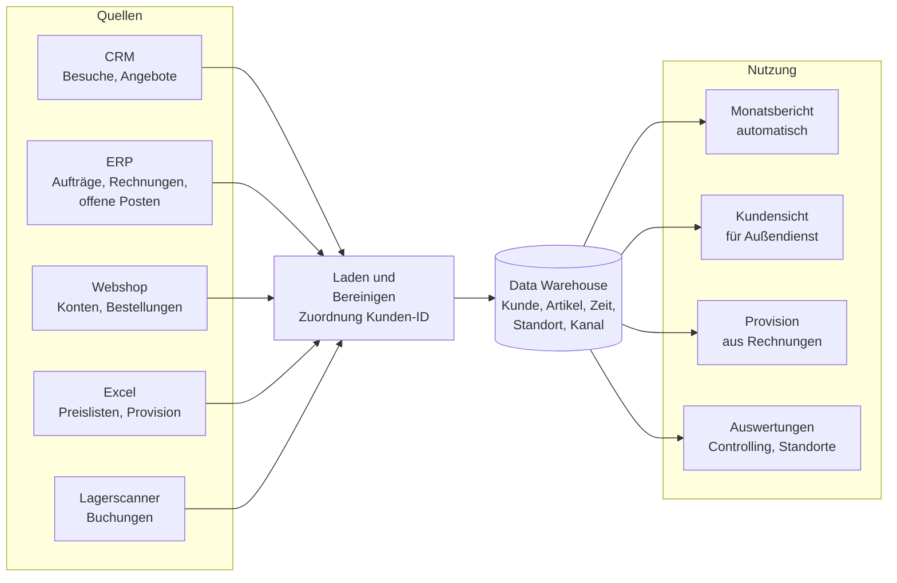

# Tag 7 (Modul 3), Arbeitsauftrag 1: Getrennte Daten bei Brandl Haustechnik

> [!NOTE]
> | Teil | Inhalt | Springen |
> |:---:|---|:---:|
> | **A** | **Mattis Lösung**: Fakten, Rechnungen, leere Raster | [→ Teil A](#teil-a-mattis-lösung) |
> | **B** | **Lösungsentwurf** (KI): zum Vergleichen, *nach* dem eigenen Entwurf lesen | [→ Teil B](#teil-b-lösungsentwurf) |

**Aufgabe:** (1) **Wo entstehen bei Brandl Daten?** (2) **Welche Probleme entstehen**, weil sie getrennt sind? (3) **Wie könnte ein zentraler Datenzugang aussehen?** Dazu das Raster System / Daten / Wer braucht sie noch / Was geht heute verloren.

---

# Teil A: Mattis Lösung

## Schritt 0 · Daten, Zahlen, Fakten aus dem Aufgabenblatt

### Das Unternehmen

| Thema | Angabe |
|---|---|
| Firma | Brandl Haustechnik GmbH, Großhandel für Heizung und Sanitär, 260 Mitarbeitende, 9 Standorte, Webshop für Handwerker |
| Umsatz | 118 Mio. € im Jahr. Zahlungsausfälle 2025: 640.000 € |
| Bericht | Der Monatsbericht liegt am 12. Arbeitstag des Folgemonats vor |
| Provision | Wird aus der Excel-Datei des Controllings berechnet, nicht aus dem ERP |
| Sonstiges | Standort Passau zieht 2027 in ein neues Gebäude. 45 eigene Lkw. Sponsoring des örtlichen Handballvereins |

### Die Systeme

| System | Umfang | Wer pflegt es? | Kundennummer |
|---|---|---|---|
| **CRM** (seit 2019) | 7.800 Kunden, 14 Außendienstler. Kunden, Besuche, Angebote, "jeder etwas anders" | Außendienst | eigene CRM-Nummer |
| **ERP** (seit 2008) | 9.100 Kunden, 38.000 Artikel. Aufträge, Lager, Rechnungen, offene Posten. **Nur Innendienst und Buchhaltung haben Zugriff** | Innendienst, Buchhaltung | ERP-Nummer |
| **Webshop** | 3.400 Handwerker-Konten, 35 % des Umsatzes. Eigene Kundendatenbank, Bestellungen werden **einmal täglich** ins ERP übertragen | Marketing | E-Mail-Adresse |
| **Excel-Laufwerk** | 43 Dateien, 11 davon heißen "…_final". Preislisten, Projektlisten, Provisionen, Monatsbericht | Controlling, Standorte | mal Name, mal ERP-Nummer |
| **Lagerscanner** (neu) | ca. 6.000 Buchungen pro Tag | Lager | **keine**, nur Artikel |

### Szenen aus dem Alltag

1. Für den Monatsbericht kopiert das Controlling **drei Tage lang** Zahlen zusammen.
2. Die Firma "Heizung Müller" steht im CRM, im ERP und im Webshop **jeweils anders**.
3. Ein Außendienstler besucht einen Kunden, der seit Monaten nicht zahlt, **er wusste es nicht**.
4. Zwei Standortleiter streiten über den Umsatz, beide haben "ihre" Excel-Datei.
5. Niemand kann sagen, wie viel ein Kunde über **alle Kanäle** insgesamt kauft.

> [!NOTE]
> **Daraus ergeben sich (reine Rechnung, keine Bewertung)**
>
> | Größe | Rechnung | Ergebnis |
> |---|---|---:|
> | Umsatz über den Webshop | 118 Mio. € × 35 % | 41,3 Mio. € |
> | Umsatz außerhalb des Webshops | 118 Mio. € − 41,3 Mio. € | 76,7 Mio. € |
> | Zahlungsausfälle im Verhältnis zum Umsatz | 640.000 € / 118 Mio. € | 0,54 % |
> | Wert von 10 % vermeidbarer Ausfälle | 640.000 € × 10 % | 64.000 € |
> | Kunden-Datensätze in allen drei Systemen zusammen | 7.800 + 9.100 + 3.400 | 20.300 |
> | Kunden: mindestens (wenn alles im größten System steckt) | größter Wert: ERP | 9.100 |
> | Kunden: höchstens (wenn sich nichts überschneidet) | Summe der Datensätze | 20.300 |
> | Unterschied CRM zu ERP | 9.100 − 7.800 | 1.300 |
> | Kunden je Außendienstler | 7.800 / 14 | 557 |
> | Dateien mit "_final" im Namen | 11 / 43 | 25,6 % |
> | Excel-Dateien ohne "_final" | 43 − 11 | 32 |
> | Lagerbuchungen pro Jahr (365 Tage, Annahme) | 6.000 × 365 | 2,19 Mio. |
> | Monatsbericht: Zeit nach Monatsende | 12. Arbeitstag | rund 16 bis 18 Kalendertage |
> | Berichte pro Jahr mit 3 Tagen Kopierarbeit (Annahme: eine Person) | 3 Tage × 12 Monate | 36 Arbeitstage |

## Schritt 1 · Ergebnisraster

| System | Welche Daten? | Wer braucht sie noch? | Was geht heute verloren? |
|:---|:---|:---|:---|
| **CRM** <br><br><br> | <br><br><br> | <br><br><br> | <br><br><br> |
| **ERP** <br><br><br> | <br><br><br> | <br><br><br> | <br><br><br> |
| **Excel** <br><br><br> | <br><br><br> | <br><br><br> | <br><br><br> |
| **Webshop** <br><br><br> | <br><br><br> | <br><br><br> | <br><br><br> |
| **Lagerscanner** (zusätzlich) <br><br><br> | <br><br><br> | <br><br><br> | <br><br><br> |

## Schritt 2 · Probleme durch getrennte Daten

| Szene | Welches Problem? | Woran liegt es? | Was würde helfen? |
|:---|:---|:---|:---|
| **Monatsbericht, drei Tage kopieren** <br><br><br> | <br><br><br> | <br><br><br> | <br><br><br> |
| **"Heizung Müller", dreimal anders** <br><br><br> | <br><br><br> | <br><br><br> | <br><br><br> |
| **Außendienst besucht Nichtzahler** <br><br><br> | <br><br><br> | <br><br><br> | <br><br><br> |
| **Zwei Standortleiter, zwei Excel-Dateien** <br><br><br> | <br><br><br> | <br><br><br> | <br><br><br> |
| **Gesamtkauf eines Kunden über alle Kanäle** <br><br><br> | <br><br><br> | <br><br><br> | <br><br><br> |
| **Provision aus Excel statt ERP** <br><br><br> | <br><br><br> | <br><br><br> | <br><br><br> |

## Schritt 3 · Zentraler Datenzugang

### Skizze (Quellen, Weg, Ziel, Nutzer)

<br><br><br><br><br><br><br><br>

| Frage | Meine Antwort |
|:---|:---|
| **Wo liegen die Daten künftig?** <br><br><br> | <br><br><br> |
| **Wie erkennt man denselben Kunden?** <br><br><br> | <br><br><br> |
| **Wer darf was sehen?** <br><br><br> | <br><br><br> |
| **Was wird zuerst verbunden?** <br><br><br> | <br><br><br> |
| **Was kostet Brandl am meisten?** <br><br><br> | <br><br><br> |

---

# Teil B: Lösungsentwurf

> [!IMPORTANT]
> **Auf einen Blick**
>
> - **Das Problem ist nicht die Menge, sondern die Trennung.** 9.100 Kunden und 6.000 Lagerbuchungen pro Tag sind für eine normale Datenbank keine Last. "Big Data" im Sinne der Folien (Excel oder ein Server reichen nicht mehr) ist das nicht. Es fehlt **Integration**: drei Systeme mit **drei verschiedenen Kundenschlüsseln** (CRM-Nummer, ERP-Nummer, E-Mail), Excel nimmt mal den Namen, mal die ERP-Nummer, der Lagerscanner hat gar keinen.
> - **Daten entstehen an fünf Stellen:** CRM (Außendienst), ERP (Innendienst, Buchhaltung), Webshop (35 % des Umsatzes, 41,3 Mio. €), 43 Excel-Dateien (Controlling, Standorte), Lagerscanner (6.000 Buchungen pro Tag, ohne Kundenbezug).
> - **Alle fünf Alltagsszenen** gehen auf zwei Ursachen zurück: **kein gemeinsamer Kundenschlüssel** (Szenen 2, 5) und **Daten liegen dort, wo sie die Nutzer nicht sehen** (Szenen 1, 3, 4, Provision).
> - **Lösung (Vorschlag):** ein **Data Warehouse** als zentrale, bereinigte Sicht. Es sammelt CRM, ERP, Webshop, Excel-Kennzahlen und Lagerdaten, mit **einer Kunden-ID** und einem **Kennzahlen-Glossar** (zum Beispiel: was heißt "Umsatz"). Ein Data Lake ist hier nicht nötig, es gibt keine Texte, Bilder oder Sensordaten.
> - **Zuerst verbinden:** **Kunde** (CRM, ERP, Webshop über eine Zuordnungstabelle), danach **offene Posten aus dem ERP** für den Außendienst (Zahlungsausfälle 640.000 €, pro 10 % Vermeidung 64.000 €), danach der **automatische Monatsbericht**.
> - **Vorsicht:** Alle Wirkungen sind Hypothesen. Das Aufgabenblatt nennt keine Kosten für Projekt, Lizenzen oder Betrieb.

> [!NOTE]
> **Annahmen:** (1) Der Webshop-Umsatz (35 %) ist im Gesamtumsatz von 118 Mio. € enthalten. (2) Die Außendienstler sehen im CRM keinen Zahlungsstatus (Szene 3 legt das nahe). (3) "Drei Tage Kopieren" meint eine Person und jeden Monat. (4) Die Webshop-Bestellungen kommen täglich ins ERP, aber unter welcher Kundennummer, nennt das Blatt nicht. (5) Die Schreibweisen von "Heizung Müller" im Python-Check sind von mir erfunden, das Blatt nennt keine. Alle Rechnungen stehen im Python-Check.

## Schritt 1 · Ergebnisraster

| System | Welche Daten? | Wer braucht sie noch? | Was geht heute verloren? |
|:---|:---|:---|:---|
| **CRM** (Außendienst, seit 2019) | 7.800 Kunden, Besuche, Angebote. **Eigene CRM-Nummer.** Pflege "jeder etwas anders" | **Innendienst** (aus Angebot wird Auftrag), **Controlling** (Angebotsvolumen, Provision), **Marketing** (Webshop-Kunden gezielt ansprechen) | **Zahlungsstand**: der Außendienst sieht keine offenen Posten (Szene 3). **Gesamtumsatz** je Kunde. Uneinheitliche Pflege, Auswertung über alle Außendienstler nur mit Mühe |
| **ERP** (Innendienst, Buchhaltung, seit 2008) | 9.100 Kunden, 38.000 Artikel, Aufträge, Rechnungen, **offene Posten**. ERP-Nummer. **Nur Innendienst und Buchhaltung haben Zugriff** | **Außendienst** (Umsatz, offene Posten), **Controlling** (Berichte, Provision), **Standortleiter**, Geschäftsführung | **Wissen über Zahlungsverzug erreicht den Vertrieb nicht.** Kein Bezug zu Besuchen aus dem CRM. Webshop-Bestellungen kommen mit **einem Tag Verzug** |
| **Excel** (Controlling, Standorte, 43 Dateien) | Preislisten, Projektlisten, **Provisionen**, **Monatsbericht**. 11 Dateien "…_final". Schlüssel mal Name, mal ERP-Nummer | **Vertrieb** (Provision), **Standortleiter**, Geschäftsführung (Bericht) | **Eine gültige Zahl** (Szene 4). **Zeit** (3 Tage Kopieren, Bericht am 12. Arbeitstag). **Nachvollziehbarkeit**: Provision kommt nicht aus dem ERP. **Historie** und welche Datei die richtige ist |
| **Webshop** (Marketing) | 3.400 Handwerker-Konten, **35 % des Umsatzes** (41,3 Mio. €). Eigene Kundendatenbank, Schlüssel **E-Mail**. Tägliche Übertragung ins ERP | **Außendienst** (Webshop-Umsatz seiner Kunden), **Controlling**, **Lager** (Verfügbarkeit), Innendienst | **Kunde über alle Kanäle** (Szene 5): wer im Webshop kauft, taucht im CRM unter anderem Namen auf. **Tagesversatz** zum ERP. Mögliche **Doppelkonten** (eine Firma, mehrere E-Mail-Adressen) |
| **Lagerscanner** (Lager, neu) | 6.000 Buchungen pro Tag, **nur Artikel**, keine Kundennummer | **Einkauf**, **Innendienst** (Lieferfähigkeit), **Controlling** (Bestand) | **Bezug zu Auftrag und Kunde**: ohne Kundennummer lässt sich eine Buchung keinem Auftrag zuordnen. Das ist eine **Hypothese**, das Blatt sagt nicht, ob der Scanner Auftragsnummern führt |

## Schritt 2 · Probleme durch getrennte Daten

| Szene | Welches Problem? | Woran liegt es? | Was würde helfen? |
|:---|:---|:---|:---|
| **Monatsbericht, drei Tage kopieren** | Zeitverlust und **Fehlerrisiko** durch Abtippen. Der Bericht liegt erst am **12. Arbeitstag** (rund 16 bis 18 Kalendertage) vor, Entscheidungen beruhen auf altem Stand | Die Zahlen liegen in ERP, CRM, Webshop und Excel getrennt. Zusammenführen geschieht **von Hand** | **Automatisches Laden** in ein zentrales Warehouse, Bericht als Abfrage statt Kopierarbeit |
| **"Heizung Müller", dreimal anders** | Ein Kunde wirkt wie **drei Kunden**. Umsatz, Besuche und Zahlungen sind getrennt | **Verschiedene Schlüssel**: CRM-Nummer, ERP-Nummer, E-Mail. Dazu verschiedene Schreibweisen | **Zuordnungstabelle** und eine **zentrale Kunden-ID**. Abgleich über Name, Adresse, Steuernummer. Zweifelsfälle prüft ein Mensch |
| **Außendienst besucht Nichtzahler** | Der Außendienst verhandelt über neue Aufträge, **ohne den Zahlungsverzug zu kennen**. Schadensgröße: Zahlungsausfälle 2025 **640.000 €** | **Offene Posten liegen nur im ERP**, und das ERP dürfen nur Innendienst und Buchhaltung sehen | **Lesende Sicht** auf offene Posten für den Außendienst (nur die eigenen Kunden, mit Rechten) |
| **Zwei Standortleiter, zwei Excel-Dateien** | Streit über Zahlen, **Misstrauen** gegen alle Berichte | Jeder hat **seine Kopie**, und "Umsatz" ist **nicht einheitlich definiert** (brutto oder netto, nach Auftrags- oder Rechnungsdatum, mit oder ohne Webshop?). Das ist eine Hypothese | **Eine Quelle**, dazu ein **Kennzahlen-Glossar** (verbindliche Definition von "Umsatz") |
| **Gesamtkauf eines Kunden über alle Kanäle** | **Niemand** kennt den Gesamtumsatz: keine gezielten Angebote, keine Kundenbewertung | CRM, ERP und Webshop haben **keinen gemeinsamen Schlüssel**, der Webshop meldet nur einmal täglich ins ERP | Kunden-ID über alle Systeme, **Faktentabelle Umsatz** mit Dimension Kanal |
| **Provision aus Excel statt ERP** | Die Provision hängt an **handgepflegten Zahlen**, ohne Prüfspur | Die Berechnung liegt in einer Excel-Datei des Controllings. Das ERP hat die Rechnungen, die Provision wird aber nicht daraus gerechnet | Provision **aus den Rechnungsdaten des Warehouse** rechnen, Regeln dokumentiert |

## Schritt 3 · Zentraler Datenzugang

### Skizze



| Frage | Meine Antwort |
|:---|:---|
| **Wo liegen die Daten künftig?** | In einem **Data Warehouse**: bereinigt, strukturiert, mit Historie. Es sammelt die Daten, die Quellsysteme laufen weiter. **Kein Data Lake**: Es gibt keine Texte, Bilder oder Sensordaten, und 2,19 Mio. Lagerbuchungen im Jahr sind kein Datenvolumen, das ein Lake braucht |
| **Wie erkennt man denselben Kunden?** | **Zentrale Kunden-ID** mit Zuordnungstabelle: Zuordnung von CRM-Nummer, ERP-Nummer und E-Mail zu einer Nummer. Gleiches Prinzip wie bei MoveWerk (App-ID "M-10234" gegen Verwaltungsnummer 10234). **Der Abgleich über Namen ist fehleranfällig** (zwei Firmen "Müller"), daher mit Ort, Straße oder Steuernummer, Zweifelsfälle von Hand prüfen |
| **Wer darf was sehen?** | **Rollen**: Außendienst nur die eigenen Kunden, Standortleiter ihren Standort, Controlling alles. Offene Posten sind sensibel (Zahlungsverzug eines Kunden), also nur mit Zweck und Berechtigung. Datenschutz und Rechte **vor** dem Start klären |
| **Was wird zuerst verbunden?** | **1** Kunde (CRM, ERP, Webshop). **2** offene Posten aus dem ERP für den Außendienst. **3** automatischer Monatsbericht und Provision. Danach Lagerscanner und Excel-Altlasten |
| **Was kostet Brandl am meisten?** | Vermutlich die **Zahlungsausfälle** (640.000 € pro Jahr, nur ein Teil vermeidbar, pro 10 % 64.000 €) und **die Zeit**: 36 Arbeitstage Kopierarbeit pro Jahr (Annahme). Das Blatt gibt keine Preise, das ist eine Hypothese. Nicht beziffern lassen sich die Kosten falscher Entscheidungen durch alte oder strittige Zahlen |

### Das Sternschema für Brandl (Vorschlag)

| Frage | Fakten | Dimensionen |
|:---|:---|:---|
| Umsatz je Kunde über alle Kanäle | Umsatz (€) | Kunde, Kanal, Zeit |
| Umsatz je Standort und Monat (Streit der Standortleiter) | Umsatz (€) | Standort, Zeit |
| Offene Posten je Kunde und Außendienstler | Offener Betrag (€) | Kunde, Außendienstler, Zeit |
| Provision je Außendienstler | Provisionsfähiger Umsatz (€) | Außendienstler, Zeit, Artikel |

> [!NOTE]
> **Vorher und nachher (Hypothesen):**
> - **Ohne:** Controlling kopiert drei Tage. Zwei Standortleiter streiten. Der Außendienst fährt ahnungslos zum Nichtzahler.
> - **Mit Warehouse:** Der Monatsbericht ist eine Abfrage. Es gibt **eine** Zahl pro Kennzahl. Die Kundensicht des Außendienstes zeigt offene Posten.
> - **Aber:** Ein Warehouse löst den Streit um "Umsatz" **nicht von selbst**. Die Definition müssen die Standortleiter und das Controlling **vorher** beschließen. Technik ersetzt keine Absprache.
> - **Aufwand:** Integration ist laut Folie "meist der aufwendigste Teil". Rechnen Sie mit Zuordnung der Kunden von Hand, Aufräumen der 43 Excel-Dateien und laufendem Betrieb.

## Schritt 4 · Check vor dem Start (Folie "Bevor Sie eine Datenplattform starten")

| Prüfpunkt | Stand bei Brandl (Hypothese) |
|:---|:---|
| Die wichtigsten Fragen und Berichte sind bekannt | **teilweise**: Monatsbericht, Provision, Kundengesamtumsatz, offene Posten sind benannt |
| Für jede Quelle gibt es eine verantwortliche Person | **teilweise**: CRM Außendienst, ERP Innendienst und Buchhaltung, Webshop Marketing, Excel Controlling und Standorte. Für den Lagerscanner das Lager. Verantwortung für die **Zuordnung** fehlt |
| Kennzahlen sind einheitlich definiert | **nein**: Szene 4 zeigt das Gegenteil |
| Der laufende Betrieb ist im Budget eingeplant | **offen**: kein Budget im Blatt |
| Zugriffsrechte und Datenschutz sind geklärt | **offen**: offene Posten sind sensibel, ERP-Zugriff heute auf zwei Abteilungen begrenzt |

## Python-Check

```python
# python3 -I check.py   (nur Standardbibliothek)
import re

umsatz, ausfall = 118_000_000, 640_000
print(umsatz * 0.35, umsatz * 0.65, ausfall / umsatz)           # 41,3 Mio; 76,7 Mio; 0,54 %
print(ausfall * 0.10)                                           # 64.000 € pro 10 % vermeidbar

crm, erp, shop = 7_800, 9_100, 3_400
print(crm + erp + shop, max(crm, erp, shop), erp - crm, crm / 14)   # 20.300; 9.100; 1.300; 557
print(11 / 43, 43 - 11, 6_000 * 365, 3 * 12)                    # 25,6 %; 32; 2,19 Mio; 36 Tage

# Zuordnung "Heizung Müller": Schreibweisen ERFUNDEN, das Blatt nennt keine
schreibweisen = {"ERP": "Heizung Müller GmbH", "CRM": "Müller, Heizung", "Webshop": "Mueller Heizung e.K."}

def schluessel(name):
    n = name.lower().replace("ü", "ue").replace("ö", "oe").replace("ä", "ae")
    wörter = re.findall(r"[a-z]+", n)
    wörter = [w for w in wörter if w not in {"gmbh", "e", "k", "kg", "ag"}]   # Rechtsform weg
    return " ".join(sorted(wörter))                                         # Reihenfolge egal

for system, name in schreibweisen.items():
    print(system, "->", schluessel(name))                       # alle drei: "heizung mueller"
# Grenze: zwei verschiedene Firmen "Heizung Müller" (zwei Orte) hätten denselben Schlüssel:
# deshalb zusätzlich Ort, Straße oder Steuernummer vergleichen und Zweifelsfälle prüfen.
```

Ergebnis: Die Zahlen passen zum Blatt (Webshop 41,3 Mio. €, Ausfälle 0,54 % des Umsatzes). Die drei erfundenen Schreibweisen von "Heizung Müller" führen mit einfachem Aufräumen (kleinschreiben, Umlaute, Rechtsform weg, Wortreihenfolge egal) auf **denselben** Schlüssel. Das zeigt das Prinzip der Zuordnung. Es zeigt auch die Grenze: Zwei verschiedene Firmen mit gleichem Namen würden **zusammengelegt**, deshalb braucht es weitere Felder und eine Prüfung von Hand.
