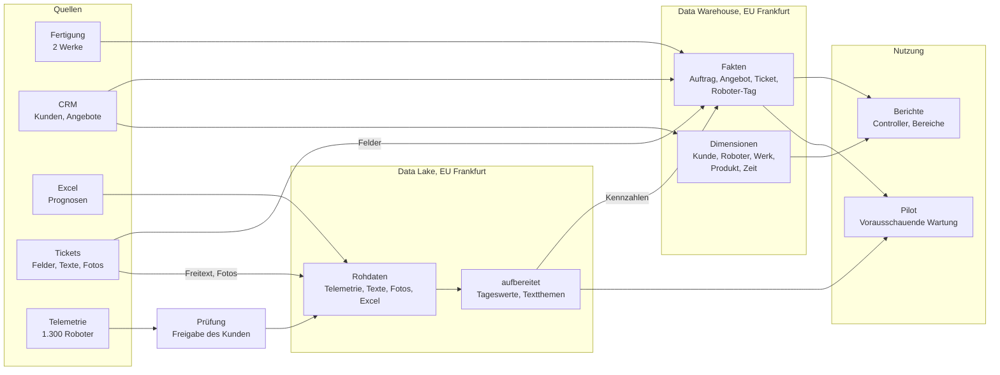

# Tag 7 (Modul 3), UE 5–6 Fallstudie: Datenarchitektur bei InduTech

> [!NOTE]
> | Teil | Inhalt | Springen |
> |:---:|---|:---:|
> | **A** | **Fakten und Rechnungen** aus dem Aufgabenblatt | [→ Teil A](#teil-a-fakten-und-rechnungen) |
> | **B** | **Lösungsentwurf** (KI) | [→ Teil B](#teil-b-lösungsentwurf) |

**Aufgabe:** Die InduTech GmbH (Industrieroboter und Greifsysteme) hat **1,5 Mio. € für 2 Jahre**. (1) Eine **geeignete Datenarchitektur** entwickeln, (2) entscheiden: **Warehouse, Lake oder Kombination**, (3) **Risiken und Kosten** bewerten. Dazu das Raster Ansatz / Vorteile / Nachteile / Kosten / Risiko und die Leitfragen (Fragen der Bereiche, Telemetrie und Kennzahlen, Reihenfolge der Quellen, Betriebskosten).

---

# Teil A: Fakten und Rechnungen

## Schritt 0 · Daten, Zahlen, Fakten aus dem Aufgabenblatt

### Das Unternehmen

| Thema | Angabe |
|---|---|
| Firma | InduTech GmbH, Hersteller von Industrierobotern und Greifsystemen, 900 Mitarbeitende, 2 Werke |
| Problem | Eine Standardanalyse dauert im Schnitt **9 Tage**. Zahlen aus verschiedenen Bereichen **passen nicht zusammen** |
| Wachstum | Neue Roboter senden Betriebsdaten. **Datenmenge verdreifacht sich in 2 Jahren** |
| Rahmen | **1,5 Mio. € für 2 Jahre**, IT-Team mit 5 Personen |
| Sonstiges | Werk 2 in Tschechien wird 2027 erweitert. Neuer Messestand für die Automatica |

### Die Datenquellen

| Bereich | System | Daten | Zustand | Umfang |
|---|---|---|---|---|
| **Produktion** | Fertigungssteuerung | Aufträge, Taktzeiten, Ausschuss | **sauber gepflegt** | ca. 40 GB. **Zwei Werke, verschiedene Softwareversionen, Auftragsnummern je Werk anders aufgebaut** |
| **Vertrieb** | CRM + Excel | Kunden, Angebote, Prognosen | **uneinheitlich gepflegt** | 6.400 Kunden im CRM. Prognosen in **210 Excel-Dateien** der Vertriebsleute |
| **Service** | Ticketsystem | Störungen, Einsätze, Freitexte | **viel Freitext** | 52.000 Tickets seit 2019. Deutsch und Englisch. **Fotos als Anhang** |
| **Roboter beim Kunden** | Telemetrie | Messwerte im Sekundentakt | **sehr groß, roh** | 1.300 Roboter, **ca. 20 GB pro Tag**. **Nur 30 % der Kunden** haben die Übertragung freigegeben |

### Weitere Angaben

| Thema | Angabe |
|---|---|
| Analysen heute | **3 Controller** ziehen Excel-Exporte, ca. **60 Standardanfragen pro Monat** |
| IT-Team | 5 Personen, **2 fest im ERP-Betrieb gebunden**, bisher **keine Cloud-Erfahrung** |
| Cloud | Ein Anbieter: ca. **25 € je Terabyte und Monat** für Speicher, Rechenzentrum in **Frankfurt** |
| Produkt | Das Produktmanagement will **vorausschauende Wartung** als Service verkaufen |
| Kunden | **Automobilkunden verlangen**, dass ihre Daten **in der EU** bleiben |

> [!NOTE]
> **Daraus ergeben sich (reine Rechnung, keine Bewertung)**
>
> Annahmen: die 20 GB pro Tag sind das, was heute wirklich ankommt (also nur von freigegebenen Kunden). Der Speicher füllt sich ab heute bei null. Die Tagesrate wächst gleichmäßig auf das Dreifache in 24 Monaten.
>
> | Größe | Rechnung | Ergebnis |
> |---|---|---:|
> | Telemetrie pro Jahr | 20 GB × 365 | 7,3 TB |
> | Telemetrie je Roboter und Tag | 20 GB / 1.300 | 15,4 MB |
> | Telemetrie je Roboter und Sekunde | 15,4 MB / 86.400 | rund 178 Byte |
> | Roboter mit Freigabe (30 %) | 1.300 × 0,3 | 390 |
> | Roboter ohne Freigabe | 1.300 − 390 | 910 |
> | Telemetrie bei 100 % Freigabe | 20 GB / 0,3 | 66,7 GB pro Tag |
> | Wachstum pro Jahr bei Verdreifachung in 2 Jahren | √3 | Faktor 1,73 |
> | Tagesrate nach 24 Monaten (heute 20 GB) | 20 GB × 3 | 60 GB pro Tag |
> | Gespeichert nach 24 Monaten (heute 20 GB) | Summe der Tagesraten | 26,8 TB |
> | Speicherkosten über 24 Monate (heute 20 GB) | 25 € je TB und Monat, aufsummiert | rund 6.900 € |
> | Speicherkosten im letzten Monat | 26,8 TB × 25 € | rund 670 € |
> | Gespeichert nach 24 Monaten bei 100 % Freigabe | 66,7 GB → 200 GB pro Tag | 89,4 TB |
> | Speicherkosten über 24 Monate bei 100 % Freigabe | 25 € je TB und Monat, aufsummiert | rund 23.100 € |
> | Fertigungsdaten im Cloud-Speicher | 40 GB = 0,04 TB × 25 € | 1 € pro Monat |
> | Tickets pro Jahr (2019 bis Oktober 2026 ≈ 7,8 Jahre) | 52.000 / 7,8 | rund 6.700 |
> | Tickets pro Tag | 6.700 / 365 | rund 18 |
> | IT-Personen ohne ERP-Bindung | 5 − 2 | 3 |
> | Standardanfragen pro Tag (30 Kalendertage) | 60 / 30 | 2 |
> | Anfragen gleichzeitig in Arbeit (Annahme: 9 Kalendertage) | 2 × 9 | 18 |
> | Anfragen je Controller und Monat | 60 / 3 | 20 |
> | Anfragen gleichzeitig offen bei 1 Tag Laufzeit | 2 × 1 | 2 |

---

# Teil B: Lösungsentwurf

> [!IMPORTANT]
> **Auf einen Blick**
>
> - **Entscheidung (Vorschlag): Kombination.** **Warehouse für Kennzahlen** (Produktion, Vertrieb, Service-Felder, tägliche Telemetrie-Werte), **Lake für Rohes** (Telemetrie im Sekundentakt, Freitexte und Fotos der Tickets). Beide hängen an **einem gemeinsamen Schlüssel** (Kunde, Roboter-Seriennummer, Werk + Auftragsnummer).
> - **Warum nicht nur Warehouse:** Telemetrie (20 GB pro Tag, 7,3 TB pro Jahr, roh) und Freitext/Fotos passen nicht in ein festes Tabellenmodell. **Warum nicht nur Lake:** Die Controller brauchen **fertige, übereinstimmende Zahlen**. Ein Lake allein löst "Zahlen passen nicht zusammen" nicht, die 9 Tage bleiben oder werden mehr.
> - **Speicher ist nicht der Kostentreiber.** Bei 25 € je TB und Monat kostet die Telemetrie über 24 Monate rund **6.900 €** (26,8 TB), selbst bei 100 % Freigabe nur rund **23.100 €** (89,4 TB). Die Fertigungsdaten kosten **1 € im Monat**. **Menschen und Aufbau** sind der Kostenblock: nur **3 von 5** IT-Personen sind frei, **niemand** hat Cloud-Erfahrung.
> - **Reihenfolge:** zuerst **Fertigung** (sauber) und **CRM-Kunden** (gemeinsamer Kundenschlüssel), dann **Service-Felder**, dann **Telemetrie als Tageswerte**, zuletzt **Excel-Prognosen** und **Freitext/Fotos**. **Roh-Telemetrie früh sammeln** (billig, später nicht nachholbar), **auswerten später**.
> - **Datenschutz zuerst:** Nur **30 %** der Kunden (390 von 1.300 Robotern) haben freigegeben. Die Freigabe muss **beim Einlesen** geprüft werden, nicht erst bei der Auswertung. Rechenzentrum **Frankfurt** erfüllt die EU-Forderung der Automobilkunden **nur teilweise** (Anbieter und Zugriff prüfen): **Rechtslage prüfen**.
> - **Vorsicht:** Das Blatt nennt **nur den Speicherpreis**. Das Budget (1,5 Mio. €) ist ein **Vorschlag**, kein Ergebnis. Ob Vorausschauende Wartung funktioniert, zeigt erst ein **Pilot**.

> [!NOTE]
> **Annahmen:** (1) Die 20 GB pro Tag sind der tatsächliche Zufluss (nur freigegebene Kunden). Wenn die 20 GB für alle 1.300 Roboter gelten und nur 30 % ausgewertet werden dürfen, bleiben die Speicherkosten klein, die Rechnung ändert sich kaum. (2) Die Datenmenge wächst gleichmäßig auf das Dreifache. (3) Es gibt eine **Roboter-Seriennummer**, die in Telemetrie, Ticket und Fertigung gleich ist. Das Blatt sagt das nicht, ohne sie ist vorausschauende Wartung nicht möglich. (4) Die Kosten für Menschen, Lizenzen und Pilot sind **von mir gesetzt** (Rechenbeispiel, 100.000 € pro Stelle und Jahr). (5) Die 9 Tage sind **Kalendertage Durchlaufzeit**, nicht Arbeitsaufwand. (6) Messestand Automatica halte ich für **Nebensache**. Die Erweiterung von Werk 2 (2027) ist **relevant**: ein weiteres Werk bringt weitere Auftragsnummern. Alle Rechnungen stehen im Python-Check.

## Schritt 1 · Fragen der Bereiche

| Bereich | Welche Fragen soll er beantworten können? |
|:---|:---|
| **Produktion** | Ausschussquote und Taktzeit **je Werk, Roboter-Typ und Monat**. Welche Aufträge liefen langsamer als geplant? Vergleich Werk 1 gegen Werk 2 (Voraussetzung: einheitliche Auftragsschlüssel) |
| **Vertrieb** | Angebote, Abschlussquote und Umsatz **je Kunde**. **Prognose gegen Ist** (heute in 210 Excel-Dateien). Welche Kunden haben viele Störungen und werden gefährdet? |
| **Service** | Störungen **je Robotertyp, Werk und Alter**. Reaktionszeit, Einsatzdauer. **Häufigste Ursachen** aus den Freitexten. Wie viele Einsätze wären vermeidbar? |
| **Bereichsübergreifend** | **Eine Zahl für Umsatz je Kunde** und **Störungsrate je Fertigungscharge** (Fertigung → Service). Welche Servicekosten hängen an welchem Kunden? |
| **Produktmanagement** | **Warnt die Telemetrie** vor einer Störung (Temperatur, Strom, Vibration steigen vor dem Ausfall)? Wie viel Vorlauf? Welche Kunden würden den Service kaufen? |

## Schritt 2 · Wohin gehört was?

| Quelle | Lake, Warehouse oder beides? | Warum? | Was ist die Hürde? | Wann anbinden? |
|:---|:---|:---|:---|:---|
| **Fertigung** | **Warehouse** (Rohkopie im Lake) | Sauber, klar strukturiert, klassische Kennzahlen. Nur 40 GB | **Zwei Werke**, verschiedene Versionen, **Auftragsnummern verschieden** | **Zuerst** (Phase 1). Schlüssel Werk + Auftragsnummer |
| **CRM** | **Warehouse** | Kunden und Angebote sind der **gemeinsame Kundenschlüssel** für alles andere | Uneinheitlich gepflegt, Dubletten | **Zuerst** (Phase 1), mit Bereinigung |
| **Excel-Prognosen** | **Lake** (Ablage), später ins CRM | 210 Dateien, Formate unterschiedlich, Pflege durch Einzelne | Jede Datei anders gebaut, Eigentum bei den Vertriebsleuten | **Zuletzt**. Besser: Prognose künftig **im CRM erfassen**, Excel auslaufen lassen |
| **Tickets: Felder** | **Warehouse** | Störung, Einsatz, Datum, Roboter, Kunde sind strukturiert | Roboter-Seriennummer im Ticket vorhanden? | Phase 2 |
| **Tickets: Freitext und Fotos** | **Lake** | Deutsch und Englisch, nicht tabellarisch. Auswertung mit Sprachmodell oder Textanalyse später | Datenschutz (Personen auf Fotos, Kundendaten im Text), Sprachmix | Phase 3, **nach** den Feldern |
| **Telemetrie roh** | **Lake** | 20 GB pro Tag, Sekundentakt, roh: für Tabellen zu groß und zu fein. Speicher billig | **Freigabe nur 30 %**, Prüfung beim Einlesen. EU-Speicherung | **Früh sammeln** (ab Phase 1/2), **später auswerten** |
| **Telemetrie als Kennzahl** | **Warehouse** (aus dem Lake berechnet) | Tageswerte je Roboter (Betriebsstunden, Höchsttemperatur, Fehlercodes) sind klein und für Berichte nutzbar | Welche Kennzahl taugt zur Vorhersage? Das weiß heute niemand | Phase 3, mit dem **Pilot** |

## Schritt 3 · Bewertungsraster

| Ansatz | Vorteile | Nachteile | Kosten | Risiko |
|:---|:---|:---|:---|:---|
| **Data Warehouse** | **Eine geprüfte Zahl**, schnelle Berichte, Controller entlastet. Passt zu sauberen Fertigungsdaten. Klare Regeln | **Telemetrie** (7,3 TB pro Jahr, roh) und **Freitexte/Fotos** passen nicht. Neue Datenarten sind jeweils **Projekte**. Kennzahlen müssen vorab feststehen | **Hoch bei Aufbau** (Modell, Ladeprozesse), Speicher billig. Genaue Zahl im Blatt nicht genannt | Vorausschauende Wartung (Wunsch des Produktmanagements) bleibt **außen vor**. Aufbau groß für ein Team ohne Cloud-Erfahrung |
| **Data Lake** | **Alles** landet roh, günstig (Telemetrie 24 Monate rund 6.900 €). **Kein Festlegen im Voraus**. Passt zu Telemetrie, Freitext, Fotos | **Keine fertigen Berichte**, jede Frage braucht Aufbereitung. Zahlen passen weiter **nicht** zusammen ohne Kennzahlen-Glossar. Controller können mit Rohdaten **nichts anfangen** | **Speicher sehr billig**, aber **Fachleute** teuer. Betrieb wächst mit den Daten | **Datensumpf**. **Datenschutz**: Rohdaten von Kunden ohne Freigabe dürfen nicht drin sein. 9 Tage Analysezeit bleiben |
| **Kombination** | **Warehouse** für Kennzahlen (löst "Zahlen passen nicht zusammen"), **Lake** für Rohes (Telemetrie, Texte). **Schrittweise** aufbaubar, Kennzahlen aus dem Lake zurück ins Warehouse. Passt zu vorausschauender Wartung | **Zwei Bausteine** statt einem: mehr Technik, mehr Schlüsselarbeit. Braucht **verbindlichen Schlüssel** zwischen beiden | **Höher als eins von beiden**, aber gut planbar: Vorschlag **1,5 Mio. €** siehe Schritt 5. Speicher nur rund 4 % der Cloud-Kosten | **Überforderung** des Teams (3 freie Personen, keine Cloud-Erfahrung). Gegenmittel: schrittweise, **verwaltete Cloud-Dienste**, externe Hilfe, **eine neue Stelle** |

## Schritt 4 · Entscheidung und Architektur

### Skizze



| Frage | Meine Antwort |
|:---|:---|
| **Meine Wahl** | **Kombination**: Warehouse für Kennzahlen, Lake für Rohes. **Schrittweise** in drei Phasen, **verwaltete Cloud-Dienste** in Frankfurt |
| **Warum?** | (1) **Problem 1 der Firma** (Zahlen passen nicht zusammen, 9 Tage) ist ein **Kennzahlen-Problem**: Warehouse. (2) **Wachstum und Produktwunsch** (Telemetrie, vorausschauende Wartung) sind ein **Rohdaten-Problem**: Lake. (3) Der **Speicher ist billig** (rund 6.900 €), das Hindernis ist das **Können**: darum klein anfangen und Hilfe holen |
| **Wie hängen Lake und Warehouse zusammen?** | Über **gemeinsame Schlüssel**: **Kunde** (aus dem CRM), **Roboter-Seriennummer** (verbindet Fertigung, Ticket, Telemetrie), **Werk + Auftragsnummer** (löst die zwei Nummernkreise). Aus dem Lake geht nur **Berechnetes** (Tageswerte, Themen) ins Warehouse. Das Roh-Material bleibt im Lake |
| **Welche Quelle zuerst, welche zuletzt?** | **Phase 1** (Monat 1 bis 9): Fertigung + CRM-Kunden, Telemetrie roh einsammeln. **Phase 2** (10 bis 16): Service-Felder, Telemetrie als Tageswerte. **Phase 3** (17 bis 24): Freitexte/Fotos, Pilot Vorausschauende Wartung, Excel-Prognosen ins CRM. **Zuletzt** die Excel-Dateien: schlechteste Qualität, höchster Aufwand. Die Phasen sind mein Vorschlag |
| **Was gilt für Telemetrie von Kunden ohne Freigabe und für die EU?** | **Ohne Freigabe: nicht speichern**, Filter **beim Einlesen** (910 von 1.300 Robotern). **EU**: Speicher und Verarbeitung in Frankfurt, Vertrag und Zugriffsrechte des Anbieters prüfen (**Rechtslage prüfen**). Die Freigabe-Quote wächst vielleicht: das Datenmodell muss damit umgehen |

## Schritt 5 · Kosten und Risiken

Die Beträge sind ein **Vorschlag**. Das Blatt nennt nur den Speicherpreis (25 € je TB und Monat).

| Posten | Aufbau, 2 Jahre | Betrieb nach dem Aufbau (pro Jahr) | Herkunft |
|:---|---:|---:|:---|
| **Externe Unterstützung Aufbau** | 450.000 € | rund 0 € | Annahme |
| **Stelle Data Engineer** (1, 2 Jahre) | 200.000 € | 100.000 € | Annahme 100.000 € pro Jahr |
| **Schulung** (3 freie IT-Personen) | 45.000 € | gering | Annahme |
| **Cloud** (Speicher, Rechnen, Warehouse-Dienst) | 180.000 € | 90.000 € | Annahme. **Speicher davon nur 6.900 €** (Rechnung aus dem Blatt) |
| **Werkzeuge** (Berichte, Lizenzen) | 90.000 € | 45.000 € | Annahme |
| **Datenschutz, Sicherheit, Recht** | 60.000 € | gering | Annahme |
| **Pilot Vorausschauende Wartung** | 250.000 € | offen | Annahme. **Erst bei Erfolg weiter** |
| **Reserve (15 %)** | 225.000 € | | Annahme |
| **Summe** | **1.500.000 €** | **rund 235.000 €** (Cloud + Stelle + Werkzeuge) | |

> [!NOTE]
> **Was Betrieb heißt (Leitfrage 4):** Nach dem Aufbau bleiben nach meiner Annahme **rund 235.000 € pro Jahr**. Der Speicher wächst auf das Dreifache und bleibt trotzdem der **kleinste** Posten. Wer den Betrieb plant, plant **Personal**, nicht Terabyte.

| Risiko | Warum gefährlich? | Woran würde ich es merken? | Was tue ich dagegen? |
|:---|:---|:---|:---|
| **Know-how** (3 freie Personen, keine Cloud-Erfahrung) | Der Aufbau bleibt stecken oder hängt an Einzelnen. Fachleute wandern ab | Pipelines laufen nur mit einer Person, Fristen reißen | **Verwaltete Dienste** statt Eigenbetrieb, **externe Hilfe** im Aufbau mit Übergabe, **1 Stelle**, Schulung, **zwei Personen je Pipeline** |
| **Schlüssel** (Werke, Kunde, Roboter) | Ohne Schlüssel **keine Zusammenführung**: das Problem "Zahlen passen nicht zusammen" bleibt | Zahlen je Werk, Kunde oder Roboter stimmen nicht zwischen Berichten | **Schlüsseltabelle** (Werk + Auftragsnummer, Kunde, Seriennummer) **vor** dem Laden bauen, **Glossar** der Kennzahlen, Zweifelsfälle von Menschen prüfen. Neue Werke (Tschechien 2027) in das Schema aufnehmen |
| **Datenschutz und EU** | **Automobilkunden** verlangen EU-Datenhaltung. **Nur 30 %** Freigabe. Fotos und Texte können **Personen und Kundendaten** enthalten | Kunde fragt nach, wo Daten liegen. Roboter ohne Freigabe tauchen im Lake auf | **Freigabeprüfung beim Einlesen**, EU-Region festlegen, Rollen und Rechte, **Löschfristen**. **Rechtslage prüfen** (Verträge, Anbieter) |
| **Datensumpf** | Viel gespeichert, **wenig genutzt**. Roh-Telemetrie ohne Fragestellung | Speicher wächst, aber kein Bericht nutzt ihn | **Fragen zuerst** (Schritt 1). Nur sammeln, wofür ein Zweck bekannt ist (**ausnahmsweise** die Telemetrie, weil nicht nachholbar). Verantwortliche je Quelle |
| **Vorausschauende Wartung zu früh** | Das **Versprechen** wird verkauft, bevor die Daten tragen. **Nur 390 Roboter** liefern Daten: die Kunden mit Freigabe sind vielleicht **nicht typisch** (Auswahlverzerrung). Störungen sind vielleicht selten, dann gibt es wenig Lernbeispiele | Der Pilot erkennt Störungen nicht früher als der Zufall, oder zu viele Fehlalarme | **Pilot vor Produkt**: erst prüfen, ob Warnungen **vor** den Störungen aus den Tickets auftauchen. Verkauf erst bei Nachweis. **Das ist offen** |

## Python-Check

```python
preis = 25  # € je TB und Monat

gb_tag = 20
print(gb_tag * 365 / 1000)                      # 7,3 TB pro Jahr
print(gb_tag * 1000 / 1300)                     # 15,4 MB je Roboter und Tag
print(gb_tag * 1e9 / 1300 / 86_400)             # rund 178 Byte je Roboter und Sekunde
print(1300 * 0.3, 1300 * 0.7, gb_tag / 0.3)     # 390 / 910 / 66,7 GB pro Tag
print(3 ** 0.5)                                 # 1,73 pro Jahr

def verlauf(gb0, faktor=3, monate=24):
    """Tagesrate wächst gleichmäßig auf das Dreifache; Speicher füllt sich ab null."""
    tb = kosten = 0.0
    g = faktor ** (1 / monate)
    for m in range(1, monate + 1):
        rate = gb0 * g ** m
        tb += rate * 30 / 1000
        kosten += tb * preis
    return tb, kosten, rate

for name, g0 in (("heute 20 GB", 20), ("alle Kunden", 20 / 0.3)):
    tb, k, r = verlauf(g0)
    print(name, f"{r:.0f} GB/Tag", f"{tb:.1f} TB", f"{k:,.0f} €", f"letzter Monat {tb * preis:,.0f} €")
# heute 20 GB:  60 GB/Tag, 26,8 TB, 6.939 €, letzter Monat 670 €
# alle Kunden: 200 GB/Tag, 89,4 TB, 23.131 €, letzter Monat 2.235 €
print(40 / 1000 * preis)                        # Fertigung: 1 € pro Monat

print(52_000 / 7.8, 52_000 / 7.8 / 365)         # rund 6.700 Tickets pro Jahr, 18 pro Tag
print(60 / 30, 60 / 30 * 9, 60 / 3)             # 2 pro Tag, 18 gleichzeitig offen, 20 je Controller
print(60 / 30 * 1)                              # 2 gleichzeitig offen bei 1 Tag Laufzeit

budget = {"extern": 450_000, "Stelle": 200_000, "Schulung": 45_000, "Cloud": 180_000,
          "Werkzeuge": 90_000, "Datenschutz": 60_000, "Pilot": 250_000, "Reserve": 225_000}
print(sum(budget.values()), 225_000 / sum(budget.values()))   # 1.500.000, 15 %
print(verlauf(20)[1] / 180_000)                 # Speicher = 3,9 % der Cloud-Kosten
print(90_000 + 100_000 + 45_000)                # 235.000 € Betrieb pro Jahr
```
