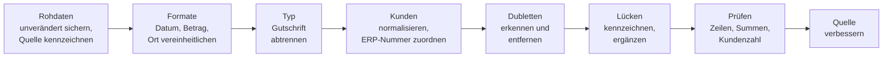

# Tag 8 (Modul 3), Arbeitsauftrag 1: Bestelldaten bei Kranz Werkzeughandel

> [!NOTE]
> | Teil | Inhalt | Springen |
> |:---:|---|:---:|
> | **A** | **Mattis Lösung**: Fakten, Rechnungen und meine Einträge | [→ Teil A](#teil-a-mattis-lösung) |
> | **B** | **Lösungsentwurf** (KI) | [→ Teil B](#teil-b-lösungsentwurf) |

**Aufgabe:** Die Kranz Werkzeughandel GmbH will ihre Bestellungen erstmals gemeinsam auswerten (Webshop und Excel des Außendienstes). Die Geschäftsführung fragt: **„Können wir damit arbeiten?“** (1) **Probleme in den Daten** finden, (2) die **Schritte** nennen, die die Daten nutzbar machen, (3) erklären, **warum saubere Daten wichtig sind**. Dazu das Raster Problem / In Zeile / Nötiger Schritt.

---

# Teil A: Mattis Lösung

## Schritt 0 · Daten, Zahlen, Fakten aus dem Aufgabenblatt

### Der Auszug (7 Zeilen, so wie zusammenkopiert)

| Nr. | Kunde | Bestelldatum | Betrag | Ort |
|---:|---|---|---|---|
| 1 | Elektro Weber GmbH | 12.03.2025 | 1.480,00 € | Kassel |
| 2 | ELEKTRO WEBER | 2025-03-12 | 1480 | 34117 Kassel |
| 3 | Bau & Haus Kraft | 13/03/2025 | *(leer)* | Göttingen |
| 4 | Schreinerei Ott | 14.03.25 | 312,50 € | *(leer)* |
| 5 | Elektro-Weber GmbH | 15.03.2025 | 86 EUR | Kassel |
| 6 | schreinerei ott | März 2025 | 312,5 | Fulda |
| 7 | Malerbetrieb Lenz | 16.03.2025 | -1.200,00 € | Kassel |

### Woher die Zeilen stammen

| Quelle | Eigenheiten | Anteil |
|---|---|---:|
| **Webshop (CSV-Export)** | Datum als JJJJ-MM-TT, Betrag ohne Währung, Ort mit Postleitzahl | ca. 61 % |
| **Excel des Außendienstes** | 5 Außendienstler, **jeder mit eigener Vorlage**, teils nur Monat statt Datum | ca. 37 % |
| **Gutschriften** | Im Webshop als **Bestellung mit negativem Betrag** erfasst | ca. 2 % |
| **Gesamt** | **14.300 Zeilen** aus 2025, **2.100 verschiedene Kundennamen**, laut ERP **1.240 aktive Kunden** | 100 % |

### Weitere Angaben

| Thema | Angabe |
|---|---|
| Elektro Weber | Hat **zwei Betriebe**: Kassel (Hauptsitz) und Baunatal |
| Schreinerei Ott | **Ein** Betrieb in Fulda, bestellt **jeden Monat dieselben Schleifmittel** |
| Doppelt erfasst | Außendienstler tragen Webshop-Bestellungen ihrer Kunden **manchmal zusätzlich** ein |
| Kranz | 22.000 Artikel, Lieferung binnen 24 Stunden, der Webshop wird von einer Agentur betreut |
| Sonstiges | Der Malerbetrieb Lenz feiert dieses Jahr 100-jähriges Bestehen |

> [!NOTE]
> **Daraus ergeben sich (reine Rechnung, keine Bewertung)**
>
> | Größe | Rechnung | Ergebnis |
> |---|---|---:|
> | Zeilen aus dem Webshop | 14.300 × 61 % | 8.723 |
> | Zeilen aus dem Excel des Außendienstes | 14.300 × 37 % | 5.291 |
> | Gutschrift-Zeilen | 14.300 × 2 % | 286 |
> | Excel-Zeilen je Vorlage (Durchschnitt, 5 Vorlagen) | 5.291 / 5 | rund 1.058 |
> | Kundennamen mehr als aktive Kunden laut ERP | 2.100 − 1.240 | 860 |
> | Namen je Kunde (Durchschnitt) | 2.100 / 1.240 | 1,69 |
> | Anteil der Namen, die nur Varianten sein können | 860 / 2.100 | 41,0 % |
> | Zeilen je aktiven Kunden | 14.300 / 1.240 | 11,5 |
> | Obergrenze doppelter Zeilen (nur Excel-Zeilen können Dubletten sein) | 14.300 × 37 % | 5.291 |
> | Auszug: verschiedene Kundennamen, roh | Zeilen 1 bis 7 zählen | 7 |
> | Auszug: Summe aller lesbaren Beträge, roh | 1.480 + 1.480 + 312,5 + 86 + 312,5 − 1.200 | 2.471 € |

## Schritt 2 · Ergebnisraster

| Problem | In Zeile | Nötiger Schritt |
|:---|:---|:---|
| **Problem 1**  händische Ergänzung aus anderer Quelle | 2 | operative Regel, pipeline |
| **Problem 2** Datumsformate | | verinheitlichen, Pflichtfelder einführen (Tag) |
| **Problem 3** Unterschiedliche Schreibweise für Kunden  | | gemeinsame ID, Haupt-und Nebensitz klären |
| **Problem 4** Einheit (EUR) nicht einheitlich | | definieren, vereinheitlichen |
| **Problem 5** unklare Provisionsregelung bei Online-Kauf | | Feld für Leads |

---

# Teil B: Lösungsentwurf

> [!IMPORTANT]
> **Auf einen Blick**
>
> - **Antwort an die Geschäftsführung:** **Noch nicht, aber nach einer Bereinigung mit Einschränkungen ja.** Der Auszug hat **neun Problemarten**, und **alle 7 Zeilen** sind davon betroffen.
> - **Aus 7 Zeilen werden 4 Kunden, 4 Bestellungen und 1 Gutschrift.** 7 Namen sind eigentlich 4 Kunden. Zwei Zeilen (2 und 6) sind **Dubletten**, Zeile 7 ist **keine Bestellung**, sondern eine **Gutschrift**.
> - **Die rohe Summe lügt:** 2.471 € roh, aber **netto nur 678,50 €** (1.878,50 € Bestellungen minus 1.200 € Gutschrift). **72,5 %** der rohen Summe (1.792,50 €) sind **doppelt gezählte** Bestellungen. Das gilt nur für **diese 7 Zeilen**, die Anteile in den 14.300 Zeilen kennt das Blatt nicht.
> - **Gesamtdaten:** 2.100 Namen gegen **1.240** aktive Kunden laut ERP: **860 Namen zu viel** (41 %), im Schnitt **1,69 Namen je Kunde**. Die echte Kundenzahl liegt **nahe 1.240**, belegt ist sie nicht.
> - **Größte Folge: die leisen Fehler.** Ein Datumsformat bricht **sichtbar** ab, eine Dublette oder eine falsch gezählte Gutschrift **rechnet still falsch weiter**. Am teuersten im Auszug: **Dubletten** (Umsatz um 1.792,50 € zu hoch). Am weitesten reichend: der **fehlende Kundenabgleich** (jede Aussage "je Kunde" ist falsch).
> - **Schritte (Kurzfassung):** Rohdaten sichern und Quelle kennzeichnen → Formate vereinheitlichen → Gutschriften abtrennen → Kundennamen abgleichen → Dubletten entfernen → Lücken kennzeichnen → prüfen (Zeilen, Summen, Kundenzahl) → **Ursache an der Quelle beheben** (eine Vorlage, Export mit Kundennummer).

> [!NOTE]
> **Annahmen:** (1) Datum mit Schrägstrich oder Punkt ist **Tag zuerst** (deutsch), bei "13/03/2025" ist das eindeutig (13 ist kein Monat). (2) Beträge ohne Währung sind **Euro**. (3) Zwei Ziffern im Jahr ("14.03.25") heißen 2025. (4) Zeile 2 trägt alle drei Webshop-Merkmale (JJJJ-MM-TT, Betrag ohne Währung, Postleitzahl), Zeile 1 stammt vermutlich aus einem Excel des Außendienstes. Das ist eine **Vermutung**. (5) Zeile 6 ist die gleiche Bestellung wie Zeile 4: Ott bestellt **einmal im Monat** dasselbe, beide stehen im März mit 312,50 €. Das ist **wahrscheinlich, nicht sicher**, darum "prüfen". (6) Zeile 5 (86 EUR) ist eine **eigene Bestellung**, denn Datum und Betrag unterscheiden sich von Zeile 1. (7) Die Gutschrift 2 % gehört nicht zu den 61 % Webshop (das Blatt summiert auf 100 %). (8) Katalogzahl (22.000 Artikel), 24-Stunden-Lieferung und das 100-jährige Bestehen von Lenz sind **Nebensache**. **Wichtig** ist die Agentur: sie kann den Export ändern. Alle Rechnungen stehen im Python-Check.

## Schritt 1 · Zeile für Zeile

| Zeile | Was fällt auf? |
|:---|:---|
| **Zeile 1** Elektro Weber GmbH | Die **sauberste** Zeile, aber **Dublette von Zeile 2** (gleicher Kunde, Datum, Betrag). Betrieb **Kassel** oder **Baunatal**? Hier Kassel |
| **Zeile 2** ELEKTRO WEBER | **Großbuchstaben** und **ohne GmbH**. Datum **JJJJ-MM-TT**, Betrag **ohne Währung**, Ort **mit PLZ** (Webshop-Muster). **Dublette** von Zeile 1 |
| **Zeile 3** Bau & Haus Kraft | Datum mit **Schrägstrich** (13/03/2025). **Betrag fehlt**. Sonderzeichen **&** im Namen |
| **Zeile 4** Schreinerei Ott | Datum nur **zweistelliges Jahr** (14.03.25). **Ort fehlt**. Betrag mit Komma und "€" |
| **Zeile 5** Elektro-Weber GmbH | **Bindestrich** statt Leerzeichen im Namen. Betrag mit **"EUR"**. Eigene Bestellung (86 €) |
| **Zeile 6** schreinerei ott | **Kleinbuchstaben**. Datum nur **Monat** (März 2025). Betrag **312,5** (ohne zweite Stelle, ohne Währung). **Wahrscheinlich Dublette von Zeile 4**. Liefert den fehlenden Ort (Fulda) |
| **Zeile 7** Malerbetrieb Lenz | **Negativer Betrag**: eine **Gutschrift**, keine Bestellung. Die Ursprungsbestellung steht **nicht** im Auszug |

## Schritt 2 · Ergebnisraster

| Problem | In Zeile | Nötiger Schritt |
|:---|:---|:---|
| **Problem 1: Dubletten** (dieselbe Bestellung zweimal, Webshop und Außendienst) | **1 + 2** sicher. **4 + 6** wahrscheinlich | **Schlüssel** aus Kunde + Datum + Betrag bilden, **eine** Zeile behalten. Bei Monat-only (Zeile 6) **als "zu prüfen"** markieren, nicht blind löschen |
| **Problem 2: Kundennamen uneinheitlich** (Groß/Klein, Rechtsform, Bindestrich, Sonderzeichen) | 1, 2, 5 (Weber). 4, 6 (Ott). 3 ("&") | Namen **normalisieren** (klein, Satzzeichen und "GmbH" weg), dann mit dem **ERP-Kundenstamm** abgleichen und eine **Kundennummer** vergeben. Zweifelsfälle von einem Menschen prüfen lassen |
| **Problem 3: Datumsformate gemischt** (TT.MM.JJJJ, JJJJ-MM-TT, TT/MM/JJJJ, TT.MM.JJ) | 1, 2, 3, 4 (und 5, 7 in einem Format) | Alles in **ISO 8601** (JJJJ-MM-TT) umwandeln, **Tag zuerst** festlegen und dokumentieren. Jahr mit zwei Ziffern ergänzen |
| **Problem 4: Datum unvollständig** (nur Monat) | 6 | **Nicht raten**: Spalte "Datum genau?" ergänzen oder den Monat getrennt führen. Für Tagesauswertungen ausschließen. Aus dem ERP oder beim Außendienst nachfragen |
| **Problem 5: Betragsformate gemischt** (1.480,00 €, 1480, 86 EUR, 312,5) | 1, 2, 4, 5, 6, 7 | Währungszeichen entfernen, **Dezimalkomma** erkennen, in **Zahl** plus **Währung (EUR)** trennen. Webshop ohne Währung: **als Euro annehmen und dokumentieren** |
| **Problem 6: Betrag fehlt** | 3 | Als **leer (NULL) markieren, nicht als 0** rechnen. Aus dem ERP oder Außendienst **nachfragen**. In Summen **ausweisen**, wie viele Zeilen ohne Betrag sind |
| **Problem 7: Ort fehlt oder mit Postleitzahl vermischt** | 4 fehlt. 2 mit PLZ | **PLZ und Ort trennen**. Fehlenden Ort aus dem Kundenstamm ergänzen (Zeile 6: Fulda) |
| **Problem 8: Gutschrift als Bestellung erfasst** (negativer Betrag) | 7 | Eigene Spalte **Typ** (Bestellung / Gutschrift). Gutschriften **nicht als Bestellung zählen**, aber vom Umsatz **abziehen**. Mit der **Ursprungsbestellung verknüpfen** (hier unbekannt) |
| **Problem 9: Kunde und Betrieb vermischt** (Elektro Weber: Kassel und Baunatal) | 1, 2, 5 (alle "Kassel") | **Zwei Ebenen** führen: **Kunde** (Elektro Weber) und **Betrieb/Standort** (Kassel, Baunatal). Ort allein als Unterscheidung reicht nicht. Der Abgleich muss mit der **ERP-Nummer** laufen |

**Wie viele Probleme habe ich gefunden?** Neun Problemarten, in **7 von 7 Zeilen**. Je nach Zählung sind es mehr oder weniger (Datum und Betrag lassen sich als je zwei Probleme zählen). Wichtiger als die Zahl ist die **Ursache**: **fehlende Regeln an der Quelle** (jeder erfasst anders) und **kein gemeinsamer Kundenschlüssel**.

## Schritt 3 · Wie viele verschiedene Kunden sind es wirklich?

| Frage | Meine Antwort |
|:---|:---|
| **Im Auszug: Wie viele Kunden, wie viele Bestellungen?** | **4 Kunden** (Elektro Weber, Bau & Haus Kraft, Schreinerei Ott, Malerbetrieb Lenz) statt 7 Namen. **4 Bestellungen** (Weber 12.03., Weber 15.03., Kraft 13.03. ohne Betrag, Ott März) und **1 Gutschrift** (Lenz). **2 Dubletten** (Zeile 2, Zeile 6) |
| **Welche Zeilen gehören zu welchem Kunden?** | **Elektro Weber**: 1, 2, 5. **Bau & Haus Kraft**: 3. **Schreinerei Ott**: 4, 6. **Malerbetrieb Lenz**: 7. Lenz hat im Auszug **nur eine Gutschrift** und keine Bestellung. Das ist kein Fehler, aber **keine Kundenaussage** wert |
| **Ist Elektro Weber ein Kunde oder zwei? Woran hängt das?** | **Ein Kunde mit zwei Betrieben** (Kassel, Baunatal) **oder zwei Kunden**, je nachdem, **wie das ERP es führt** (eine Kundennummer mit zwei Lieferadressen oder zwei Nummern). Das Blatt sagt es nicht. Für **Umsatz je Kunde** ist es **ein Kunde**, für **Lieferung und Außendienst** sind es **zwei Standorte**. Beides festhalten |
| **Bei 14.300 Zeilen: Wie viele Kunden sind es? Was sagen 2.100 und 1.240?** | **Nahe 1.240**, denn das ERP kennt die **aktiven** Kunden. 2.100 ist die Zahl der **Schreibweisen** (860 mehr, 41 %), nicht der Kunden. Vorsicht: **1.240 muss nicht exakt stimmen** (aktiv heißt nicht "kauft", Neukunden und Ex-Kunden können fehlen, Elektro Weber kann zweimal gezählt sein). Die Zahl ist die **Gegenprobe**: Nach der Bereinigung sollte die Kundenzahl **bei rund 1.240 landen**. Weicht sie stark ab, **stimmt der Abgleich nicht** |

## Schritt 4 · Schritte in der richtigen Reihenfolge



| Schritt | Was tue ich? | Warum an dieser Stelle? |
|:---|:---|:---|
| **Schritt 1: Sichern und kennzeichnen** | Rohdaten **unverändert** ablegen. Spalte **Quelle** ergänzen (Webshop, Excel Außendienst 1 bis 5) | Ohne Original kann man Fehler nicht zurückverfolgen. Die Quelle erklärt Format **und** Dubletten |
| **Schritt 2: Formate vereinheitlichen** | **Datum** → JJJJ-MM-TT, **Betrag** → Zahl + Währung, **Ort** → PLZ und Ort getrennt | Erst wenn alles gleich aussieht, lassen sich Zeilen **vergleichen** |
| **Schritt 3: Typ bestimmen** | Negativer Betrag → **Gutschrift**, eigene Spalte | Vor jeder Summe und Zählung nötig, sonst zählt eine Gutschrift als Bestellung |
| **Schritt 4: Kunden abgleichen** | Name **normalisieren**, mit **ERP-Kundenstamm** abgleichen, **Kundennummer** und **Betrieb** vergeben, Zweifelsfälle **prüfen lassen** | Die Dublettensuche (Schritt 5) braucht **einheitliche Kunden**, sonst sind Zeile 1 und 2 "verschiedene" Kunden |
| **Schritt 5: Dubletten entfernen** | Schlüssel **Kunde + Datum + Betrag**. Sichere Treffer entfernen, **Monat-only** als "prüfen" | Erst nach Schritt 2 und 4 vergleichbar. Vorher findet man sie **nicht** |
| **Schritt 6: Lücken behandeln** | Fehlender Betrag und Ort **kennzeichnen** (nicht mit 0 oder Leerzeichen füllen), aus **ERP/Kundenstamm** ergänzen | Nach dem Entfernen der Dubletten wird sichtbar, **was wirklich fehlt** (Zeile 6 liefert den Ort für Zeile 4) |
| **Schritt 7: Prüfen** | **Zeilen** vorher/nachher (14.300 → ?), **Summe** vorher/nachher, **Kundenzahl** gegen ERP (rund 1.240), Stichproben von Hand | Zeigt, ob eine Regel **zu viel** oder **zu wenig** gelöscht hat |
| **Schritt 8: Quelle verbessern** | **Eine** Excel-Vorlage für alle 5 Außendienstler, Webshop-Export mit **Währung und Kundennummer** (die **Agentur** kann es ändern), **Außendienst trägt Webshop-Bestellungen nicht mehr doppelt ein** | Sonst wiederholt sich die Bereinigung **jeden Monat**. Bereinigen ist Notlösung, Vermeiden ist die Lösung |

## Schritt 5 · Warum sind saubere Daten wichtig?

| Frage | Meine Antwort |
|:---|:---|
| **Was würde in diesem Auszug passieren, wenn ich nichts bereinige?** | **Umsatz**: 2.471 € statt netto 678,50 € (3,6-fach). **Kunden**: 7 statt 4 (+75 %). **Bestellungen**: 7 statt 4. Durchschnittlicher Bestellwert und Kundenwert wären **falsch** |
| **Welcher Fehler hätte die größten Folgen? Warum?** | **Dubletten** in Euro: 1.792,50 € von 2.471 € (72,5 %), aber nur **in diesem Auszug**. **Kundenabgleich** in der Breite: jede Aussage "je Kunde" (Top-Kunden, Kundenwert, Abwanderung) wäre falsch, bei 2.100 gegen 1.240 sind **69 % mehr Kunden** im Bericht. **Gutschrift**: wird sie **als Bestellung** gezählt, steigt die Bestellzahl, wird sie **weggelassen**, steigt der Umsatz um 1.200 €. **Mein Urteil**: Dubletten und Kundenabgleich zusammen, weil beide **still** falsch rechnen |
| **Welche Fehler fallen auf, welche nicht?** | **Fallen auf**: Datum und Betrag in mehreren Formaten (das Programm bricht ab oder zeigt Fehler), fehlender Betrag. **Fallen nicht auf**: Dubletten, Namensvarianten, Gutschriften (Zahlen sehen plausibel aus). Gefährlich ist, **was keine Fehlermeldung gibt** |
| **Was kann man an der Quelle ändern, damit es nicht wieder passiert?** | **Eine Vorlage** für alle Außendienstler (Datum als Auswahl, Betrag als Zahl, Kunde aus dem ERP-Kundenstamm), **Kundennummer** im Webshop-Export (**Agentur** beauftragen), klare Regel: **Webshop-Bestellungen nicht doppelt eintragen**, Gutschriften mit **Verweis auf die Ursprungsbestellung** |
| **Meine Antwort an die Geschäftsführung: „Können wir damit arbeiten?“** | **Noch nicht, aber ja nach Bereinigung.** Die Daten sind **brauchbar**, die Zeilen enthalten, was gebraucht wird (Kunde, Datum, Betrag). Vorher sind **Umsatz und Kundenzahl falsch**. Nach der Bereinigung gelten Einschränkungen: Zeilen ohne Betrag oder genaues Datum, **Gutschriften** ohne Ursprungsbestellung. **Entscheidung** erst nach dem **Prüfschritt** (Kundenzahl nahe 1.240) |

## Python-Check

```python
import re
from datetime import date

ROHDATEN = [
    (1, "Elektro Weber GmbH", "12.03.2025", "1.480,00 €", "Kassel"),
    (2, "ELEKTRO WEBER", "2025-03-12", "1480", "34117 Kassel"),
    (3, "Bau & Haus Kraft", "13/03/2025", "", "Göttingen"),
    (4, "Schreinerei Ott", "14.03.25", "312,50 €", ""),
    (5, "Elektro-Weber GmbH", "15.03.2025", "86 EUR", "Kassel"),
    (6, "schreinerei ott", "März 2025", "312,5", "Fulda"),
    (7, "Malerbetrieb Lenz", "16.03.2025", "-1.200,00 €", "Kassel"),
]
MONATE = {"märz": 3}

def datum(s):
    """-> (date | None, (Jahr, Monat) | None). Nur Monat bekannt: kein Datum."""
    s = s.strip()
    if m := re.fullmatch(r"(\d{4})-(\d{2})-(\d{2})", s):
        return date(int(m[1]), int(m[2]), int(m[3])), None
    if m := re.fullmatch(r"(\d{1,2})[./](\d{1,2})[./](\d{2,4})", s):
        j = int(m[3]); j = j + 2000 if j < 100 else j
        return date(j, int(m[2]), int(m[1])), None      # Annahme: Tag zuerst
    if m := re.fullmatch(r"([A-Za-zäöü]+) (\d{4})", s):
        return None, (int(m[2]), MONATE[m[1].lower()])
    raise ValueError(s)

def betrag(s):
    s = s.replace("€", "").replace("EUR", "").strip()
    if not s:
        return None                                      # fehlt: NICHT als 0 rechnen
    if "," in s:                                         # deutsches Format 1.480,00
        s = s.replace(".", "").replace(",", ".")
    return float(s)

def kunde(s):
    s = s.lower().replace("&", " ").replace("-", " ")
    s = re.sub(r"\bgmbh\b", "", s)
    return " ".join(s.split())

def ort(s):
    m = re.fullmatch(r"(\d{5})\s+(.+)", s.strip())
    return (m[1], m[2]) if m else (None, s.strip() or None)

zeilen = []
for nr, k, d, b, o in ROHDATEN:
    dd, mon = datum(d)
    plz, ortname = ort(o)
    zeilen.append(dict(nr=nr, kunde=kunde(k), datum=dd, monat=mon or (dd.year, dd.month),
                       betrag=betrag(b), plz=plz, ort=ortname))

print(sum(z["betrag"] for z in zeilen if z["betrag"] is not None))   # 2471.0 roh
print(len({r[1] for r in ROHDATEN}), len({z["kunde"] for z in zeilen}))   # 7 Namen, 4 Kunden

# Dubletten: sicher (gleiches Datum) und zu prüfen (nur Monat bekannt)
sicher, pruefen, gesehen = [], [], {}
for z in zeilen:
    if z["betrag"] and z["betrag"] > 0 and z["datum"]:
        key = (z["kunde"], z["datum"], z["betrag"])
        if key in gesehen: sicher.append((gesehen[key], z["nr"]))
        else: gesehen[key] = z["nr"]
for z in zeilen:
    if z["datum"] is None:
        for y in zeilen:
            if y["datum"] and y["kunde"] == z["kunde"] and y["betrag"] == z["betrag"] and y["monat"] == z["monat"]:
                pruefen.append((y["nr"], z["nr"]))
print(sicher, pruefen)                                   # [(1, 2)] [(4, 6)]

dup = {b for _, b in sicher + pruefen}
bestell = [z for z in zeilen if z["betrag"] and z["betrag"] > 0 and z["nr"] not in dup]
gutsch = [z for z in zeilen if z["betrag"] and z["betrag"] < 0]
print([z["nr"] for z in bestell], [z["nr"] for z in gutsch])     # [1, 4, 5] [7]; Zeile 3 ohne Betrag
brutto, gs = sum(z["betrag"] for z in bestell), sum(z["betrag"] for z in gutsch)
print(brutto, gs, brutto + gs)                           # 1878.5 -1200.0 678.5
roh = sum(z["betrag"] for z in zeilen if z["betrag"] is not None)
dubl = sum(z["betrag"] for z in zeilen if z["nr"] in dup)
print(dubl, f"{dubl / roh:.1%}", round(roh / (brutto + gs), 2))  # 1792.5 72.5 % 3.64

n, namen, erp = 14_300, 2_100, 1_240
print(round(n * .61), round(n * .37), round(n * .02))    # 8723 5291 286
print(round(namen / erp, 2), namen - erp, f"{(namen - erp) / namen:.1%}", f"{(namen - erp) / erp:.0%}")
# 1,69 Namen je Kunde, 860 mehr, 41,0 %, 69 % mehr als ERP
print(round(n / erp, 1), round(n * .37 / 5))             # 11,5 Zeilen je Kunde, 1058 je Excel-Vorlage
```
