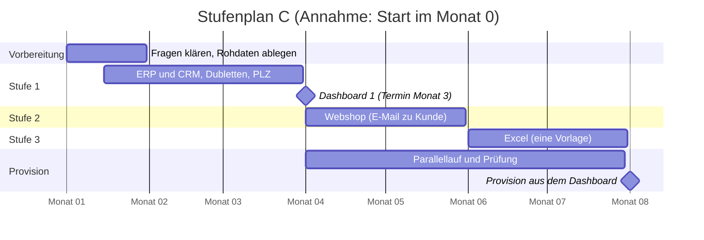

# Tag 8 (Modul 3), Arbeitsauftrag 2: ETL-Ansatz für das Kranz-Warehouse

> [!NOTE]
> | Teil | Inhalt | Springen |
> |:---:|---|:---:|
> | **A** | **Fakten und Rechnungen** aus dem Aufgabenblatt | [→ Teil A](#teil-a-fakten-und-rechnungen) |
> | **B** | **Lösungsentwurf** (KI) | [→ Teil B](#teil-b-lösungsentwurf) |

**Aufgabe:** Sie verantworten das neue Data Warehouse der Kranz Werkzeughandel GmbH. Die Geschäftsführung will in **drei Monaten** ein Vertriebsdashboard sehen, die Daten sind schlecht, das Budget ist **250.000 €**. (1) **Vor- und Nachteile** der drei ETL-Ansätze bewerten, (2) eine **Entscheidung** treffen, (3) die **Risiken schlechter Daten** benennen. Dazu das Raster Vorteile / Nachteile / Risiken schlechter Daten / Ihre Entscheidung.

---

# Teil A: Fakten und Rechnungen

## Schritt 0 · Daten, Zahlen, Fakten aus dem Aufgabenblatt

### Die drei Ansätze

| Ansatz | Was konkret passiert | Kosten | Zeit |
|---|---|---:|---|
| **A) Schnelle Integration** | Alle Quellen in 6 Wochen **unverändert** ins Warehouse laden, **Fehler später beheben** | ca. 60.000 € | 6 Wochen |
| **B) Gründliche Bereinigung** | Jede Quelle **vor dem Laden vollständig bereinigt**, Regeln mit **allen Fachbereichen** abgestimmt | ca. 380.000 € | erste Berichte nach **9 Monaten** |
| **C) Schrittweise Verbesserung** | Start mit **Umsatz- und Kundendaten**, bereinigt um die **10 häufigsten Fehler**. **Alle 2 Monate** kommt eine Quelle hinzu | ca. 200.000 € | Start sofort, Quellen im Zweimonatstakt |

### Die Quellen

| Quelle | Inhalt | Zustand |
|---|---|---|
| **ERP** | Rechnungen, Gutschriften, **1,2 Mio. Zeilen** | weitgehend sauber |
| **Webshop** | **380.000 Bestellungen** pro Jahr | Kunden **nur per E-Mail-Adresse** erkennbar |
| **CRM** | **9.400 Kunden**, Besuchsberichte | **18 % Dubletten**, PLZ fehlt bei **9 %** |
| **Excel Außendienst** | Bestellungen per Telefon und vor Ort | **5 verschiedene Vorlagen** |
| **Lieferanten-Preislisten** | Einkaufspreise von **140 Lieferanten** | 2 Formate, **für das Dashboard nicht nötig** |

### Weitere Angaben

| Thema | Angabe |
|---|---|
| Rolle | Sie verantworten das neue Data Warehouse der Kranz Werkzeughandel GmbH |
| Dashboard | Soll **Umsatz je Kunde, je Region und je Außendienstler** zeigen. Geschäftsführung will es in **drei Monaten** sehen |
| Provision | **Ab nächstem Jahr** wird die Provision der Außendienstler **aus dem Dashboard berechnet** |
| Personal | **3 Personen** interne IT. **Externer Data Engineer: 950 € pro Tag** |
| Leerfelder | **Umsatzsteuer-ID** bei 40 % der Kunden leer (nur für Auslandskunden nötig) |
| Rahmen | Zeitdruck für Analysen. Datenqualität aktuell schlecht. **Budget 250.000 €** |
| Sonstiges | Kranz plant eine Filiale in Erfurt. Der Geschäftsführer wechselt Ende des Jahres in den Beirat |

> [!NOTE]
> **Daraus ergeben sich (reine Rechnung, keine Bewertung)**
>
> | Größe | Rechnung | Ergebnis |
> |---|---|---:|
> | Rest vom Budget bei A | 250.000 € − 60.000 € | 190.000 € |
> | Rest vom Budget bei B | 250.000 € − 380.000 € | −130.000 € |
> | Rest vom Budget bei C | 250.000 € − 200.000 € | 50.000 € |
> | B im Verhältnis zum Budget | 380.000 € / 250.000 € | 152 % |
> | Anteil am Budget (A / C) | 60 / 250 und 200 / 250 | 24 % / 80 % |
> | Zeit A in Monaten | 6 Wochen / 4,345 | 1,4 Monate |
> | B: Abstand zum Termin | 9 Monate − 3 Monate | 6 Monate zu spät |
> | Budget in Tagen des externen Data Engineers | 250.000 € / 950 € | 263 Tage |
> | Kosten in Tagen (A / B / C), wenn alles extern | 60.000 / 380.000 / 200.000 € geteilt durch 950 € | 63 / 400 / 211 Tage |
> | Reserve bei C in Tagen | 50.000 € / 950 € | 53 Tage (rund 2,5 Monate) |
> | Kundensätze im CRM, die Dubletten sind | 9.400 × 18 % | 1.692 |
> | Verschiedene Kunden im CRM (Annahme: Dubletten sind überzählige Sätze) | 9.400 − 1.692 | 7.708 |
> | Kundenzahl ohne Bereinigung zu hoch um | 9.400 / 7.708 − 1 | 22,0 % |
> | CRM-Sätze ohne PLZ | 9.400 × 9 % | 846 |
> | Kunden ohne Umsatzsteuer-ID | 9.400 × 40 % | 3.760 |
> | Webshop-Bestellungen pro Monat | 380.000 / 12 | rund 31.700 |
> | ERP-Zeilen je Webshop-Bestellung | 1.200.000 / 380.000 | 3,2 |
> | Spielraum für Fehlerbehebung nach A, bevor das Budget reißt | 250.000 € − 60.000 € | 190.000 € |

---

# Teil B: Lösungsentwurf

> [!IMPORTANT]
> **Auf einen Blick**
>
> - **Entscheidung (Vorschlag): Ansatz C, schrittweise**, aber mit **zwei Änderungen**: (1) **Rohdaten zuerst unverändert ablegen** (der gute Teil von A), bereinigt wird **im Warehouse** und kann wiederholt werden. (2) Die **Provision wird erst scharf geschaltet, wenn die Zahlen geprüft sind**.
> - **Warum C:** **200.000 €** passen ins Budget (**50.000 € Reserve**, rund 53 Tage externer Data Engineer), das Dashboard kommt zum **Termin**, und das Wichtigste (Umsatz und Kunden) wird **zuerst** sauber. **B** kostet **380.000 €** (**130.000 € über Budget**, 152 %) und liefert **6 Monate nach dem Termin**. **A** ist schnell und billig, zeigt aber **falsche Zahlen**.
> - **Der entscheidende Punkt ist die Provision.** Ab nächstem Jahr wird sie **aus dem Dashboard** berechnet. Dann sind **Fehler im Dashboard Fehler im Gehalt**. Das spricht gegen A, denn Dubletten und Gutschriften verfälschen den Umsatz je Außendienstler.
> - **Dubletten im CRM:** 18 % von 9.400 Sätzen sind **1.692 überzählige Sätze**, ohne Bereinigung wäre die Kundenzahl **22 % zu hoch** (9.400 statt rund 7.700). **PLZ fehlt bei 846 Sätzen**: für diese ist die **Region** nicht bestimmbar.
> - **Nicht alles bereinigen:** Die **Preislisten** (140 Lieferanten) und die **Umsatzsteuer-ID** (3.760 leere Felder, nur für Ausland nötig) braucht das Dashboard **nicht**. Bereinigt wird, was das Dashboard braucht: Kundenschlüssel, PLZ, Außendienst-Zuordnung, Betrag, Datum, Typ (Rechnung oder Gutschrift).
> - **Offen:** Ob **Webshop- und Excel-Bestellungen** schon im ERP stehen. Wenn ja, wäre **das ERP allein fast vollständig**, und eine zweite Ladung würde **doppelt zählen**. Das ist die **erste Frage** vor Projektstart.
> - **Vorsicht:** C bereinigt nur die **10 häufigsten Fehler**. Das Blatt sagt nicht, **welchen Teil der Fehler** das abdeckt. Für die Provision ist der Rest ein Risiko.

> [!NOTE]
> **Annahmen:** (1) Die 18 % Dubletten sind **überzählige Datensätze** (9.400 enthalten rund 7.700 verschiedene Kunden). (2) Die erste Stufe von C (ERP und CRM) steht zum **Termin nach 3 Monaten**, danach folgen **Webshop in Monat 5** und **Excel in Monat 7**. Das Blatt sagt nicht, wann die erste Stufe fertig ist. Die Preislisten wären Monat 9 und bleiben aus. (3) Die **Zuordnung Kunde → Außendienstler** liegt im CRM. Das Blatt sagt es nicht, ohne sie gibt es keinen "Umsatz je Außendienstler". (4) Die **Region** entsteht aus der **PLZ**. (5) Die **Nachbesserung nach A** kostet im Beispiel zwischen 100.000 € und 380.000 €. Das Blatt nennt **keine Zahl**, es sind nur Beispielwerte. (6) Die **Provision** startet erst, wenn das Dashboard läuft. Das Blatt nennt kein Datum. (7) Die Tage des externen Data Engineers sind nur eine **Umrechnung** (alles extern gedacht), die Aufteilung zwischen intern und extern ist offen. (8) **Erfurt** halte ich für **fast** Nebensache (eine neue Filiale braucht später nur eine neue Region im Modell), der **Wechsel des Geschäftsführers** für Nebensache. Alle Rechnungen stehen im Python-Check.

## Schritt 1 · Bewertungsraster

| Kriterium | A) Schnell | B) Gründlich | C) Schrittweise |
|:---|:---|:---|:---|
| **Vorteile** | **Billigste** (60.000 €), **schnellste** (6 Wochen, 1,4 Monate). Alle Quellen **sofort** im Warehouse. **Rohdaten** bleiben erhalten. **190.000 €** Reserve | **Sauberste** Daten, **Regeln mit allen Fachbereichen** abgestimmt (alle tragen mit). Beste Grundlage für Provision und spätere Auswertungen | **Ins Budget** (200.000 €, 50.000 € Reserve). **Zum Termin** ein erstes Dashboard. **Wichtigstes zuerst** (Umsatz, Kunden). **Lernen** aus jeder Stufe. Quellen kommen planbar im **Zweimonatstakt** |
| **Nachteile** | Das Dashboard zeigt **ungeprüfte Zahlen**. Die Nachbesserung ist **ungeplant** und **kostet am Ende oft mehr**. Reihenfolge: **erst falsche Zahlen, dann Korrektur**. Provision auf dieser Basis nicht vertretbar | **380.000 €**, also **130.000 € über Budget** (152 %). **9 Monate**, also **6 Monate nach dem Termin**. Bereinigt auch, was das Dashboard **nicht** braucht (Preislisten, USt-ID). Abstimmung mit allen Fachbereichen **dauert** | **Nur die 10 häufigsten Fehler** werden behoben, der Rest bleibt. **Vollständig erst nach mehreren Stufen** (rund Monat 7). Das Dashboard ist anfangs **nicht komplett**. Braucht **Disziplin**, damit die Stufen nicht einschlafen |
| **Risiken schlechter Daten** | **Hoch**: 1.692 Kunden-Dubletten (Kundenzahl **22 % zu hoch**), 846 Sätze ohne PLZ (Region fehlt), Webshop-Kunden nur per E-Mail (**kein Abgleich**), 5 Excel-Vorlagen, **doppelte Bestellungen**. Falsche **Provision**, Vertrauensverlust | **Niedrig** für die Daten. **Hoch** für **Zeit und Geld**: Das Projekt kann am Budget scheitern oder **verspätet** kommen. Gefahr, dass **Perfektion** die Lieferung verhindert | **Mittel**: Die ersten Stufen sind sauber (ERP weitgehend sauber, CRM bereinigt). **Restfehler** bleiben, **Webshop und Excel** kommen später mit ihren Problemen. Beherrschbar durch **Prüfregeln** und **Provisionstor** |
| **Passt ins Budget (250.000 €)?** | **Ja** (24 %), aber **nur, wenn die Nachbesserung höchstens 190.000 € kostet** | **Nein** (152 %), **130.000 € zu viel** | **Ja** (80 %), **50.000 € Reserve** |
| **Passt zum Termin (3 Monate)?** | **Ja** (6 Wochen), mit falschen Zahlen | **Nein** (9 Monate, 6 Monate Verzug) | **Ja**, mit der ersten Stufe (Annahme) |
| **Reicht es für die Provision?** | **Nein.** Dubletten und Gutschriften verfälschen den Umsatz je Außendienstler | **Ja**, aber **zu spät** | **Ja, wenn das Provisionstor eingebaut ist** (Prüfung vor Scharfschaltung) |

## Schritt 2 · Was braucht das Dashboard wirklich?

| Quelle | Brauche ich sie für das Dashboard? | Was muss daran stimmen? | Wann anbinden? |
|:---|:---|:---|:---|
| **ERP** | **Ja, Kern.** Rechnungen und Gutschriften sind der **Umsatz** | Betrag, Datum, **Typ** (Gutschrift abziehen), **Kundennummer**. Weitgehend sauber, dann **nur prüfen** | **Stufe 1** (zum Termin) |
| **Webshop** | **Ja, wenn die Bestellungen nicht schon im ERP stehen.** 380.000 pro Jahr (rund 31.700 pro Monat) | **Kunde nur über E-Mail**: Zuordnung zur Kundennummer nötig. **Dubletten mit dem Excel** des Außendienstes ausschließen | **Stufe 2** (Monat 5). **Vorher klären**, ob das ERP sie schon enthält |
| **CRM** | **Ja, Kundenstamm.** Liefert **Region** (PLZ) und vermutlich die **Zuordnung zum Außendienstler** | **1.692 Dubletten** entfernen, **846 PLZ** ergänzen (ERP, Adressdienst, Außendienst), **Außendienst-Zuordnung** prüfen | **Stufe 1** (zum Termin) |
| **Excel Außendienst** | **Ja, wenn die Bestellungen nicht im ERP stehen** (Telefon, vor Ort) | **5 Vorlagen**: Datum, Betrag, Kunde vereinheitlichen. **Doppelt eingetragene** Webshop-Bestellungen entfernen | **Stufe 3** (Monat 7). **Eine** neue Vorlage einführen |
| **Lieferanten-Preislisten** | **Nein**, das Dashboard zeigt **Umsatz**, keine Einkaufspreise. Erst bei einer **Margen-Frage** nötig | 2 Formate, 140 Lieferanten: **nicht anfassen** | **Nicht jetzt**, frühestens nach Monat 9 |

## Schritt 3 · Meine Entscheidung

| Frage | Meine Antwort |
|:---|:---|
| **Meine Wahl** | **C, schrittweise**, mit **Rohdaten-Ablage** und **Provisionstor** |
| **Warum diese?** | (1) **Budget**: 200.000 € passen, B nicht (152 %). (2) **Termin**: C liefert in 3 Monaten ein erstes Dashboard, B erst nach 9. (3) **Qualität**: Umsatz und Kunden, die **Kern des Dashboards**, werden **zuerst** bereinigt. (4) **Provision**: Sie bekommt erst saubere Zahlen, wenn sie gebraucht werden |
| **Warum nicht die anderen?** | **A**: schnell, aber **ungeprüfte Zahlen** gehen direkt in die Provision. Kundenzahl 22 % zu hoch, Region bei 846 Sätzen leer. Die Nachbesserung ist **ungeplant**, ab 190.000 € **reißt sie das Budget**. **B**: **130.000 € über Budget**, **6 Monate Verzug**, bereinigt auch, was das Dashboard nicht braucht (Preislisten, USt-ID) |
| **Was ändere ich am gewählten Ansatz?** | (1) **Rohdaten unverändert ablegen** (Rohschicht), Regeln wirken **darauf**: so lässt sich nach jeder Regeländerung **neu rechnen**. Das ist der brauchbare Teil von A. (2) **Prüfregeln** in jeder Stufe: Summe gegen ERP, Kundenzahl, keine Dubletten, keine leere PLZ bei Umsatzkunden. (3) **Provisionstor**: Das Dashboard trägt bis dahin den Vermerk **"vorläufig"**. (4) **Reserve** (50.000 €, 53 Tage) für die **10 häufigsten Fehler**, die schlimmer sind als gedacht |
| **Was passiert mit der Provision?** | **Erst nach bestandener Prüfung.** Vorschlag: **Parallellauf** (Provision wie bisher aus Excel, daneben aus dem Dashboard), **Abweichungen je Außendienstler** ansehen und erklären, **dann** umstellen. **Rechtslage prüfen** (Änderung der Berechnung, Mitbestimmung, Einsicht für Außendienstler). Das Blatt nennt weder Provisionssatz noch Datum |
| **Was weiß ich nicht und kläre ich zuerst?** | (1) **Stehen Webshop und Excel-Bestellungen schon im ERP?** (2) **Wo liegt die Zuordnung Kunde → Außendienstler?** (3) **Welche 10 Fehler** sind die häufigsten, und welchen Anteil decken sie ab? (4) **Wann startet die Provision?** (5) **Wer entscheidet** über Regeln, wenn der Geschäftsführer in den Beirat wechselt? (6) Wie viel der 200.000 € ist **intern** (3 Personen) und wie viel **extern** (950 € pro Tag)? |

## Schritt 4 · Risiken schlechter Daten

| Risiko | Was passiert konkret? | Wen trifft es? | Was tue ich dagegen? |
|:---|:---|:---|:---|
| **Dubletten im Kundenstamm** | 18 % der 9.400 Sätze (1.692) sind Dubletten. **Umsatz je Kunde ist auf zwei Sätze verteilt**, die Kundenzahl ist **22 % zu hoch**, "Top-Kunden" stimmen nicht | Vertrieb, Geschäftsführung, Außendienst (Zuordnung) | **Dublettenabgleich** vor der ersten Stufe (Name, Adresse, E-Mail), Zweifelsfälle von Menschen prüfen. **Eine Kundennummer** im Warehouse |
| **Fehlende PLZ** | Bei 846 Sätzen ist die **Region unbekannt**: Der Umsatz fällt in "ohne Region" oder wird falsch zugeordnet. **Gebiet des Außendienstlers** unklar | Regionsauswertung, Außendienst (Gebiet), spätere **Filiale Erfurt** | PLZ aus **ERP** oder Adressdaten ergänzen, **Außendienst** fragt nach. Im Dashboard **"ohne Region"** sichtbar ausweisen, nicht verstecken |
| **Doppelte Bestellungen** (Webshop und Excel) | Außendienstler tragen Webshop-Bestellungen **zusätzlich** ein: **Umsatz zu hoch**, und zwar **bei genau denen**, die doppelt eintragen | Außendienstler (Provision!), Controlling | **Abgleich Kunde + Datum + Betrag** zwischen Webshop und Excel. **Regel an der Quelle**: Webshop-Bestellungen nicht mehr eintragen. **Zuerst klären**, ob das ERP beides schon hat |
| **Gutschriften falsch behandelt** | Werden sie als Umsatz **addiert** oder **weggelassen**, stimmt der Umsatz nicht (zu hoch oder zu niedrig, je nach Fall). Das ERP enthält Gutschriften | Controlling, Provision | **Typ** (Rechnung / Gutschrift) als eigene Spalte, **Gutschriften abziehen**, Prüfregel: Summe stimmt mit ERP überein |
| **Falsche Provision** | Fehler im Dashboard werden zu **Fehlern im Gehalt**. Streit, Misstrauen, im schlimmsten Fall **Rechtsstreit**. Nicht nur das **Dashboard** verliert Vertrauen, sondern auch die **Berechnung** | Außendienstler (5 Vorlagen: bis zu 5 verschiedene Fehlerquellen), Geschäftsführung | **Provisionstor** und **Parallellauf**, **Einspruchsweg** für Außendienstler, **Rechtslage prüfen** |
| **Vertrauen in das Dashboard geht verloren** | Ein **falscher Wert, den jemand kennt**, genügt, und alle Zahlen gelten als unsicher. Das Dashboard wird **nicht genutzt**, die Excel-Listen leben weiter | Geschäftsführung, alle Nutzer, das **Warehouse-Projekt** | **Vor dem Start Stichproben** mit Fachbereichen, **"vorläufig"-Vermerk**, **Datenstand** und **bekannte Lücken** auf dem Dashboard zeigen |

> [!NOTE]
> **Die Antwort auf "Was passiert, wenn das Dashboard falsche Zahlen zeigt?"**
>
> Es ist **nicht** der falsche Wert allein, sondern was **daran hängt**. Mit der Provision aus dem Dashboard wird aus einer **Fehlinformation** ein **Zahlungsfehler**. Dubletten und Gutschriften rechnen **still** falsch (keine Fehlermeldung), darum helfen **Prüfregeln**, nicht Hoffnung.

## Schritt 5 · Zeitplan für die Geschäftsführung



| Zeitpunkt | Was ist dann da? | Was fehlt noch? |
|:---|:---|:---|
| **Monat 3** (Termin) | **Dashboard Stufe 1**: Umsatz je Kunde und je Region aus **ERP und bereinigtem Kundenstamm**. Vermerk **"vorläufig"**. Prüfregeln laufen | **Webshop** und **Excel** (falls nicht schon im ERP). **Provision** noch nicht scharf. Je nach Zuordnung noch kein Umsatz je Außendienstler |
| **Monat 5** | **Webshop** angebunden, Zuordnung E-Mail → Kunde. Doppelte Bestellungen erkannt | Excel des Außendienstes (5 Vorlagen). Parallellauf der Provision **läuft** |
| **Monat 7** | **Excel** angebunden (**eine** neue Vorlage). Alle drei **für das Dashboard nötigen Quellen** da. **Provisionsprüfung** möglich | Preislisten (bewusst aus). **Restfehler** jenseits der 10 häufigsten |
| **Meine Erklärung in drei Sätzen** | **"Zum Termin zeigt das Dashboard den Umsatz aus dem ERP je Kunde und Region, ausdrücklich als vorläufig. Webshop und Außendienst-Excel folgen im Zweimonatstakt, vollständig sind wir nach etwa sieben Monaten. Die Provision rechnen wir erst aus dem Dashboard, wenn die Zahlen im Parallellauf mit der bisherigen Berechnung übereinstimmen, damit niemand wegen eines Datenfehlers falsch bezahlt wird."** | |

Die Daten im Gantt-Diagramm sind **Beispieltermine** (Start Januar 2027), das Blatt nennt keinen Starttermin.

## Python-Check

```python
budget = 250_000
opt = {"A Schnell": 60_000, "B Gründlich": 380_000, "C Schrittweise": 200_000}
tag = 950                                       # € pro Tag, externer Data Engineer

for k, v in opt.items():
    print(k, f"{v:,}", "Rest", f"{budget - v:,}", f"{v / budget:.0%}", f"{v / tag:.0f} Tage")
# A: Rest 190.000, 24 %, 63 Tage | B: Rest -130.000, 152 %, 400 Tage | C: Rest 50.000, 80 %, 211 Tage
print(round(budget / tag), round(50_000 / tag), round(50_000 / tag / 21, 1))   # 263, 53, 2,5 Monate
print(380_000 - budget, f"{(380_000 - budget) / budget:.0%}")                  # 130.000, 52 % über Budget

print(round(6 / 4.345, 1), 9 - 3)               # A: 1,4 Monate, B: 6 Monate zu spät

for x in (100_000, 190_000, 200_000, 380_000):  # Beispielwerte für die Nachbesserung nach A
    gesamt = 60_000 + x
    print(x, gesamt, "passt" if gesamt <= budget else f"über Budget um {gesamt - budget:,}")
# 190.000 passt gerade, 200.000 überschreitet um 10.000, 380.000 um 190.000

crm = 9_400
dub, plz = crm * .18, crm * .09
print(dub, crm - dub, f"{crm / (crm - dub) - 1:.1%}", plz)    # 1692, 7708, 22,0 % zu hoch, 846
print(crm * .4)                                               # 3760 ohne USt-ID (nur Ausland nötig)
print(round(380_000 / 12), round(1_200_000 / 380_000, 1))     # 31.667 pro Monat, 3,2 ERP-Zeilen je Bestellung
```
