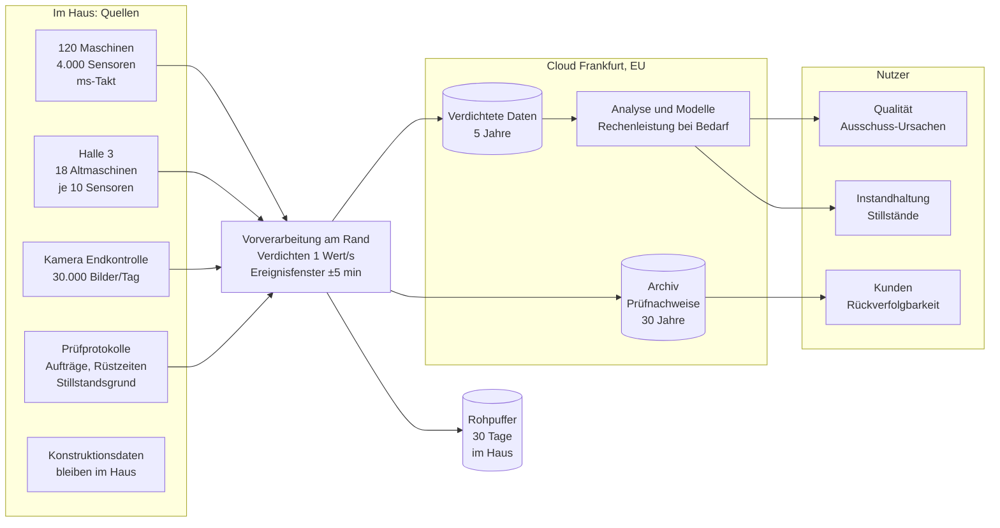

# Tag 9 (Modul 3), UE 5–6 Fallstudie: Datenerhebung und Cloud bei SmartFactory

> [!NOTE]
> | Teil | Inhalt | Springen |
> |:---:|---|:---:|
> | **A** | **Fakten und Rechnungen** aus dem Aufgabenblatt | [→ Teil A](#teil-a-fakten-und-rechnungen) |
> | **B** | **Lösungsentwurf** (KI) | [→ Teil B](#teil-b-lösungsentwurf) |

**Aufgabe:** Die SmartFactory GmbH (Präzisionsteile für Medizin und Luftfahrt) hat **2 Mio. € für 3 Jahre**. (1) Eine **Strategie zur Datenerhebung** entwickeln, (2) über die **Cloud-Nutzung** entscheiden, (3) **Risiken und Kosten** bewerten. Dazu das Raster Thema / Entscheidung / Begründung / Risiko und die Leitfragen (Welche Daten helfen bei Ausschuss und Stillständen? Müssen Millisekundenwerte dauerhaft gespeichert werden? Was darf das Haus nicht verlassen? Was kostet jede Option über drei Jahre?).

---

# Teil A: Fakten und Rechnungen

## Schritt 0 · Daten, Zahlen, Fakten aus dem Aufgabenblatt

### Das Unternehmen

| Thema | Angabe |
|---|---|
| Firma | SmartFactory GmbH, Präzisionsteile für **Medizin- und Luftfahrttechnik**, 680 Mitarbeitende |
| Maschinen | **120** vernetzte Fertigungsmaschinen, rund **4.000 Sensoren** |
| Problem | Daten werden gespeichert, aber **kaum genutzt**. Ausschuss und Stillstände bleiben **unerklärt** |
| Rahmen | **2 Mio. € für 3 Jahre**. Kunden verlangen **Rückverfolgbarkeit jedes Teils** |
| Sonstiges | 75-jähriges Jubiläum im Mai, Parkhaus für Beschäftigte im Bau. Für die Datenfrage vermutlich ohne Bedeutung |

### Welche Daten heute anfallen

| Daten | Menge | Heutige Nutzung |
|---|---|---|
| Sensorwerte (Temperatur, Vibration) | sehr hoch, **Millisekundentakt** | **keine**, nur gespeichert |
| Prüfprotokolle je Teil | mittel | für Kunden-Nachweise |
| Kamerabilder der Endkontrolle | hoch (30.000 Bilder pro Tag, je ca. 5 MB) | nur bei Reklamationen |
| Aufträge und Rüstzeiten | gering | Planung und Abrechnung |

### Gespeicherte Maschinendaten (Diagramm der Folie)

| Jahr | 2023 | 2024 | 2025 | 2026 (Prognose) |
|---|---:|---:|---:|---:|
| **TB** | 35 | 80 | 170 | 360 |

### Infrastruktur und Kosten im Detail

| Thema | Angabe |
|---|---|
| Serverraum | **400 TB** Speicher, **95 % belegt**. Erweiterung um 400 TB: ca. **280.000 €** + **40.000 €** Betrieb pro Jahr |
| Cloud-Angebot | Speicher ca. **20 € je TB und Monat**, Rechenleistung nach Nutzung, Rechenzentrum in **Frankfurt** |
| Sensoren | **85 %** der gespeicherten Datenmenge |
| Ausschuss | **3,8 %** (Branche ca. 2 %), kostet ca. **1,9 Mio. € pro Jahr**. Ungeplante Stillstände ca. **1.100 Stunden** |
| Backup | Dauern die **ganze Nacht** |

### Was Sie außerdem erfahren

| Thema | Angabe |
|---|---|
| Luftfahrtkunden | **Konstruktionsdaten dürfen das Unternehmen nicht verlassen.** Prüfnachweise **30 Jahre** aufbewahren |
| IT | 4 Personen, Internet **1 Gbit/s**, der **Wartungsvertrag** für den Serverraum endet nächstes Jahr |
| Maschinen | Die **18 Maschinen in Halle 3** sind über 15 Jahre alt, je nur ca. **10 Sensoren** |
| Vorfall | Stromausfall 2025: Server **6 Stunden** nicht erreichbar |

> [!NOTE]
> **Daraus ergeben sich (reine Rechnung, keine Bewertung)**
>
> | Größe | Rechnung | Ergebnis |
> |---|---|---:|
> | Belegt / frei im Serverraum | 400 TB × 95 % / 5 % | 380 TB / 20 TB |
> | Sensoren in den 360 TB | 360 TB × 85 % | 306 TB |
> | Rest (alles außer Sensoren) | 360 TB × 15 % | 54 TB |
> | Wachstum je Jahr | 80−35, 170−80, 360−170 | +45, +90, +190 TB |
> | Wachstumsfaktor | 80/35, 170/80, 360/170 | 2,29 · 2,12 · 2,12 |
> | Trend (Annahme: Faktor 2,1 bleibt): 2027, 2028, 2029 | 360 × 2,1 … | 756 · 1.588 · 3.334 TB |
> | Kamerabilder pro Tag | 30.000 × 5 MB | 150 GB |
> | Kamerabilder pro Jahr | 150 GB × 365 | 54,75 TB |
> | Kamerabilder 30 Jahre | 54,75 TB × 30 | rund 1.642 TB |
> | Mittlere Datenrate 2026 | 190 TB / 1 Jahr | 48 Mbit/s (4,8 % von 1 Gbit/s) |
> | Ausschuss je Prozentpunkt | 1,9 Mio. € / 3,8 | 500.000 € pro Jahr |
> | Ausschuss bei Branchenwert (2 %) | 500.000 € × 2 | 1,0 Mio. € pro Jahr |
> | Mögliche Ersparnis bis Branche | 1,9 Mio. € − 1,0 Mio. € | 900.000 € pro Jahr (2,7 Mio. € in 3 Jahren) |
> | 10 % weniger Ausschuss | 1,9 Mio. € × 10 % | 190.000 € pro Jahr (570.000 € in 3 Jahren) |
> | Stillstand je Maschine | 1.100 h / 120 | 9,2 h pro Jahr |
> | Halle 3: Anteil der Maschinen | 18 / 120 | 15 % |
> | Halle 3: Sensoren | 18 × 10 | 180 (4,5 % von 4.000) |
> | Ø Sensoren je Maschine, übrige 102 | 4.000 / 120, 3.820 / 102 | 33,3 und 37,5 |

---

# Teil B: Lösungsentwurf

> [!IMPORTANT]
> **Auf einen Blick**
>
> - **Nicht alles speichern, sondern gezielt erheben und verdichten.** Der Bestand verdoppelt sich jedes Jahr (35, 80, 170, 360 TB, Faktor 2,1). Läuft der Trend weiter, sind es 2029 rund **3.334 TB**. 85 % davon sind Sensorwerte, die heute **niemand nutzt**.
> - **Entscheidung (Vorschlag): Hybrid (Option C).** **Im Haus** bleiben die Maschinenanbindung, die **Vorverarbeitung**, ein **30-Tage-Puffer** für Rohdaten und die **Konstruktionsdaten** (dürfen das Haus nicht verlassen). **In die Cloud (Frankfurt)** gehen die **verdichteten** Daten, Prüfprotokolle, Bilder und die Analysen.
> - **Millisekundenwerte nicht dauerhaft speichern.** Rohdaten nur **30 Tage** (Puffer) und **rund um Ereignisse** (Ausschuss, Stillstand, Auffälligkeit). Dauerhaft nur **Kennwerte** (zum Beispiel Mittel, Min, Max, Streuung je Sekunde): Faktor 50 weniger.
> - **Kosten über 3 Jahre:** A) Serverraum erweitern **2,72 Mio. €** (über Budget). B) alles roh in die Cloud **mindestens 1,0 Mio. €** nur für Speicher, plus Rechenleistung, plus 42 Tage Erstumzug, und die Konstruktionsdaten dürfen ohnehin nicht. **C) Hybrid: rund 0,26 Mio. € bekannte Kosten**, **rund 1,74 Mio. € Rest** für Aufbau, Sensorik, Notstrom, Schulung.
> - **Der Nutzen ist größer als jede Kostenzeile.** Ausschuss kostet **1,9 Mio. € pro Jahr** (3,8 % statt 2 % der Branche). 10 % weniger Ausschuss sind **190.000 € pro Jahr**, der Branchenwert wären **900.000 € pro Jahr**. Dafür muss man erst die **Ursachen** kennen, und dafür fehlt heute vor allem eine **Stillstands- und Ausschussursache je Teil**.
> - **Zuerst die Frage, dann die Daten.** Die Daten werden gespeichert und nicht genutzt: Das Problem ist **keine Technik, sondern fehlende Verknüpfung** von Teil, Maschine, Zeit, Sensorwerten und Prüfergebnis.
> - **Vorsicht:** Das Wachstum (Faktor 2,1), die Verdichtung (Faktor 50), die Aufbewahrung der Bilder und der Preis der Rechenleistung sind **Annahmen**. Das Blatt nennt keinen Preis für Rechenleistung, Aufbau oder Betrieb.

> [!NOTE]
> **Annahmen:** (1) Der Bestand wächst weiter um Faktor 2,1 pro Jahr (letzte zwei Jahre 2,12). Das ist ein **Worst Case**. Mit gezielter Erhebung sollte er niedriger liegen. (2) Die 360 TB sind **Bestand** (Summe), nicht Zuwachs je Jahr. Dazu passt die Auslastung: 360 TB Maschinendaten plus ca. 20 TB anderes sind 95 % von 400 TB. (3) Die **54 TB Rest** (15 %) entsprechen fast genau **einem Jahr Kamerabilder** (54,75 TB). Ich lese daraus, dass heute rund **12 Monate** Bilder gespeichert werden. Das ist eine **Schlussfolgerung**, das Blatt sagt es nicht. (4) Millisekundentakt heißt **1.000 Werte pro Sekunde und Kanal**. (5) Verdichtung auf **1 Wert pro Sekunde mit 20 Kennwerten** ist Faktor 1.000 / 20 = **50**. (6) Rechenleistung in der Cloud: **5.000 € pro Monat**. Das Blatt nennt nur "nach Nutzung", das ist **meine Zahl**. (7) Cloud-Preis **20 € je TB und Monat**, konstant. (8) Preise für Aufbau, Schulung, Notstrom, neue Sensoren und den Wartungsvertrag stehen nicht auf dem Blatt und sind **nicht eingerechnet**. Alle Rechnungen stehen im Python-Check.

## Schritt 1 · Ergebnisraster

| Thema | Meine Entscheidung | Begründung | Risiko |
|:---|:---|:---|:---|
| **Welche Daten erheben?** | **(1) Immer:** Teil-Kennung, Maschine, Zeit, Auftrag, Rüstzeit, Charge, **Prüfergebnis** (OK oder Fehler mit **Fehlerart**), **Stillstandsgrund**. **(2) Verdichtet, dauerhaft:** Sensorwerte der **relevanten** Kanäle (Vibration, Temperatur der kritischen Stellen) als Kennwerte je Sekunde. **(3) Roh nur bei Ereignis:** Millisekundenwerte **±5 Minuten** um Ausschuss, Stillstand, Auffälligkeit. **(4) Bilder:** Ergebnis und Kennung immer, das Bild selbst **12 Monate**, Fehlerbilder länger. **(5) Halle 3:** zuerst **nicht nachrüsten**, über Zeit und Teil zuordnen. Gezielt nachrüsten, wo der Ausschuss hoch ist | **Rückverfolgbarkeit** je Teil verlangen die Kunden. Ausschuss und Stillstände sind **unerklärt**, weil Ursache und Zeitpunkt **nicht verknüpft** sind. 4.000 Sensoren × 1.000 Werte pro Sekunde helfen nicht ohne die Frage "Welcher Kanal sagt einen Fehler voraus?". Temperaturen ändern sich langsam: **1 Wert pro Sekunde** genügt, nur Vibration braucht hohe Takte | **Wichtiges wird nicht erfasst** (falscher Kanal). Verdichtung **verliert** Information. **Stillstandsgrund** muss jemand eintragen (Mehraufwand für Bediener). **Betriebsrat** und Datenschutz: Maschinendaten können Beschäftigte betreffen |
| **Wie lange speichern?** | **Prüfprotokolle und teilbezogene Kennwerte: 30 Jahre** (Pflicht der Luftfahrtkunden). **Verdichtete Sensorwerte: 5 Jahre** (Modelle brauchen Historie). **Rohwerte: 30 Tage Puffer**, Ereignisfenster **2 Jahre**. **Bilder: 12 Monate**, Fehlerbilder bis Ende der Prüffrist. **Aufträge und Rüstzeiten: nach gesetzlicher Frist**. **Konstruktionsdaten: im Haus, nach Kundenvorgabe** | 30 Jahre sind **Pflicht** für Nachweise, aber für **Rohwerte** und alle Bilder nicht belegt: 30 Jahre Bilder wären **1.642 TB**. Je kürzer die Frist, desto weniger Speicher, Pflege und Angriffsfläche ("Nicht alles speichern") | **Zu früh gelöscht**: Fordert ein Kunde doch Rohdaten oder Bilder nach Jahren. Darum **vorher schriftlich klären**, was als Prüfnachweis zählt. Archiv über **30 Jahre**: Technik, Formate und Anbieter wechseln |
| **Wo verarbeiten?** | **Im Haus:** Maschinenanbindung, **Vorverarbeitung** (Verdichten am Rand), Rohpuffer, Konstruktionsdaten, Steuerung. **In der Cloud (Frankfurt):** verdichtete Daten, Prüfprotokolle, Bilder, **Analyse und Modelltraining**, **Kopie** des Archivs und Backup. **Notstrom und USV** im Haus | **Konstruktionsdaten dürfen nicht raus.** Die Cloud liefert **Rechenleistung bei Bedarf** für Modelle, die man nicht dauernd braucht. Die Kopie in der Cloud schützt vor **Stromausfall** (6 Stunden 2025) und vor **Überlastung** des vollen Serverraums | **Zwei Welten** mit 4 Personen. **Abhängigkeit** vom Anbieter (Lock-in, 30-Jahre-Archiv). **Kosten laufen unbemerkt** (Budgetgrenze nötig). Verbindung bricht ab: Fertigung läuft im Haus weiter, Analyse pausiert |

> [!NOTE]
> **Zu den Leitfragen:** *Welche Daten helfen, Ausschuss und Stillstände zu verstehen?* Die **Verknüpfung** von Prüfergebnis, Teil, Maschine, Zeit und Sensorzustand, dazu der **Stillstandsgrund**. *Müssen Millisekundenwerte dauerhaft gespeichert werden?* **Nein.** 30 Tage Puffer und Ereignisfenster genügen, dauerhaft nur Kennwerte. Ob Kunden Rohwerte als Nachweis verlangen, ist **offen und schriftlich zu klären**. *Welche Daten sollen das Haus nicht verlassen?* **Konstruktionsdaten** (Vorgabe der Luftfahrtkunden). Prüfprotokolle mit Kundenbezug nur mit **Vertrag nach Art. 28 DSGVO**, **EU-Rechenzentrum** und Verschlüsselung.

## Schritt 2 · Kosten über 3 Jahre

| Option | Was passiert? | Kosten 3 Jahre | Reicht das Budget (2 Mio. €)? | Hauptrisiko |
|:---|:---|:---|:---|:---|
| **A) Serverraum erweitern** | Immer wieder 400 TB dazukaufen (280.000 € + 40.000 € Betrieb je Jahr und Erweiterung). Alles roh behalten | **Trend: 8 Erweiterungen** (1 bis 2027, 3 bis 2028, 8 bis 2029): Anschaffung **2,24 Mio. €** + Betrieb **0,48 Mio. €** = **2,72 Mio. €**. Nur **eine** Erweiterung: 400.000 €, reicht nur bis 2027 | **Nein**, schon der Trend sprengt es. Nur mit einer einzigen Erweiterung (400.000 €) im Budget | Der Raum ist voll und die **Wartung läuft aus**. Backups dauern heute eine Nacht und würden **länger**. **Stromausfall** bleibt. Man speichert weiter, **was niemand nutzt** |
| **B) Alles roh in die Cloud** | Umzug aller Daten, Speicher 20 € je TB und Monat | **Nur Speicher: rund 1,0 Mio. €** (Mittel 558, 1.172, 2.461 TB). **Dazu** Rechenleistung. **Erstumzug** der 360 TB bei 80 % von 1 Gbit/s: **42 Tage** Dauerlast | **Knapp**, nur wenn die Rechenleistung unter 1 Mio. € bleibt. **Verstößt** aber gegen die Vorgabe der Luftfahrtkunden (Konstruktionsdaten) | **Kosten steigen mit dem Datenwachstum** (2029: 3.334 TB, 66.700 € pro Monat). **Lock-in**. Verstoß gegen Kundenvorgabe. Datenmenge wächst, ohne dass man etwas lernt |
| **C) Hybrid: verdichten, Cloud für Analyse** | Rohdaten 30 Tage im Haus, Kennwerte und Analysen in der Cloud. Kein Serverraum-Ausbau | **Cloud-Speicher rund 81.000 €** (Bestand 91, 119, 179 TB zum Jahresende). **Rechenleistung 180.000 €** (Annahme). **Bekannt: rund 261.000 €.** **Rest: rund 1,74 Mio. €** für Aufbau, Sensorik Halle 3, Notstrom, Schulung, Wartungsvertrag, Puffer | **Ja**, mit großem Rest. **Nicht beziffert** sind Aufbau und Betrieb. Der Rest ist **kein Spielgeld**, sondern Platzhalter dafür | **Aufbau** ist Arbeit (4 Personen), **Verdichtung** kann falsch gewählt sein, **Wartungsvertrag** endet nächstes Jahr. **Zwei Welten** zu betreiben |

> [!NOTE]
> **Was die Kosten bedeuten:** Die Cloud-Kosten bei C sind **klein, weil die Daten klein bleiben**, nicht weil die Cloud billig wäre. Der größte Hebel ist die **Verdichtung** (Faktor 50 auf 85 % der Daten). Wer **alles roh** behält, zahlt bei A **2,72 Mio. €** und bei B **mehr als 1,0 Mio. €**, für Daten, die heute keiner liest. Die 1,74 Mio. € Rest bei C sind **kein Gewinn**: Aufbau, Personal und Notstrom stehen nicht auf dem Blatt.

> [!NOTE]
> **Gegenrechnung Nutzen (Hypothese):** Ausschuss kostet **1,9 Mio. € pro Jahr**. **10 % weniger** wären **190.000 € pro Jahr** (570.000 € in 3 Jahren), der Branchenwert (2 %) **900.000 € pro Jahr** (2,7 Mio. € in 3 Jahren). Die ungeplanten Stillstände (1.100 Stunden, 9,2 Stunden je Maschine) lassen sich **nicht in € umrechnen**: Das Blatt nennt keinen Stundensatz. **Ob die Daten diese Ursachen wirklich erklären, ist unbewiesen.** Darum ein **Pilot**, nicht alle 120 Maschinen auf einmal.

## Schritt 3 · Skizze



| Frage | Meine Antwort |
|:---|:---|
| **Was passiert zuerst?** | **Pilot** an wenigen Maschinen mit hohem Ausschuss: Teil, Zeit, Prüfergebnis, Stillstandsgrund und wenige Sensorkanäle **verknüpfen**. Danach erst skalieren. Die **Wartung** und **Notstrom** parallel klären, die laufen nächstes Jahr aus |
| **Was ist mit Halle 3?** | 18 Maschinen (15 %) mit 180 Sensoren (4,5 %) sind **datenarm**. Erst **über Zeit und Teil** zuordnen. Nachrüsten nur, wenn die Auswertung zeigt, dass dort viel Ausschuss entsteht (Preise stehen nicht auf dem Blatt) |
| **Wie kommen die Daten zur Cloud?** | Mittlere Datenrate heute **48 Mbit/s** (4,8 % von 1 Gbit/s). **Roh** hochladen wäre 2029 (1.496 TB/Jahr) bei rund **380 Mbit/s** im Mittel. Verdichtet nur ein Bruchteil. Altbestand **nicht** hochladen (42 Tage), sondern **vor Ort verdichten** |
| **Was ist mit dem Altbestand (306 TB roh)?** | **Vor Ort verdichten**, Ereignisfenster behalten, den Rest **erst löschen**, wenn die Kunden schriftlich bestätigt haben, dass keine Rohdaten als Nachweis nötig sind. Das schafft Platz im vollen Serverraum |
| **Wie lässt sich der Stromausfall abfangen?** | **USV und Notstrom** für die Server (6 Stunden 2025). Kopie in der Cloud. Die Fertigung darf von der Cloud **nicht abhängen** |
| **Wer darf was sehen?** | Konstruktion nur im Haus und wenige Personen. Qualität und Instandhaltung sehen verdichtete Daten. **Maschinendaten mit Personenbezug** (Schicht, Bediener) nur mit Betriebsrat und Zweck |

## Schritt 4 · Risiken

| Risiko | Wie groß? | Gegenmittel |
|:---|:---|:---|
| **Wachstum läuft weiter** | Bei Faktor 2,1: 3.334 TB 2029. Auch verdichtet wächst es mit | **Jährlich prüfen**, Löschfristen, nur Kanäle speichern, die in der Analyse nützen |
| **Verdichtung verliert Information** | Ein seltener Fehler kann im Mittelwert **verschwinden** | **Ereignisfenster** mit Rohwerten, Pilot mit Vergleich "roh gegen verdichtet", Min/Max/Streuung mitführen |
| **Aufbewahrung falsch eingeschätzt** | Löscht man Rohdaten oder Bilder, die der Kunde später verlangt, ist das **nicht umkehrbar** | **Schriftlich klären**, was Prüfnachweis ist. Im Zweifel länger, die Menge ist klein |
| **Konstruktionsdaten verlassen das Haus** | Verstoß gegen die Vorgabe der Luftfahrtkunden | Im Haus, getrennt, Zugriffsrechte, **keine** Kopie in der Cloud. Prüfen, dass Prüfprotokolle keine Konstruktionsdetails enthalten |
| **Personal** | 4 Personen, Aufbau und zwei Welten | **Partner** für den Aufbau, Schulung, Dokumentation. Priorität setzen: Pilot vor Ausbau |
| **Ausfall und Strom** | 6 Stunden Ausfall 2025. Der Serverraum ist voll, die Wartung endet | **USV, Notstrom**, Wartung **rechtzeitig verlängern oder ersetzen**, Cloud-Kopie, Notfallübung |
| **Cloud-Kosten und Lock-in** | Preis, Datenwachstum, **30 Jahre** Archiv | **Budgetgrenze und Kostenwarnung**, offene Formate, Ausstiegsplan, **Datenexport** vertraglich |
| **Datenschutz** | Prüfprotokolle mit Kundenbezug, Beschäftigtendaten | **EU-Rechenzentrum** (Frankfurt), **Vertrag nach Art. 28 DSGVO**, Verschlüsselung, **Betriebsrat** einbeziehen |
| **Kein Nutzen** | Die Daten erklären Ausschuss und Stillstände vielleicht nicht | **Pilot mit Messlatte**: Ziel vorher festlegen (zum Beispiel 10 % weniger Ausschuss = 190.000 € pro Jahr), nach 6 Monaten prüfen, **nicht** weiter ausbauen, wenn nichts gefunden wird |

> [!NOTE]
> **Was bewusst fehlt:** Das 75-jährige Jubiläum und das Parkhaus sind keine Datenfragen. **Nicht beziffert** sind Aufbau, Sensorik für Halle 3, Notstrom, Schulung, Personal und der neue Wartungsvertrag. **Nicht belegt** sind Wachstum, Verdichtungsfaktor, die Bildaufbewahrung und der Preis der Rechenleistung. Die Entscheidung gilt, **solange** diese Annahmen halten und die Kunden bestätigen, dass Prüfprotokolle genügen.

## Python-Check

```python
# python3 -I check3.py   (nur Standardbibliothek)
from math import ceil
# --- Bestand und Trend (Diagramm der Folie, TB) ---
bestand = {2023: 35, 2024: 80, 2025: 170, 2026: 360}
jahre = sorted(bestand)
for a, b in zip(jahre, jahre[1:]):
    print(f"{a}->{b}: +{bestand[b]-bestand[a]} TB, Faktor {bestand[b]/bestand[a]:.2f}")
f = 2.1                                   # Annahme: Wachstum wie zuletzt, Faktor 2,1 pro Jahr
prog = {2026: 360}
for j in (2027, 2028, 2029):
    prog[j] = prog[j - 1] * f
print("Trend Bestand (TB):", {j: round(v) for j, v in prog.items()})
print("Belegt heute:", 400 * 0.95, "TB frei:", 400 * 0.05, "TB | Sensoren 85 % von 360:", round(360 * .85), "TB | Rest 15 %:", round(360 * .15), "TB")
bilder_tb = 30_000 * 5 * 365 / 1_000_000
print("Kamerabilder:", 30_000 * 5 / 1000, "GB/Tag,", round(bilder_tb, 2), "TB/Jahr, 30 Jahre:", round(bilder_tb * 30), "TB")
neu26 = 360 - 170
print("Neu 2026:", neu26, "TB =", round(neu26 * 1e12 * 8 / 365 / 86400 / 1e6), "Mbit/s im Mittel (1 Gbit/s Leitung)")
# --- Option A: Serverraum erweitern (400 TB je 280.000 € + 40.000 €/Jahr) ---
cap = 400; n = 0; capex = opex = 0; ber = {}
for j in (2027, 2028, 2029):
    need = ceil((prog[j] - 400) / 400)            # Erweiterungen insgesamt nötig
    n = max(n, need)
    ber[j] = n
capex = n * 280_000
opex = sum(40_000 * ber[j] for j in ber)
print("A Erweiterungen je Jahr:", ber, "| Capex:", capex, "| Betrieb:", opex, "| gesamt:", capex + opex)
print("A, nur 1 Erweiterung (kein Wachstum danach):", 280_000 + 3 * 40_000)
# --- Option B: alles roh in die Cloud (20 € je TB und Monat, nur Speicher) ---
start = 360; summe = 0
for j in (2027, 2028, 2029):
    mittel = (prog[j - 1] + prog[j]) / 2
    summe += mittel * 20 * 12
print("B Cloud nur Speicher, alle Rohdaten, 3 Jahre:", round(summe))
print("B Erstumzug 360 TB bei 80 % von 1 Gbit/s:", round(360e12 * 8 / 800e6 / 86400, 1), "Tage")
# --- Option C: verdichten, Rohdaten nur 30 Tage, Cloud für verdichtete Daten ---
V = 50                                           # Annahme: Verdichtungsfaktor 50
roh_neu = {2026: neu26 * .85}
for j in (2027, 2028, 2029): roh_neu[j] = roh_neu[j - 1] * f
print("Neue Sensor-Rohdaten (TB/Jahr):", {j: round(v) for j, v in roh_neu.items()})
print("Rohpuffer 30 Tage (TB):", {j: round(roh_neu[j] / 12, 1) for j in (2027, 2028, 2029)})
verd = 306 / V; erei = 306 * 0.02; sonst = 10
cloud_end = {}
for j in (2027, 2028, 2029):
    verd += roh_neu[j] / V; erei += roh_neu[j] * 0.02
    cloud_end[j] = bilder_tb + verd + erei + sonst
prev = bilder_tb + 306 / V + 306 * .02 + sonst
kosten_sp = 0
for j in (2027, 2028, 2029):
    kosten_sp += (prev + cloud_end[j]) / 2 * 20 * 12; prev = cloud_end[j]
print("C Cloud-Bestand Jahresende (TB):", {j: round(v) for j, v in cloud_end.items()}, "| Speicherkosten 3 Jahre:", round(kosten_sp))
rechen = 5_000 * 36
print("C Rechenleistung (Annahme 5.000 €/Monat):", rechen, "| C bekannt gesamt:", round(kosten_sp + rechen))
print("Budget:", 2_000_000, "| Rest nach C:", round(2_000_000 - kosten_sp - rechen))
print("Verdichtung 1.000 Hz auf 1 Wert/s mit 4 Kennwerten: Faktor", 1000 / 4, "| mit 20 Kennwerten:", 1000 / 20)
# --- Nutzen ---
print("Ausschuss je Prozentpunkt:", round(1_900_000 / 3.8), "€/Jahr | auf 2 %:", round(1_900_000 / 3.8 * 2), "€ | Ersparnis bis Branche:", round(1_900_000 - 1_900_000 / 3.8 * 2), "€/Jahr, 3 Jahre:", round((1_900_000 - 1_900_000 / 3.8 * 2) * 3))
print("10 % weniger Ausschuss:", 190_000, "€/Jahr, 3 Jahre:", 570_000)
print("Stillstände je Maschine:", round(1_100 / 120, 1), "h/Jahr | 10 % weniger:", 110, "h")
print("Halle 3: Anteil Maschinen", round(18 / 120 * 100), "% | Sensoren 18 × 10 =", 180, "=", round(180 / 4000 * 100, 1), "% | Ø Sensoren je Maschine:", round(4000 / 120, 1), "| übrige Maschinen:", round((4000 - 180) / 102, 1))
```

**Ausgabe:**

```text
2023->2024: +45 TB, Faktor 2.29
2024->2025: +90 TB, Faktor 2.12
2025->2026: +190 TB, Faktor 2.12
Trend Bestand (TB): {2026: 360, 2027: 756, 2028: 1588, 2029: 3334}
Belegt heute: 380.0 TB frei: 20.0 TB | Sensoren 85 % von 360: 306 TB | Rest 15 %: 54 TB
Kamerabilder: 150.0 GB/Tag, 54.75 TB/Jahr, 30 Jahre: 1642 TB
Neu 2026: 190 TB = 48 Mbit/s im Mittel (1 Gbit/s Leitung)
A Erweiterungen je Jahr: {2027: 1, 2028: 3, 2029: 8} | Capex: 2240000 | Betrieb: 480000 | gesamt: 2720000
A, nur 1 Erweiterung (kein Wachstum danach): 400000
B Cloud nur Speicher, alle Rohdaten, 3 Jahre: 1005739
B Erstumzug 360 TB bei 80 % von 1 Gbit/s: 41.7 Tage
Neue Sensor-Rohdaten (TB/Jahr): {2026: 162, 2027: 339, 2028: 712, 2029: 1496}
Rohpuffer 30 Tage (TB): {2027: 28.3, 2028: 59.4, 2029: 124.6}
C Cloud-Bestand Jahresende (TB): {2027: 91, 2028: 119, 2029: 179} | Speicherkosten 3 Jahre: 81007
C Rechenleistung (Annahme 5.000 €/Monat): 180000 | C bekannt gesamt: 261007
Budget: 2000000 | Rest nach C: 1738993
Verdichtung 1.000 Hz auf 1 Wert/s mit 4 Kennwerten: Faktor 250.0 | mit 20 Kennwerten: 50.0
Ausschuss je Prozentpunkt: 500000 €/Jahr | auf 2 %: 1000000 € | Ersparnis bis Branche: 900000 €/Jahr, 3 Jahre: 2700000
10 % weniger Ausschuss: 190000 €/Jahr, 3 Jahre: 570000
Stillstände je Maschine: 9.2 h/Jahr | 10 % weniger: 110 h
Halle 3: Anteil Maschinen 15 % | Sensoren 18 × 10 = 180 = 4.5 % | Ø Sensoren je Maschine: 33.3 | übrige Maschinen: 37.5
```
